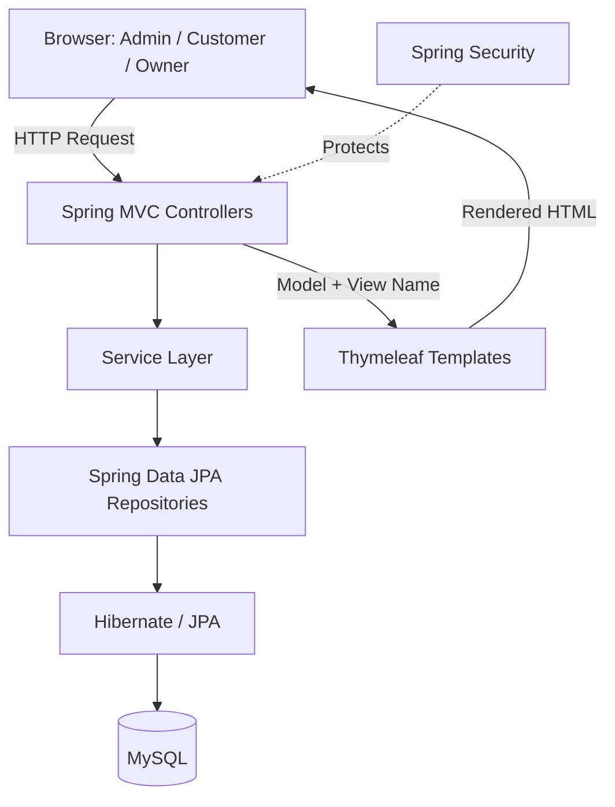
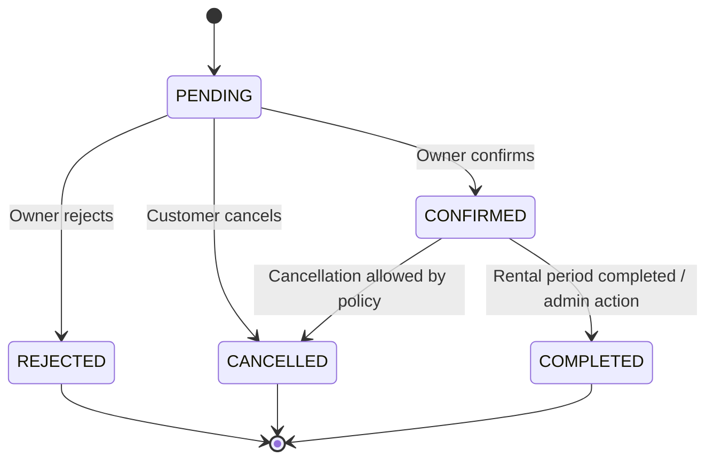
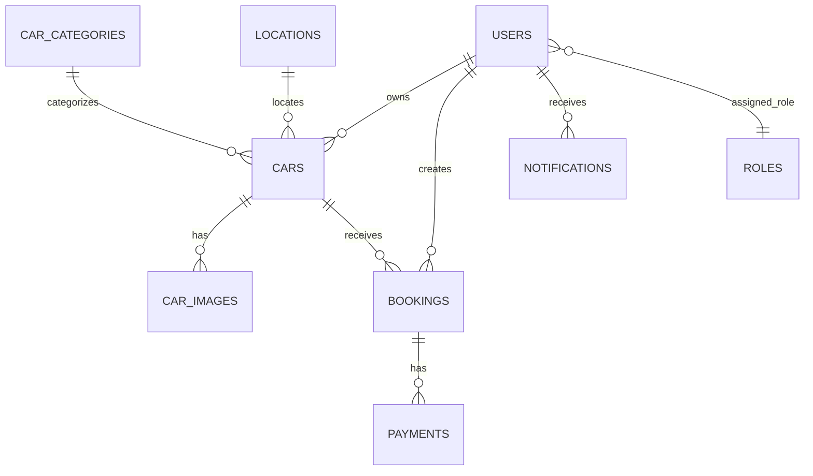
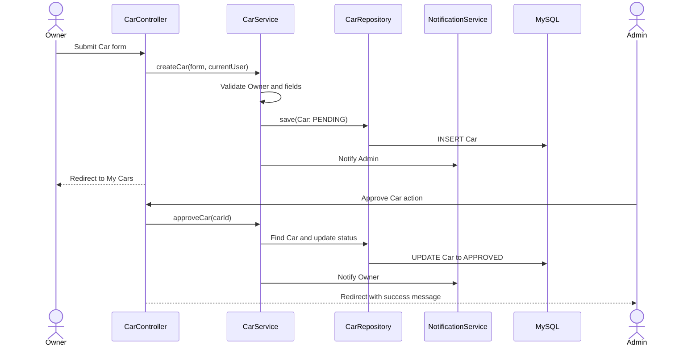
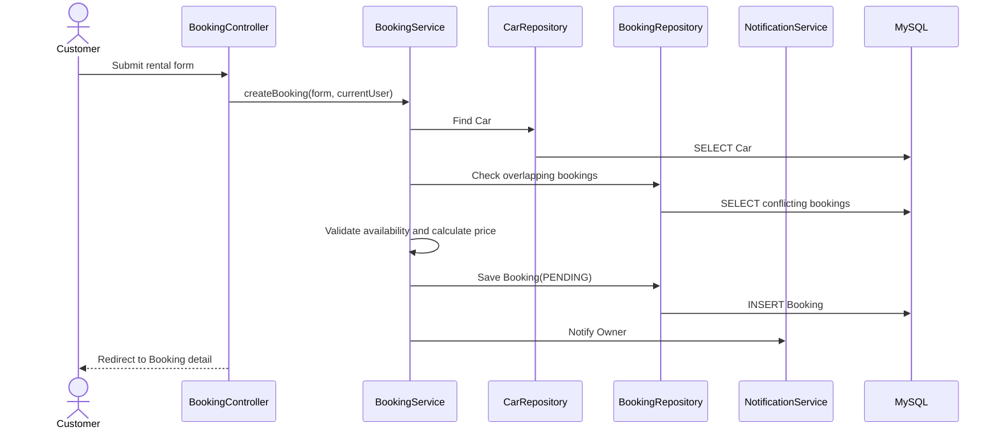
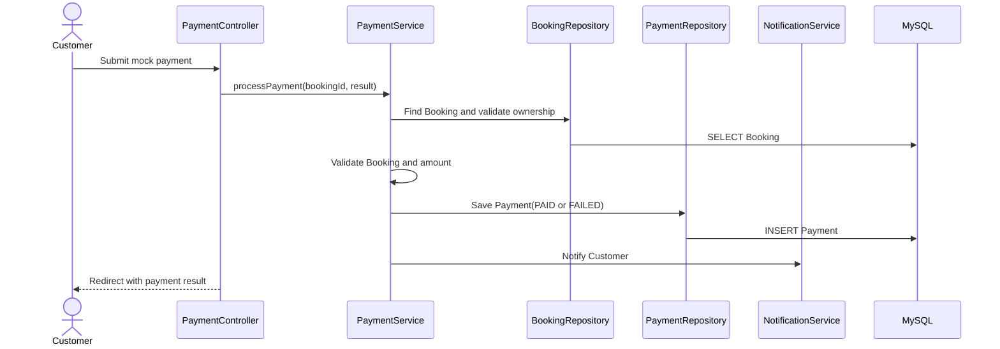

# CarRent — Software Design Document (SDD)

**Phiên bản:** 1.0  
**Trạng thái:** Bản thiết kế khởi đầu  
**Nền tảng:** Java, Spring Boot, Thymeleaf, Spring Security, Spring Data JPA/Hibernate, MySQL, Maven  
**Kiến trúc:** Monolithic Web Application — Server-side MVC + 3-layer architecture  
**Ngôn ngữ tài liệu:** Tiếng Việt

---

## 1. Tổng quan dự án

### 1.1. Giới thiệu

CarRent là ứng dụng web cho thuê xe hơi. Hệ thống cho phép người thuê tìm kiếm và xem thông tin xe, tạo đơn thuê và thực hiện thanh toán giả lập. Người cho thuê quản lý danh sách xe và xử lý các yêu cầu thuê. Admin quản lý tài khoản, kiểm duyệt xe và theo dõi hoạt động toàn hệ thống.

Ứng dụng được xây dựng bằng Java Spring Boot, dùng Thymeleaf để render giao diện HTML phía server và MySQL để lưu trữ dữ liệu.

### 1.2. Mục tiêu

- Cung cấp quy trình thuê xe trực tuyến đơn giản.
- Cho phép Owner tự quản lý các xe thuộc quyền sở hữu của mình.
- Cho phép Admin quản lý tài khoản và kiểm duyệt xe trước khi công khai.
- Bảo đảm phân quyền giữa Admin, Customer và Owner.
- Quản lý booking, trạng thái thanh toán giả lập và thông báo.
- Tạo một dự án có cấu trúc rõ ràng, dễ bảo trì và phù hợp để học tập/phát triển portfolio.

### 1.3. Phạm vi

**Bao gồm:**

- Đăng nhập và phân quyền theo role.
- Dashboard Admin.
- Quản lý User.
- Quản lý Car phía Admin và Owner.
- Quy trình duyệt Car.
- Category, ảnh xe và địa điểm.
- Tìm kiếm, lọc, sắp xếp, phân trang và xem chi tiết Car.
- Booking và quản lý trạng thái booking.
- Thanh toán giả lập.
- Notification lưu trong database.
- Quản lý profile.

**Không nằm trong phạm vi phiên bản này:**

- Swagger/OpenAPI.
- Docker.
- Unit Test/Integration Test.
- Microservices.
- Cổng thanh toán thực tế.
- WebSocket hoặc hệ thống notification realtime.
- Hệ thống giao nhận xe, kiểm tra hư hỏng, hoàn cọc và bảo hiểm nâng cao.
- Các module khuyến mãi, yêu thích, đánh giá/review và audit log chưa được chọn cho MVP.

---

## 2. Công nghệ sử dụng

| Thành phần | Công nghệ | Mục đích |
|---|---|---|
| Ngôn ngữ | Java | Ngôn ngữ backend |
| Backend framework | Spring Boot | Xây dựng ứng dụng web |
| Web MVC / UI | Spring MVC + Thymeleaf | Xử lý HTTP và render HTML phía server |
| Security | Spring Security | Xác thực và phân quyền |
| ORM | Spring Data JPA + Hibernate | Mapping object và thao tác database |
| Database | MySQL | Lưu dữ liệu |
| Build tool | Maven | Quản lý dependencies và build |
| Validation | Jakarta Bean Validation | Kiểm tra dữ liệu đầu vào |
| Tiện ích tùy chọn | Lombok | Giảm boilerplate code |

### 2.1. Lưu ý về mô hình giao diện

CarRent dùng **Thymeleaf trong cùng ứng dụng Spring Boot**, không tách frontend thành một ứng dụng React/Angular riêng. Controller có thể trả về tên template để Spring MVC render HTML.

Vì dùng server-side MVC, các controller giao diện thường trả về `String` tên view, ví dụ `return "cars/list";`. Với form submit, nên cân nhắc mô hình Post/Redirect/Get để tránh gửi lại form khi refresh.

---

## 3. Kiến trúc hệ thống

### 3.1. Lựa chọn kiến trúc

- **Monolithic:** toàn bộ chức năng nằm trong một ứng dụng Spring Boot.
- **MVC:** Model, View, Controller.
- **3-layer:** Controller, Service, Repository.
- **Database tập trung:** một MySQL database cho toàn hệ thống.

Đây là kiến trúc phù hợp với project nhỏ: ít thành phần triển khai, dễ đọc code và không cần hạ tầng giao tiếp giữa nhiều dịch vụ.

### 3.2. Sơ đồ kiến trúc



### 3.3. Trách nhiệm từng layer

**Controller**
- Nhận request từ browser.
- Đọc path variable, query parameter và form data.
- Gọi Service.
- Trả về template, redirect hoặc thông báo lỗi phù hợp.
- Không chứa business logic cốt lõi.

**Service**
- Xử lý quy tắc nghiệp vụ.
- Kiểm tra quyền sở hữu dữ liệu khi cần.
- Kiểm tra tính khả dụng của xe và trạng thái booking.
- Tính tổng tiền ở backend.
- Điều phối thao tác với nhiều Repository trong cùng một transaction khi cần.
- Tạo notification sau các sự kiện nghiệp vụ.

**Repository**
- Truy vấn, thêm, sửa và xóa dữ liệu.
- Sử dụng Spring Data JPA.
- Không chứa quy tắc nghiệp vụ cấp ứng dụng.

**Entity / Model**
- Biểu diễn dữ liệu và quan hệ database.
- Không nên trả Entity trực tiếp ra giao diện nếu điều đó làm lộ dữ liệu không cần thiết.

**Thymeleaf View**
- Render HTML.
- Hiển thị dữ liệu được Controller đưa vào Model.
- Hiển thị form, lỗi validation và thông báo thành công/thất bại.

**Spring Security**
- Xác thực người dùng.
- Kiểm tra role và bảo vệ các route.
- Nên sử dụng session-based authentication mặc định phù hợp với ứng dụng Thymeleaf, thay vì bắt buộc JWT. JWT không cần thiết cho MVP server-rendered nếu không có client/API độc lập.

### 3.4. Luồng xử lý ví dụ: tạo booking

1. Customer mở trang chi tiết xe và gửi form chọn ngày thuê.
2. `BookingController` nhận form và validation cơ bản.
3. `BookingService` lấy Customer hiện tại từ security context.
4. Service kiểm tra xe đã được duyệt, đang hoạt động và không bị trùng lịch.
5. Service tính giá từ giá thuê lưu trong database.
6. Service tạo booking ở trạng thái `PENDING`.
7. Service tạo notification cho Owner.
8. Transaction được commit và Controller redirect đến trang chi tiết booking.

---

## 4. Vai trò và phân quyền

Mỗi tài khoản chỉ có **một role** trong phiên bản này.

### 4.1. Roles

- `ADMIN`
- `CUSTOMER`
- `OWNER`

### 4.2. Ma trận quyền

| Chức năng | ADMIN | CUSTOMER | OWNER |
|---|:---:|:---:|:---:|
| Xem Admin Dashboard | Có | Không | Không |
| Xem và quản lý User | Có | Không | Không |
| Xem danh sách Car công khai | Có | Có | Có |
| Xem chi tiết Car | Có | Có | Có |
| Tạo Car | Có thể quản trị | Không | Có |
| Sửa/xóa Car | Quản trị | Không | Chỉ xe của mình |
| Duyệt/từ chối Car | Có | Không | Không |
| Tạo Booking | Không | Có | Không |
| Xem Booking | Tất cả | Đơn của mình | Đơn liên quan xe của mình |
| Confirm/Reject Booking | Giám sát | Không | Có |
| Thực hiện mock payment | Không | Đơn của mình | Không |
| Xem Notification | Của mình | Của mình | Của mình |
| Cập nhật Profile | Của mình | Của mình | Của mình |

> Quyền thực tế phải được kiểm tra ở backend. Ẩn nút trên giao diện không đủ để bảo vệ dữ liệu. Owner A không được phép sửa Car của Owner B bằng cách thay ID trên URL.

### 4.3. Quy tắc tài khoản

Trạng thái tài khoản đề xuất:

- `ACTIVE`
- `INACTIVE`
- `BANNED`

Tài khoản không ở trạng thái `ACTIVE` không được thực hiện các hành động cần đăng nhập theo chính sách hệ thống.

---

## 5. Functional Requirements

### FR-01. Authentication và Authorization

- Người dùng có thể đăng nhập bằng thông tin xác thực hợp lệ.
- Hệ thống xác định role của người dùng sau khi đăng nhập.
- Người dùng chỉ truy cập được các chức năng được cấp quyền.
- Người dùng chưa đăng nhập được chuyển đến trang đăng nhập khi truy cập trang cần xác thực.
- Đăng xuất kết thúc session.
- Tài khoản bị khóa hoặc vô hiệu hóa không được tiếp tục sử dụng chức năng cần xác thực.

**Đăng ký:** Có thể cho người dùng chọn đăng ký Customer hoặc Owner. Không cho phép tự đăng ký role Admin; tài khoản Admin được tạo bằng dữ liệu khởi tạo hoặc do Admin có thẩm quyền cấp.

### FR-02. Admin Dashboard

Dashboard hiển thị các thống kê cơ bản:

- Tổng số User.
- Tổng Customer và Owner.
- Tổng số Car.
- Số Car chờ duyệt.
- Tổng số Booking.
- Booking đang chờ xử lý.
- Booking đã hoàn tất hoặc bị hủy.
- Tổng tiền thanh toán thành công và thống kê theo tháng, nếu dữ liệu payment có sẵn.

Các số liệu doanh thu phải được định nghĩa rõ: ví dụ tổng `Payment` có trạng thái `PAID`, không mặc định coi mọi booking là doanh thu.

### FR-03. Admin User Management

Admin có thể:

- Xem danh sách User.
- Tìm kiếm User theo tên/email.
- Xem chi tiết User.
- Cập nhật thông tin quản trị phù hợp.
- Kích hoạt, vô hiệu hóa hoặc khóa tài khoản.
- Lọc danh sách theo role hoặc trạng thái.

Không nên cho phép Admin xem mật khẩu dạng rõ. Mật khẩu phải được hash bằng cơ chế phù hợp của Spring Security.

### FR-04. Admin Car Management

Admin có thể:

- Xem danh sách toàn bộ Car.
- Tìm kiếm và lọc Car.
- Xem chi tiết Car và Owner.
- Duyệt hoặc từ chối Car.
- Ẩn/ngừng đăng tin Car theo quy tắc hệ thống.
- Theo dõi trạng thái kiểm duyệt và trạng thái đăng tin.

### FR-05. Car Approval Workflow

Khi Owner tạo Car, Car mới có trạng thái kiểm duyệt `PENDING`.

- Admin duyệt: `PENDING -> APPROVED`.
- Admin từ chối: `PENDING -> REJECTED`.
- Car chỉ được xuất hiện trong danh sách công khai khi đã `APPROVED` và đang `ACTIVE`.
- Khi sửa các thông tin quan trọng của Car, dự án có thể chọn yêu cầu duyệt lại hoặc không. Với MVP, nên ghi rõ chính sách; phương án đơn giản là chỉ yêu cầu duyệt ban đầu, Admin có thể ẩn xe nếu cần.

Có thể lưu lý do từ chối để Owner biết cần sửa nội dung gì.

### FR-06. Owner Car Management

Owner có thể:

- Xem danh sách Car của mình.
- Tạo Car.
- Xem chi tiết Car của mình.
- Cập nhật thông tin, giá, category, location và hình ảnh.
- Ngừng đăng tin hoặc xóa Car nếu không có booking ràng buộc đang hoạt động.
- Theo dõi trạng thái kiểm duyệt.

Owner chỉ được thao tác trên Car có `owner_id` tương ứng với tài khoản hiện tại.

### FR-07. Car Category

- Car được gán một Category.
- Hệ thống hiển thị danh sách Category.
- Admin có thể quản lý Category nếu chức năng này được bật trong phạm vi quản trị.
- Không xóa Category đang được Car sử dụng nếu chưa có chính sách xử lý các Car liên quan.

Ví dụ category: `SEDAN`, `SUV`, `MPV`, `LUXURY`, `ECONOMY`, `ELECTRIC`.

### FR-08. Car Images

- Một Car có thể có nhiều hình ảnh.
- Một hình ảnh có thể được đánh dấu là ảnh đại diện.
- Khi xóa Car, cần xử lý các bản ghi hình ảnh liên quan.
- Có thể lưu URL hoặc đường dẫn ảnh trong database; file ảnh có thể lưu trong thư mục upload của ứng dụng trong môi trường phát triển.
- Kiểm tra loại file và kích thước upload; không tin tưởng tên file do người dùng gửi lên.

### FR-09. Search, Filter, Sort và Car Detail

Customer có thể:

- Xem danh sách Car đã được duyệt và đang hoạt động.
- Tìm kiếm theo tên xe, hãng hoặc model.
- Lọc theo Category, địa điểm, khoảng giá, số chỗ, loại nhiên liệu hoặc hộp số nếu các thuộc tính này được triển khai.
- Sắp xếp theo giá tăng/giảm hoặc mới nhất.
- Phân trang danh sách.
- Xem chi tiết Car, ảnh, giá thuê, thông số, địa điểm và thông tin Owner phù hợp.
- Kiểm tra khả dụng theo ngày dự kiến thuê.

Đề xuất sử dụng Spring Data `Pageable` và `Sort`. Không tải toàn bộ dữ liệu về rồi lọc ở giao diện.

### FR-10. Booking

Customer có thể:

- Chọn Car và khoảng thời gian thuê.
- Chọn địa điểm nhận xe nếu nghiệp vụ hỗ trợ.
- Xem giá ước tính.
- Tạo Booking.
- Xem danh sách và chi tiết Booking của mình.
- Hủy Booking khi đáp ứng quy tắc hủy.

Owner có thể:

- Xem Booking liên quan đến các Car mình sở hữu.
- Xem thông tin khách thuê và khoảng thời gian.
- Xác nhận hoặc từ chối Booking đang ở trạng thái cho phép xử lý.

Admin có thể xem và giám sát toàn bộ Booking.

### FR-11. Booking Status

Trạng thái đề xuất cho MVP:

- `PENDING`: chờ Owner xử lý.
- `CONFIRMED`: Owner đã xác nhận.
- `REJECTED`: Owner từ chối.
- `CANCELLED`: Booking bị hủy hợp lệ.
- `COMPLETED`: Booking hoàn tất theo quy tắc của MVP.

Luồng chính:



Nếu chưa xây dựng quy trình bàn giao và nhận lại xe, `COMPLETED` có thể được đặt theo quy tắc MVP khi khoảng thuê kết thúc và booking đáp ứng điều kiện đã quy định. Cần tránh để trạng thái hoàn tất tự động nếu nghiệp vụ chưa được định nghĩa.

### FR-12. Mock Payment

- Customer có thể bắt đầu thanh toán cho Booking hợp lệ.
- Hệ thống tạo bản ghi Payment.
- Thanh toán được mô phỏng, không gọi cổng thanh toán bên ngoài.
- Kết quả mô phỏng có thể là `PAID` hoặc `FAILED`.
- Lưu số tiền, phương thức mô phỏng, thời gian và trạng thái.
- Chỉ người dùng có quyền với Booking mới được xem hoặc thao tác thanh toán của Booking đó.

Trạng thái đề xuất:

- `PENDING`
- `PAID`
- `FAILED`
- `REFUNDED` (chỉ dùng nếu triển khai logic hoàn tiền)

Phương thức mô phỏng có thể là `MOCK_CARD`, `MOCK_BANK_TRANSFER` hoặc `CASH_SIMULATED`. Không thu thập thông tin thẻ hoặc tài khoản ngân hàng thật.

### FR-13. Notification

Hệ thống lưu notification trong database và cung cấp chức năng:

- Xem danh sách notification của người dùng hiện tại.
- Xem chi tiết.
- Đánh dấu một notification đã đọc.
- Đánh dấu tất cả đã đọc (tùy chọn).
- Phát sinh notification khi có sự kiện như Car được duyệt/từ chối, Booking được tạo/xác nhận/từ chối/hủy, Payment thành công/thất bại.

MVP không yêu cầu realtime. Người dùng tải lại trang hoặc truy cập trang notification để xem thông báo mới.

### FR-14. Location

- Car liên kết với một Location.
- Location có thể lưu tên địa điểm, tỉnh/thành, quận/huyện và địa chỉ.
- Customer lọc Car theo địa điểm.
- Owner chọn địa điểm khi tạo hoặc sửa Car.

Để đơn giản, chưa cần tích hợp bản đồ hoặc định vị GPS.

### FR-15. Profile Management

Người dùng có thể:

- Xem Profile của mình.
- Cập nhật tên hiển thị, số điện thoại, avatar hoặc thông tin liên hệ phù hợp.
- Đổi mật khẩu bằng cách xác minh mật khẩu hiện tại.
- Xem email và role; việc thay đổi email cần xác thực bổ sung nếu được triển khai.

Không cho phép người dùng tự thay đổi role của mình qua form Profile.

---

## 6. Business Rules

### BR-01. Role

Mỗi tài khoản có đúng một role trong MVP: `ADMIN`, `CUSTOMER` hoặc `OWNER`.

### BR-02. Car Ownership

Owner chỉ được tạo, cập nhật, ngừng đăng tin hoặc xóa Car thuộc quyền sở hữu của mình. Admin có quyền quản trị toàn hệ thống.

### BR-03. Car Visibility

Car chỉ được hiển thị công khai khi `approval_status = APPROVED` và `listing_status = ACTIVE`.

### BR-04. Booking Date

- Thời điểm bắt đầu phải trước thời điểm kết thúc.
- Không cho phép khoảng thời gian thuê không hợp lệ.
- Cần xác định quy ước múi giờ và kiểu dữ liệu ngày giờ thống nhất.
- Có thể yêu cầu ngày bắt đầu không ở trong quá khứ.

### BR-05. Booking Overlap

Để kiểm tra hai khoảng thuê có trùng nhau, dùng điều kiện:

```text
existing.start_date < requested.end_date
AND
existing.end_date > requested.start_date
```

Chỉ những Booking ở trạng thái giữ chỗ hoặc đang hoạt động mới được tính là xung đột, ví dụ `PENDING`, `CONFIRMED`. Các trạng thái `REJECTED`, `CANCELLED` và `COMPLETED` không chặn lịch mới.

**Lưu ý:** Nếu `PENDING` giữ chỗ, cần định nghĩa thời hạn xử lý hoặc cơ chế giải phóng booking quá hạn ở phiên bản sau. Trong MVP, phải nhất quán về việc Booking `PENDING` có chặn lịch hay không.

### BR-06. Price Calculation

Tổng tiền được tính ở backend từ giá thuê trong database và khoảng thời gian thuê:

```text
totalAmount = rentalRate × billableDuration
```

Quy tắc làm tròn, cách tính ngày lẻ và phí bổ sung (nếu có) phải được xác định. Không sử dụng số tiền do browser gửi lên làm nguồn dữ liệu đáng tin cậy.

### BR-07. Booking Authorization

- Customer chỉ xem và hủy Booking của mình.
- Owner chỉ xem và xử lý Booking liên quan đến Car của mình.
- Admin được phép xem toàn bộ Booking.
- Chỉ cho phép chuyển trạng thái theo các transition đã định nghĩa.

### BR-08. Payment

- Payment phải liên kết với một Booking.
- Số tiền thanh toán lấy từ dữ liệu Booking phía server.
- Không cho phép người dùng thanh toán cho Booking của người khác.
- Dashboard chỉ cộng các Payment thành công (`PAID`) khi tính tổng thanh toán thành công.

### BR-09. Data Integrity

- Dùng foreign key cho quan hệ giữa các bảng.
- Email tài khoản nên unique.
- Không xóa cứng dữ liệu đang được Booking hoặc Payment tham chiếu nếu làm mất lịch sử giao dịch.
- Các thao tác nhiều bước liên quan đến tạo Booking/Payment/Notification nên dùng transaction khi phù hợp.

---

## 7. Database Design

### 7.1. Danh sách bảng đề xuất

MVP dự kiến có 10 bảng:

| Bảng | Mục đích |
|---|---|
| `users` | Tài khoản, profile, role và trạng thái |
| `roles` | Danh sách role |
| `user_roles` | Liên kết User–Role; mỗi User chỉ có một role theo quy tắc MVP |
| `cars` | Thông tin xe và Owner |
| `car_categories` | Category của xe |
| `car_images` | Ảnh xe |
| `locations` | Địa điểm xe |
| `bookings` | Đơn thuê |
| `payments` | Thanh toán giả lập |
| `notifications` | Thông báo người dùng |

Để đơn giản hơn nữa, có thể bỏ `roles` và `user_roles`, lưu một cột `role` dạng enum trong `users`. Đây là lựa chọn phù hợp nếu role không được quản lý động trong giao diện. Trong trường hợp đó, tổng số bảng là 9.

### 7.2. Các cột quan trọng

#### `users`

- `id` — PK
- `full_name`
- `email` — unique
- `password_hash`
- `phone`
- `avatar_url` (nullable)
- `role` hoặc liên kết `user_roles`
- `status`
- `created_at`
- `updated_at`

#### `roles` và `user_roles` (nếu chọn mô hình bảng role)

`roles`:
- `id` — PK
- `name` — unique

`user_roles`:
- `user_id` — FK
- `role_id` — FK
- Unique constraint trên `user_id` để bảo đảm mỗi User chỉ có một role.

#### `car_categories`

- `id` — PK
- `name`
- `description`
- `created_at`

#### `locations`

- `id` — PK
- `name`
- `province`
- `district`
- `address_detail`

#### `cars`

- `id` — PK
- `owner_id` — FK tới `users`
- `category_id` — FK tới `car_categories`
- `location_id` — FK tới `locations`
- `brand`
- `model`
- `manufacture_year`
- `license_plate` (tùy chính sách bảo mật và nghiệp vụ)
- `color`
- `seat_count`
- `transmission`
- `fuel_type`
- `description`
- `price_per_day`
- `approval_status`
- `listing_status`
- `rejection_reason` (nullable)
- `created_at`
- `updated_at`

#### `car_images`

- `id` — PK
- `car_id` — FK tới `cars`
- `image_url`
- `is_primary`
- `created_at`

#### `bookings`

- `id` — PK
- `customer_id` — FK tới `users`
- `car_id` — FK tới `cars`
- `start_date`
- `end_date`
- `pickup_location` hoặc `location_id` tùy thiết kế
- `total_amount`
- `status`
- `customer_note` (nullable)
- `owner_note` (nullable)
- `created_at`
- `updated_at`

Nên lưu giá thuê tại thời điểm đặt (ví dụ `price_per_day_snapshot`) hoặc lưu trực tiếp tổng tiền đã tính để tránh việc thay đổi giá Car làm thay đổi lịch sử Booking.

#### `payments`

- `id` — PK
- `booking_id` — FK tới `bookings`
- `amount`
- `method`
- `status`
- `transaction_reference` (mã giả lập)
- `paid_at` (nullable)
- `created_at`
- `updated_at`

Nếu cho phép nhiều lần thanh toán/thử lại, một Booking có thể có nhiều Payment. Nếu MVP chỉ cho một Payment cho mỗi Booking, đặt unique constraint trên `booking_id`.

#### `notifications`

- `id` — PK
- `user_id` — FK tới `users`
- `title`
- `message`
- `type`
- `is_read`
- `related_entity_type` (nullable)
- `related_entity_id` (nullable)
- `created_at`

### 7.3. Quan hệ ERD



Quan hệ role cuối cùng phụ thuộc lựa chọn database:
- Nếu dùng cột `users.role`, không cần bảng `roles`.
- Nếu dùng `roles` và `user_roles`, thể hiện quan hệ qua bảng trung gian và đặt unique constraint trên `user_id`.

### 7.4. Quy tắc xóa dữ liệu

- Không xóa Car nếu có Booking cần giữ lại làm lịch sử; ưu tiên đặt `listing_status = INACTIVE`.
- Không xóa User nếu User có Booking/Payment lịch sử; ưu tiên khóa hoặc vô hiệu hóa tài khoản.
- Xử lý ảnh liên quan khi xóa Car theo chính sách đã chọn.
- Foreign key phải phản ánh quy tắc lưu giữ lịch sử.

---

## 8. Thiết kế giao diện Thymeleaf

### 8.1. Các nhóm trang

**Trang chung**
- `/login`
- `/register`
- `/access-denied`
- `/profile`
- `/profile/edit`
- `/profile/change-password`
- `/notifications`

**Customer**
- `/cars`
- `/cars/{id}`
- `/bookings/new`
- `/bookings`
- `/bookings/{id}`
- `/bookings/{id}/payment`

**Owner**
- `/owner/dashboard`
- `/owner/cars`
- `/owner/cars/new`
- `/owner/cars/{id}/edit`
- `/owner/bookings`
- `/owner/bookings/{id}`

**Admin**
- `/admin/dashboard`
- `/admin/users`
- `/admin/users/{id}`
- `/admin/cars`
- `/admin/cars/{id}`
- `/admin/bookings`
- `/admin/categories` (nếu bật quản lý category)

Các URL là đề xuất để thiết kế; có thể thay đổi khi triển khai.

### 8.2. Cấu trúc template

```text
src/main/resources/
├── templates/
│   ├── fragments/
│   │   ├── header.html
│   │   ├── footer.html
│   │   ├── navigation.html
│   │   └── messages.html
│   ├── auth/
│   │   ├── login.html
│   │   └── register.html
│   ├── cars/
│   │   ├── list.html
│   │   └── detail.html
│   ├── booking/
│   │   ├── list.html
│   │   ├── detail.html
│   │   └── create.html
│   ├── payment/
│   │   └── mock-payment.html
│   ├── notification/
│   │   └── list.html
│   ├── profile/
│   │   ├── view.html
│   │   └── edit.html
│   ├── owner/
│   │   ├── dashboard.html
│   │   ├── cars.html
│   │   └── bookings.html
│   ├── admin/
│   │   ├── dashboard.html
│   │   ├── users.html
│   │   ├── cars.html
│   │   └── bookings.html
│   └── error/
│       ├── 403.html
│       └── 404.html
└── static/
    ├── css/
    ├── js/
    └── images/
```

Nên tái sử dụng fragment Thymeleaf cho header, navigation, footer và thông báo để tránh lặp HTML.

---

## 9. Package Structure

Cấu trúc code tham khảo:

```text
com.carrent
├── CarRentApplication.java
├── config/
│   └── SecurityConfig.java
├── security/
│   └── CustomUserDetailsService.java
├── auth/
│   ├── AuthController.java
│   └── AuthService.java
├── user/
│   ├── User.java
│   ├── UserController.java
│   ├── UserService.java
│   └── UserRepository.java
├── car/
│   ├── Car.java
│   ├── CarCategory.java
│   ├── CarImage.java
│   ├── CarController.java
│   ├── CarService.java
│   ├── CarRepository.java
│   ├── CarCategoryRepository.java
│   └── CarImageRepository.java
├── location/
│   ├── Location.java
│   └── LocationRepository.java
├── booking/
│   ├── Booking.java
│   ├── BookingStatus.java
│   ├── BookingController.java
│   ├── BookingService.java
│   └── BookingRepository.java
├── payment/
│   ├── Payment.java
│   ├── PaymentController.java
│   ├── PaymentService.java
│   └── PaymentRepository.java
├── notification/
│   ├── Notification.java
│   ├── NotificationController.java
│   ├── NotificationService.java
│   └── NotificationRepository.java
├── admin/
│   ├── AdminController.java
│   └── AdminService.java
└── common/
    ├── exception/
    └── validation/
```

Có thể thêm package `dto` trong các module nếu cần các form object riêng. Với Thymeleaf, nên dùng form DTO cho dữ liệu nhận từ browser thay vì bind trực tiếp form lên Entity.

Không bắt buộc tạo interface cho mọi Service/Repository nếu chưa có nhu cầu. Spring Data JPA Repository thường là interface; Service có thể là class cụ thể để giữ code gọn.

---

## 10. API/Route Design

Do CarRent sử dụng Thymeleaf, phần lớn route phục vụ trang HTML và form submit, không nhất thiết phải thiết kế toàn bộ dưới dạng REST API JSON.

| Method | Route | Chức năng | Quyền |
|---|---|---|---|
| GET | `/login` | Trang đăng nhập | Public |
| GET | `/register` | Trang đăng ký | Public |
| GET | `/cars` | Danh sách, tìm kiếm, lọc, sort, pagination | Public/đã thống nhất chính sách |
| GET | `/cars/{id}` | Chi tiết Car | Public nếu Car được duyệt và đang hoạt động |
| GET | `/profile` | Xem profile | Đã đăng nhập |
| GET/POST | `/profile/edit` | Xem form và cập nhật profile | Đã đăng nhập |
| GET | `/profile/change-password` | Form đổi mật khẩu | Đã đăng nhập |
| POST | `/profile/change-password` | Đổi mật khẩu | Đã đăng nhập |
| GET | `/bookings` | Lịch sử Booking của Customer | CUSTOMER |
| GET | `/bookings/new` | Form tạo Booking | CUSTOMER |
| POST | `/bookings` | Tạo Booking | CUSTOMER |
| GET | `/bookings/{id}` | Chi tiết Booking có kiểm tra quyền | Người có quyền |
| POST | `/bookings/{id}/cancel` | Hủy Booking | CUSTOMER, theo quy tắc |
| GET | `/bookings/{id}/payment` | Trang mock payment | CUSTOMER, chủ Booking |
| POST | `/bookings/{id}/payment` | Xử lý mock payment | CUSTOMER, chủ Booking |
| GET | `/notifications` | Danh sách notification | Đã đăng nhập |
| POST | `/notifications/{id}/read` | Đánh dấu đã đọc | Chủ notification |
| GET | `/owner/cars` | Danh sách xe của Owner | OWNER |
| GET/POST | `/owner/cars/new` | Form và tạo Car | OWNER |
| GET/POST | `/owner/cars/{id}/edit` | Form và cập nhật Car | Owner của Car |
| POST | `/owner/cars/{id}/deactivate` | Ngừng đăng tin | Owner của Car |
| GET | `/owner/bookings` | Booking của các xe thuộc Owner | OWNER |
| POST | `/owner/bookings/{id}/confirm` | Xác nhận Booking | Owner của Car |
| POST | `/owner/bookings/{id}/reject` | Từ chối Booking | Owner của Car |
| GET | `/admin/dashboard` | Dashboard | ADMIN |
| GET | `/admin/users` | Danh sách User | ADMIN |
| POST | `/admin/users/{id}/status` | Cập nhật trạng thái User | ADMIN |
| GET | `/admin/cars` | Danh sách Car quản trị | ADMIN |
| POST | `/admin/cars/{id}/approve` | Duyệt Car | ADMIN |
| POST | `/admin/cars/{id}/reject` | Từ chối Car | ADMIN |
| GET | `/admin/bookings` | Theo dõi Booking | ADMIN |

**Ghi chú:**
- GET dùng để hiển thị trang/dữ liệu; POST dùng cho các hành động thay đổi trạng thái.
- Các form POST cần CSRF protection khi dùng Spring Security với session/cookie.
- Khi thao tác thành công, ưu tiên redirect và hiển thị flash message.
- Các route Admin/Owner phải được bảo vệ cả ở cấu hình security lẫn kiểm tra quyền sở hữu trong Service.

---

## 11. Sequence Diagrams cho nghiệp vụ chính

### 11.1. Owner tạo Car và Admin duyệt



### 11.2. Customer tạo Booking



Trong code thực tế, việc kiểm tra trùng lịch và tạo Booking cần được thiết kế cẩn thận để giảm nguy cơ hai request đồng thời cùng đặt một xe. Transaction đơn thuần không phải lúc nào cũng đủ để ngăn race condition; với MVP, có thể bắt đầu bằng transaction và kiểm tra availability, đồng thời ghi nhận đây là giới hạn cần nâng cấp nếu có nhiều người đặt đồng thời.

### 11.3. Mock Payment



---

## 12. Non-functional Requirements

### NFR-01. Security

- Mật khẩu phải được hash bằng `PasswordEncoder`, ví dụ BCrypt.
- Phân quyền theo role bằng Spring Security.
- Kiểm tra quyền sở hữu dữ liệu trong các Service liên quan.
- Bật CSRF protection cho các form thay đổi dữ liệu nếu dùng session-based authentication.
- Validate dữ liệu đầu vào và encode output phù hợp để giảm nguy cơ XSS.
- Không hiển thị stack trace hoặc thông tin nhạy cảm cho người dùng.
- Không lưu mật khẩu dạng rõ hoặc thông tin thanh toán thật.

### NFR-02. Data Integrity

- Dùng primary key, foreign key, unique constraint và các kiểu dữ liệu phù hợp.
- Tạo Booking và các thay đổi liên quan cần transaction khi phù hợp.
- Kiểm soát các chuyển đổi trạng thái Booking và Payment.
- Giữ lịch sử giao dịch quan trọng, tránh xóa cứng không phù hợp.

### NFR-03. Performance

- Phân trang danh sách Car, User và Booking.
- Chỉ truy vấn dữ liệu cần hiển thị.
- Tạo index phù hợp cho các trường thường dùng để tìm kiếm/lọc như email, owner_id, car_id, status và khoảng ngày booking sau khi đánh giá truy vấn.
- Tránh tải tất cả ảnh hoặc toàn bộ dữ liệu lớn trong một lần.

### NFR-04. Maintainability

- Phân tách Controller, Service và Repository.
- Dùng tên class, method, biến rõ nghĩa.
- Không lặp business logic giữa Admin và Owner.
- Tập trung xử lý lỗi và validation theo cách nhất quán.

### NFR-05. Usability

- Giao diện hiển thị lỗi form rõ ràng.
- Có thông báo thành công/thất bại sau các thao tác.
- Có trạng thái rỗng khi chưa có Car, Booking hoặc Notification.
- Có xác nhận trước các thao tác quan trọng như từ chối Car hoặc hủy Booking.

---

## 13. Xử lý lỗi

Nên chuẩn hóa các tình huống:

- `404 Not Found`: không tìm thấy Car, Booking hoặc User.
- `403 Forbidden`: người dùng không đủ quyền.
- Validation error: dữ liệu form không hợp lệ.
- Business error: Car chưa được duyệt, Car không khả dụng, Booking không thể hủy hoặc trạng thái không cho phép chuyển đổi.
- Unexpected error: hiển thị trang lỗi chung, log chi tiết ở server.

Với ứng dụng Thymeleaf, lỗi form nên trả lại template cùng lỗi validation; lỗi truy cập có thể điều hướng đến trang `403.html`. Không hiển thị thông tin nội bộ của database cho người dùng.

---

## 14. Roadmap triển khai

### Phase 1 — Foundation

- Khởi tạo Spring Boot và cấu hình MySQL.
- Tạo Entity và quan hệ cơ bản.
- Tạo layout Thymeleaf dùng chung.
- Đăng nhập, đăng xuất, đăng ký và role.
- Cấu hình Spring Security.

### Phase 2 — Car Management

- Category và Location.
- Owner CRUD Car.
- Upload/quản lý Car Images.
- Admin xem Car và duyệt/từ chối.
- Trang danh sách, tìm kiếm, lọc, sort, pagination và chi tiết Car.

### Phase 3 — Booking

- Form tạo Booking.
- Kiểm tra ngày thuê và trùng lịch.
- Tính tổng tiền ở backend.
- Customer xem lịch sử Booking.
- Owner xác nhận/từ chối.
- Customer hủy Booking theo quy tắc.

### Phase 4 — Payment và Notification

- Mock Payment.
- Lưu trạng thái thanh toán.
- Notification cho các sự kiện chính.
- Trang danh sách và đánh dấu đã đọc.

### Phase 5 — Admin và hoàn thiện

- Dashboard thống kê.
- Quản lý User và trạng thái tài khoản.
- Profile Management.
- Xử lý lỗi, kiểm tra quyền truy cập thủ công và rà soát business rules.
- Hoàn thiện tài liệu SDD, ERD, Use Case và Sequence Diagram.

---

## 15. Use Cases chính

### Admin

- UC-01: Đăng nhập.
- UC-02: Xem Dashboard.
- UC-03: Xem và quản lý User.
- UC-04: Xem danh sách Car.
- UC-05: Duyệt Car.
- UC-06: Từ chối Car.
- UC-07: Theo dõi Booking.

### Customer

- UC-08: Đăng ký/đăng nhập.
- UC-09: Tìm kiếm và lọc Car.
- UC-10: Xem chi tiết Car.
- UC-11: Tạo Booking.
- UC-12: Xem lịch sử Booking.
- UC-13: Hủy Booking.
- UC-14: Thanh toán giả lập.
- UC-15: Xem Notification.
- UC-16: Cập nhật Profile.

### Owner

- UC-17: Đăng nhập.
- UC-18: Xem danh sách Car của mình.
- UC-19: Tạo Car.
- UC-20: Cập nhật/ngừng đăng tin Car.
- UC-21: Theo dõi trạng thái duyệt Car.
- UC-22: Xem Booking liên quan.
- UC-23: Xác nhận/từ chối Booking.
- UC-24: Xem Notification.
- UC-25: Cập nhật Profile.

---

## 16. Các quyết định cần chốt trước khi triển khai

Một số chi tiết nghiệp vụ chưa được xác định hoàn toàn. Nên chốt chúng trước khi tạo schema database cuối cùng:

1. **Đăng ký Owner:** Owner được tự đăng ký hay phải được Admin kích hoạt?
2. **Car approval:** Khi Owner sửa Car đã duyệt, Car có cần duyệt lại không?
3. **Booking PENDING:** Có giữ chỗ xe ngay không? Nếu có, giữ trong bao lâu?
4. **Cách tính giá:** Tính theo ngày lịch, số khoảng 24 giờ hay có thêm phí?
5. **Payment:** Mock payment chỉ thực hiện sau khi Owner xác nhận hay có thể thanh toán ngay khi tạo Booking?
6. **Hoàn tất Booking:** Ai chuyển sang `COMPLETED` và thời điểm nào?
7. **Xóa Car/User:** Dùng soft delete/inactive hay cho phép xóa cứng khi không có dữ liệu liên quan?
8. **Upload ảnh:** Lưu file trong thư mục dự án hay chỉ lưu URL ảnh?
9. **Location:** Một Car có một địa điểm cố định hay có thể chọn địa điểm nhận xe khác khi Booking?
10. **Role schema:** Dùng cột enum `users.role` để đơn giản hay tạo bảng `roles` và `user_roles`?

### Đề xuất mặc định cho MVP

- Owner được tự đăng ký với role `OWNER`; Admin không được tự đăng ký.
- Car cần Admin duyệt lần đầu.
- Booking `PENDING` tạm thời chặn lịch để tránh đặt trùng.
- Giá tính theo số ngày thuê; cách làm tròn được định nghĩa rõ trong Service.
- Mock Payment chỉ cho Booking đã `CONFIRMED`.
- `COMPLETED` được cập nhật theo quy tắc MVP đã công bố.
- Ưu tiên vô hiệu hóa thay vì xóa cứng dữ liệu đã có lịch sử.
- Lưu ảnh bằng đường dẫn/URL; không cần dịch vụ lưu trữ ảnh riêng ở giai đoạn đầu.
- Mỗi Car có một Location mặc định.
- Dùng cột enum `role` trong `users` để giảm số bảng vì mỗi tài khoản chỉ có một role.

---

## 17. Kết luận

CarRent được thiết kế như một ứng dụng web monolithic dùng Spring Boot, Spring MVC, Thymeleaf và MySQL. Code được chia thành Controller, Service và Repository; giao diện render phía server; Spring Security chịu trách nhiệm đăng nhập và phân quyền theo ba role `ADMIN`, `CUSTOMER`, `OWNER`.

Thiết kế tập trung vào các chức năng cốt lõi: quản lý tài khoản, quản lý và duyệt xe, tìm kiếm xe, Booking, mock payment, notification, location và profile. Các chức năng nâng cao như cổng thanh toán thật, realtime notification, Microservices, Docker, Swagger/OpenAPI và automated testing không thuộc phạm vi tài liệu phiên bản này.

Đây là baseline để tiếp tục hoàn thiện SDD, ERD chi tiết, Use Case Specification, class design và triển khai từng phase.
