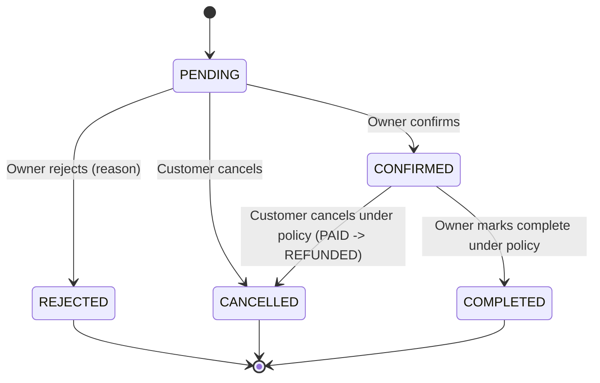
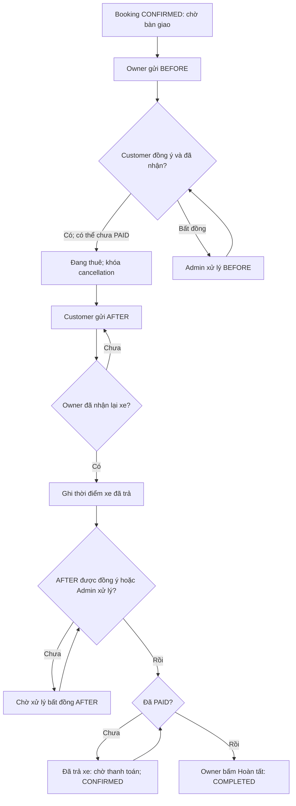
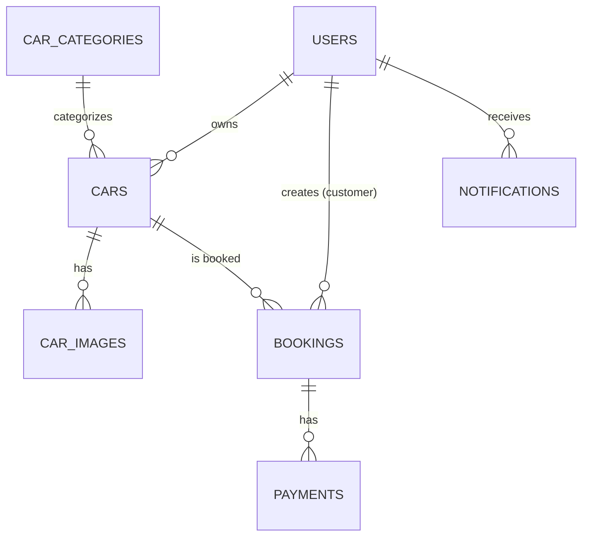
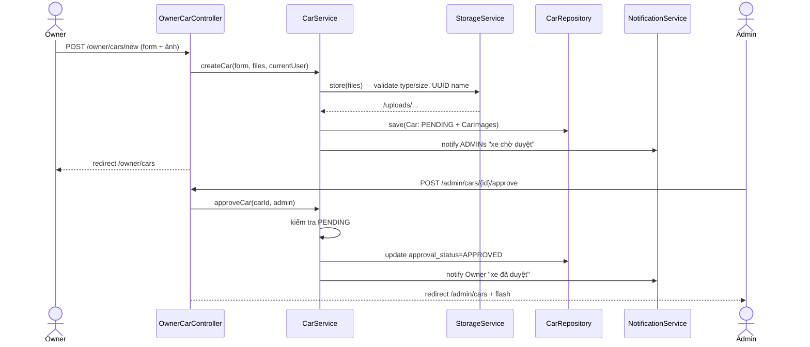
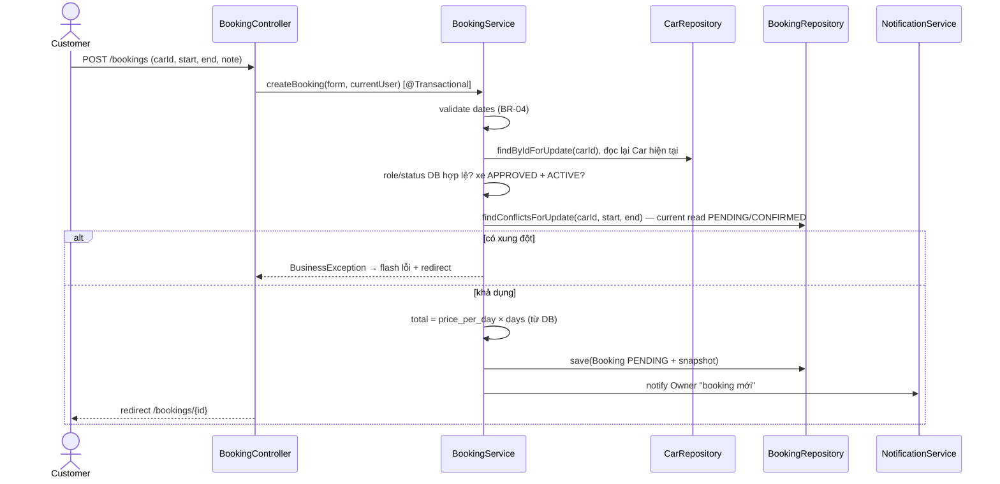
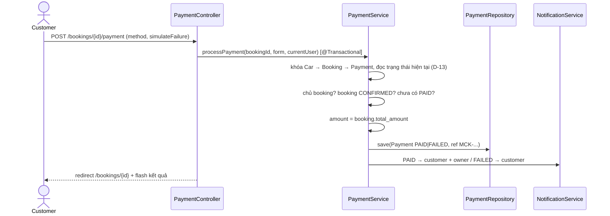

# CarRent — Software Design Document (SDD)

**Phiên bản:** 2.20
**Trạng thái:** Schema/seed DB, Phase 1, Phase 2, Phase 3, P4.1 và Phase 7/P7.1–P7.4 đã triển khai/kiểm chứng; tiếp theo P4.2
**Ngày:** 2026-10-27
**Nền tảng:** Java 21, Spring Boot 4.1.x, Spring MVC + Thymeleaf, Spring Security, Spring Data JPA/Hibernate, MySQL 8, Maven Wrapper
**Kiến trúc:** Monolithic Web Application — Server-side MVC + 3-layer architecture
**Ngôn ngữ tài liệu:** Tiếng Việt
**Tài liệu liên quan:** `CarRent.md` (bản thảo v1.0 — giữ nguyên để tham chiếu), `docs/decisions.md` (hồ sơ quyết định), `docs/plans/phase-*.md` (implementation plan, sinh sau khi duyệt SDD này)

> SDD v2.13 ghi nhận Phase 3 hoàn tất cả 5 đợt: notification, booking/create/availability/list/detail, cancel/refund atomic, Owner confirm/reject/complete và xóa xe không có lịch sử thuê an toàn DB/file/concurrency. Payment mapping P4.1 đã có; tiếp theo P4.2; payment service/UI thuộc P4.2 trở đi. Thay thế CarRent.md v1.0 và quy ước entity tự tạo schema của SDD v2.0. `scriptDB.sql` tại gốc dự án là nguồn chân lý vật lý của DB; entity các phase sau phải map theo schema sẵn có. Nếu plan cũ mâu thuẫn, quy ước DB-first tại §7.6–7.8 thắng. Xem quyết định D-24 trong `decisions.md`.

> **Bổ sung v2.14:** Chủ dự án duyệt module **Biên bản bàn giao và trả xe** ngày 2026-10-12: xác nhận chéo, cho nhận xe chưa PAID, trả xe xong chờ PAID mới COMPLETED, bất đồng do Admin xử lý thủ công. Đây là thiết kế cho **Phase 6**, chưa có code hoặc migration chạy trên DB. FR-16, BR-11–BR-15 và §7.9 chỉ áp dụng sau khi Phase 6 được kích hoạt; hành vi Phase 3 ghi ở các checkpoint là kết quả lịch sử. Plan: [Phase 6](plans/phase-6-inspection.md); quyết định D-25.

> **Bổ sung v2.15:** Ngày 2026-10-17, chủ dự án duyệt chuyển chọn lịch sang sidebar `/cars`: lọc xe trống trong toàn bộ khoảng thuê, bỏ kiểm tra khả dụng riêng tại chi tiết, điền sẵn ngày sang form đặt thuê và giữ dữ liệu khi lỗi. Quy tắc trùng lịch và khóa khi tạo đơn giữ theo BR-05/D-13; không đổi schema. Xem D-26. Các kết quả kiểm chứng Phase 2–3 bên dưới là bằng chứng lịch sử của luồng cũ.

> **Bổ sung v2.16:** Ngày 2026-10-27, chủ dự án tạm hoãn xử lý chuyển thiếu/thừa khoản trả trước 30%, lưu backlog tại §1.4. Admin dùng nguồn tiền và kênh chi payOS/Bảo Kim riêng để tự động hoàn khoản Owner thanh toán trùng hoặc đến sau hạn; hạn thanh toán gói Owner là 15 phút, xem §1.5. Phạm vi kiểm chứng tiền thật ban đầu là một Owner và Admin, xem §1.6. Các mục này chưa được gán phase; thiết kế đầy đủ về thanh toán thật, gói Owner, bàn giao và queue đang được brainstorming sẽ được tổng hợp riêng trước triển khai.

> **Bổ sung v2.17:** Đã cập nhật các plan theo brainstorming ngày 2026-10-27: Queue → nền thanh toán thật → luồng thuê 30/70 và hợp đồng Owner → gói Owner → Admin. Xem [hợp đồng chung và roadmap hiện hành](plans/README.md) và §14.1. Hợp đồng này thay các chỉ dẫn triển khai mock payment, nhận xe chưa trả trước, Customer xác nhận nhận xe lần hai, hủy theo 72 giờ và bắt giải quyết AFTER trước complete của thiết kế cũ đối với workflow mới. Các chương FR/BR/schema cũ và checkpoint vẫn được giữ làm tham chiếu; phải đồng bộ chi tiết SDD trước cutover, không coi toàn bộ schema/workflow mới đã tồn tại trong ứng dụng.

> **Bổ sung v2.19:** P7.3 đã nối singleton queue vào 14 POST xe/booking/ảnh, cấu hình transaction timeout 30 giây và trả HTTP 503 khi queue đầy/hết chờ trước chạy. Build sạch đạt 94 test; giữ DB locking, CSRF, kiểm tra lại quyền khi thực thi và policy legacy. P7.4 còn gate transaction/hai kết nối và contract worker tài chính; chưa có thanh toán thật. Bằng chứng và map route tại [plan Phase 7](plans/phase-7-car-queue.md#bằng-chứng-p73--2026-10-27).

> **Bổ sung v2.20:** P7.4 hoàn tất gate local Phase 7: 9 test transaction/DB thật mới, tổng build sạch 103 test đạt. Kiểm chứng queue chờ chưa mở transaction, caller/lệnh sau đợi commit/rollback, hai kết nối bỏ qua queue vẫn chống đặt trùng và current read loại snapshot/entity cũ. Contract worker Phase 4/6 đã ghi; không thêm code production/schema/job tiền. Tiếp theo P4.2; chưa kiểm chứng provider live hoặc human review. Chi tiết tại [checkpoint P7.4](plans/phase-7-car-queue.md#bằng-chứng-p74--2026-10-27).

---

## 1. Tổng quan dự án

### 1.1. Giới thiệu

CarRent là ứng dụng web cho thuê xe hơi. Người thuê (Customer) tìm kiếm, xem thông tin xe, tạo đơn thuê và thanh toán giả lập. Người cho thuê (Owner) quản lý danh sách xe và xử lý yêu cầu thuê. Admin quản lý tài khoản, kiểm duyệt xe và theo dõi hoạt động toàn hệ thống.

Ứng dụng dựng bằng Spring Boot, render HTML phía server bằng Thymeleaf, lưu dữ liệu bằng MySQL.

### 1.2. Mục tiêu

- Quy trình thuê xe trực tuyến đơn giản, hoàn chỉnh từ tìm xe → đặt → duyệt → thanh toán giả lập.
- Owner tự quản lý xe của mình; Admin kiểm duyệt xe trước khi công khai.
- Phân quyền chặt giữa `ADMIN` / `CUSTOMER` / `OWNER`, kiểm tra ở backend.
- Cấu trúc code rõ ràng theo layer, phù hợp học tập/portfolio, dễ mở rộng.

### 1.3. Phạm vi

**Bao gồm:**

- Đăng nhập/đăng ký, phân quyền theo role, khóa/vô hiệu hóa tài khoản.
- Owner CRUD xe + upload ảnh; Admin duyệt/từ chối/ẩn xe.
- Category xe (seed sẵn), địa điểm dạng text trên xe.
- Tìm kiếm, lọc, sắp xếp, phân trang, xem chi tiết xe + kiểm tra khả dụng.
- Booking đầy đủ vòng đời: PENDING → CONFIRMED/REJECTED/CANCELLED → COMPLETED.
- Mock payment (giả lập) cho booking đã xác nhận.
- Notification lưu database, đánh dấu đã đọc.
- Admin Dashboard thống kê, quản lý User.
- Profile + đổi mật khẩu.
- Phase 6: biên bản tình trạng xe trước/sau thuê, ảnh riêng tư, xác nhận nhận/trả thực tế và xử lý bất đồng thủ công.

**Không bao gồm (phiên bản này):**

- Swagger/OpenAPI, Docker, unit test/integration test tự động.
- Microservices, REST API JSON riêng cho client độc lập.
- Cổng thanh toán thật, WebSocket/notification realtime.
- Điều phối giao xe đến nơi khác, tự kết luận hư hỏng/trách nhiệm, tự tính bồi thường/phí trễ/phí nhiên liệu, bảo hiểm, khuyến mãi, yêu thích, review và audit log toàn hệ thống. Phase 6 chỉ lưu bằng chứng và lịch sử thao tác của biên bản.
- i18n song ngữ, upload avatar, quản lý Category qua UI (chỉ seed).

---

### 1.4. Backlog — xử lý chuyển thiếu/thừa khoản trả trước 30%

**Trạng thái:** Tạm hoãn theo yêu cầu chủ dự án ngày 2026-10-27. Chỉ lưu để đọc lại và thiết kế sau; chưa triển khai, chưa chọn A/B và chưa gán phase.

**Bối cảnh:** Trong luồng thanh toán thật đang được brainstorming, Customer trả trước 30% bằng VietQR và có 15 phút để thanh toán giữ chỗ. Số tiền điền sẵn trên QR không bảo đảm Customer chuyển đúng số tiền trong ứng dụng ngân hàng.

**Các phương án đã thảo luận, chưa được duyệt:**

- **A — Cộng dồn trong thời hạn, hoàn phần dư:** các giao dịch hợp lệ cùng mã thanh toán được cộng dồn trong thời hạn 15 phút. Chưa đủ thì hiển thị số còn thiếu và cho chuyển bổ sung; đủ thì xác nhận đặt xe; thừa thì tạo yêu cầu hoàn phần dư. Hết hạn vẫn thiếu thì đơn hết hạn, giải phóng xe và tạo yêu cầu hoàn toàn bộ số đã nhận.
- **B — Chỉ nhận từng giao dịch đúng số tiền:** chỉ giao dịch bằng đúng số tiền yêu cầu mới đủ điều kiện xác nhận; giao dịch lệch số tiền tạo yêu cầu hoàn toàn bộ. Customer phải thực hiện lại khoản thanh toán đúng số tiền trong thời hạn còn lại.

Ví dụ tham khảo cho phương án A, với khoản trả trước **600.000 VND**:

| Tình huống | Cách xử lý từng được đề xuất |
|---|---|
| Nhận 400.000 VND | Chưa xác nhận đặt xe; còn thiếu 200.000 VND |
| Nhận thêm 200.000 VND trong hạn | Đủ khoản trả trước, xác nhận đặt xe |
| Hết hạn vẫn chỉ nhận 400.000 VND | Đơn hết hạn; tạo yêu cầu hoàn 400.000 VND |
| Nhận 650.000 VND trong hạn | Ghi nhận trả trước 600.000 VND; tạo yêu cầu hoàn 50.000 VND dư |

**Cần chốt khi mở lại:** chọn A/B hoặc phương án khác; thời điểm bắt đầu cửa sổ hủy miễn phí khi có nhiều giao dịch; đối soát giao dịch đến muộn, trùng lặp và các khoản hoàn. Đề xuất lấy thời điểm nhận đủ khoản trả trước làm mốc hủy miễn phí chưa được duyệt.

**Giới hạn phạm vi:** chưa xây cộng dồn, chuyển bổ sung hoặc tự động hoàn do lệch số tiền cho khoản trả trước 30% trong đợt triển khai sắp tới. Trước khi tích hợp tiền thật, phải xác định cách ghi nhận các khoản lệch chưa được xử lý; không mặc định xác nhận đã trả đủ khi số tiền chưa đủ và không bỏ mất giao dịch đã nhận. Các quy tắc cơ sở dữ liệu, mock payment và bằng chứng triển khai hiện có ở phần sau vẫn mô tả phiên bản trước khi tích hợp thanh toán thật.

---

### 1.5. Thanh toán gói Owner — hoàn khoản trả trùng và thời hạn

**Trạng thái:** Đã được chủ dự án chốt lại ngày 2026-10-27, thay cho quyết định tạm hoãn trước đó. Đã phân bổ nền thanh toán/hoàn tại Phase 4 và nghiệp vụ gói tại Phase 8; chưa có code. Admin cần nguồn tiền và kênh chi payOS/Bảo Kim riêng, được nhà cung cấp kích hoạt trước khi thực hiện hoàn tiền thật.

**Luồng đã chốt:** khi Owner chuyển khoản thực tế hai lần cho cùng một yêu cầu mua/gia hạn, khoản hợp lệ đầu tiên kích hoạt hoặc gia hạn 30 ngày; khoản trả trùng tạo yêu cầu hoàn và được chuyển tự động từ nguồn tiền, kênh chi riêng của Admin tới tài khoản nhận hoàn của Owner. Không tự coi khoản trả trùng là một lần gia hạn khác. Backend đối soát trạng thái chuyển tiền qua API; giao diện polling trạng thái tại CarRent. Chỉ báo hoàn tất khi nhà cung cấp xác nhận chuyển thành công; thiếu thông tin nhận hoặc thiếu số dư thì giữ trạng thái chờ phù hợp.

**Phân biệt kỹ thuật:** SePay gửi lại cùng một webhook không phải Owner thực hiện thêm một lần chuyển khoản. Mỗi giao dịch ngân hàng chỉ được xử lý một lần; không cộng thời hạn hoặc tạo yêu cầu hoàn thêm khi webhook được gửi lại. Mỗi khoản phải hoàn cần chống chuyển tiền lặp khi gọi lại API hoặc đối soát kết quả chưa rõ.

**Đã chốt trong brainstorming:** yêu cầu thanh toán gói Owner có thời hạn **15 phút**; hết hạn thì ẩn QR, thông báo hết hạn và cho phép tạo yêu cầu mới. Gói đang còn hiệu lực không mất thời hạn đã mua chỉ vì một yêu cầu gia hạn mới hết hạn. Khoản mua gói hợp lệ đã kích hoạt không được hoàn theo số ngày chưa sử dụng.

**Tiền gói thực sự đến sau hạn — đã chốt:** không kích hoạt hoặc gia hạn từ yêu cầu đã hết hạn; tạo yêu cầu hoàn **100%** và chuyển tự động từ nguồn tiền, kênh chi payOS/Bảo Kim của Admin tới Owner. Đề xuất trước đó chỉ lưu tiền đến muộn ở trạng thái chờ đối soát được thay bằng quyết định hoàn tự động này. Backend vẫn lưu giao dịch và tiến trình hoàn, chỉ báo hoàn thành khi chuyển tiền thành công.

**Phân biệt webhook chậm:** ngân hàng nhận tiền đúng hạn nhưng webhook đến sau hạn không mặc định là Owner chuyển muộn; cần đối soát thời điểm giao dịch thực tế. Vòng đời yêu cầu bị hủy trước hạn dùng mặc định hoàn 100% được ghi riêng để review tại [hợp đồng plan](plans/README.md), không tự coi tiền đến sau hủy là một lần mua hợp lệ.

---

### 1.6. Phạm vi kiểm chứng thanh toán thật — một Owner và Admin

**Đã chốt ngày 2026-10-27:** bản local kiểm chứng toàn bộ luồng tiền thật với **một Owner và Admin trước**, thay vì triển khai kết nối nhiều Owner thật ngay trong đợt đầu.

- **Owner thử nghiệm:** có tài khoản ngân hàng nhận tiền thuê qua SePay và kênh chi payOS/Bảo Kim riêng để hoàn tiền Customer từ nguồn tiền của Owner.
- **Admin:** có tài khoản ngân hàng nhận phí gói qua SePay và kênh chi payOS/Bảo Kim riêng để hoàn tiền gói cho Owner theo §1.5.
- **Customer:** không cần liên kết SePay/payOS; cung cấp tài khoản nhận khi phát sinh hoàn tiền.
- Thiết kế liên kết cấu hình nhận/chi với đúng chủ thể Owner hoặc Admin; không dùng chung tài khoản Admin để nhận tiền thuê thay Owner. Kiểm tra cấu hình hợp lệ trước khi bật thanh toán thật cho chủ thể đó.
- Tự động kết nối nhiều Owner không nằm trong đợt kiểm chứng ban đầu. Việc mở rộng cần xác minh điều kiện nhà cung cấp cho phép CarRent tích hợp các kênh riêng của nhiều Owner.

**Điều kiện trước khi kiểm chứng tiền thật:** nhà cung cấp đã duyệt/kích hoạt các kênh nhận và chi tương ứng; kiểm chứng quyền gọi API, webhook, đích nhận và trạng thái chuyển tiền. Sandbox hoặc tài liệu API không thay thế xác nhận khả năng sử dụng tài khoản thật. Hiện đây là phạm vi thiết kế, chưa có bằng chứng giao dịch thật đã chạy thành công.

---

## 2. Môi trường phát triển và công nghệ

### 2.1. Công nghệ

| Thành phần | Công nghệ | Ghi chú |
|---|---|---|
| Ngôn ngữ | Java 21 (Temurin) | Đã cài trên máy |
| Backend framework | **Spring Boot 4.1.x** (mặc định mới của start.spring.io) | Web MVC starter = `spring-boot-starter-webmvc` (không phải `spring-boot-starter-web` của dòng 3.x) |
| UI | Spring MVC + Thymeleaf | Server-side render |
| CSS/UI | **Tailwind CSS (Play CDN) + design tokens Material Design 3 theo prototype Stitch** + `static/css/custom.css` nhỏ | Xem `docs/design/stitch/README.md` |
| Security | Spring Security | Session-based + CSRF, BCrypt |
| ORM | Spring Data JPA + Hibernate | `ddl-auto=none`; map schema từ `scriptDB.sql`, không tự tạo/sửa bảng |
| Database | MySQL 8.0 (`carrent`, utf8mb4) | Service `MySQL80` đang chạy |
| Build | Maven Wrapper (`mvnw`) | Không cần cài Maven toàn máy |
| Validation | Jakarta Bean Validation | Hibernate Validator |
| Tiện ích | Lombok | Getter/setter/builder |

### 2.2. Môi trường máy (fact đã kiểm tra)

- Hệ điều hành: Windows 11. Terminal chính: PowerShell.
- Java: Temurin 21.0.11 LTS.
- MySQL: 8.0.45, service `MySQL80` đang chạy, client tại `C:\Program Files\MySQL\MySQL Server 8.0\bin\mysql.exe`.
- Maven: không có trên PATH → mọi lệnh build dùng `.\mvnw` trong thư mục dự án.
- Thư mục gốc dự án: `C:\Users\Admin\Documents\hoc\Car` — code Spring Boot nằm ngay tại gốc; tài liệu nằm trong `docs\`. Repo đã được khởi tạo Git; Phase 2 làm trên nhánh `feat/phase2-car`. `.gitignore` loại cấu hình local, build, bằng chứng kiểm tra và ảnh runtime; giữ sáu ảnh seed.

### 2.3. Quy ước ngôn ngữ

- **UI:** toàn bộ label, menu, thông báo, trang lỗi → **tiếng Việt**.
- **Code:** tên class/method/biến, comment, commit message → **tiếng Anh**.
- **Tiền tệ:** VND, số nguyên (`BIGINT`), không phần thập phân.
- **Ngày thuê:** `LocalDate`; timestamps: `LocalDateTime` theo múi giờ máy chủ.

---

## 3. Kiến trúc hệ thống

### 3.1. Lựa chọn kiến trúc

- **Monolithic:** một ứng dụng Spring Boot duy nhất.
- **MVC + 3-layer:** Controller → Service → Repository.
- **Một MySQL database** tập trung.

### 3.2. Sơ đồ kiến trúc

```mermaid
flowchart TD
    U[Browser: Admin / Customer / Owner]
    U -->|HTTP Request| C[Spring MVC Controllers]
    C --> S[Service Layer]
    S --> R[Spring Data JPA Repositories]
    R --> H[Hibernate / JPA]
    H --> DB[(MySQL carrent)]
    C -->|Model + View Name| T[Thymeleaf Templates + Tailwind (Stitch design)]
    T -->|Rendered HTML| U
    SEC[Spring Security] -. Protects .-> C
    FS[StorageService] -. uploads/ .-> S
```

### 3.3. Trách nhiệm từng layer

**Controller**
- Nhận request, đọc path variable / query param / form data, bind lên DTO form.
- Gọi Service; trả về template, redirect hoặc error page.
- Không chứa business logic.

**Service**
- Toàn bộ business rules: ownership, trạng thái, tính giá, transaction, tạo notification.
- Transaction (`@Transactional`) cho các thao tác nhiều bảng (booking + payment + notification).

**Repository**
- Spring Data JPA interface; query thuần, không business logic.

**Entity**
- Mapping bảng; không bind trực tiếp lên form Thymeleaf — luôn qua DTO form.

**View (Thymeleaf)**
- Render HTML, hiển thị validation error, flash message; không tính toán nghiệp vụ.

**Spring Security**
- Session-based form login, BCrypt, CSRF bật, guard route theo role; ownership kiểm tra thêm trong Service.

**StorageService** (`storage/`)
- Validate + lưu file ảnh upload vào thư mục `uploads/` của dự án (cùng cấp `src/`, **không** nằm trong `src/main/resources`), trả về web path `/uploads/<uuid>.<ext>` để DB lưu.

### 3.4. Luồng xử lý ví dụ: tạo booking

1. Customer submit form chọn ngày thuê trên xe.
2. `BookingController` bind form `BookingCreateForm`, validation cơ bản (ngày hợp lệ).
3. `BookingService` lấy Customer từ security context, kiểm tra role/status DB; khóa và đọc lại Car hiện tại, kiểm tra `APPROVED` + `ACTIVE`.
4. Service query booking trùng lịch (BR-05) bằng current locking read trong transaction (D-13).
5. Service tính `totalAmount` từ `price_per_day` trong DB, lưu snapshot vào booking.
6. Tạo Booking `PENDING`, tạo notification cho Owner — cùng transaction.
7. Redirect đến trang chi tiết booking (PRG pattern).

---

## 4. Vai trò và phân quyền

Mỗi tài khoản đúng **một role** (cột enum `users.role`).

### 4.1. Roles

`ADMIN` · `CUSTOMER` · `OWNER`

### 4.2. Ma trận quyền

| Chức năng | ADMIN | CUSTOMER | OWNER |
|---|:---:|:---:|:---:|
| Xem Admin Dashboard | Có | Không | Không |
| Xem + quản lý User (status) | Có | Không | Không |
| Xem danh sách Car công khai | Có | Có | Có |
| Xem chi tiết Car công khai | Có | Có | Có |
| Xem Car chưa duyệt / của mình | Có (admin view) | Không | Có (xe của mình) |
| Tạo / sửa / ngừng đăng xe | Quản trị | Không | Có (chỉ xe mình) |
| Xóa cứng Car | Không (chỉ ẩn) | Không | Chỉ khi không có booking nào |
| Duyệt / từ chối Car | Có | Không | Không |
| Tạo Booking | Không | Có | Không |
| Xem Booking | Tất cả | Của mình | Liên quan xe của mình |
| Confirm / Reject / Complete Booking | Giám sát | Không | Có (xe của mình) |
| Hủy Booking | Không | Của mình (theo quy tắc) | Không |
| Mock Payment | Không | Booking của mình (đã CONFIRMED) | Không |
| Xem Notification | Của mình | Của mình | Của mình |
| Cập nhật Profile / đổi mật khẩu | Của mình | Của mình | Của mình |
| Phase 6: lập biên bản BEFORE | Chỉ xem | Chỉ xem | Owner của xe |
| Phase 6: xác nhận nhận xe / bất đồng BEFORE | Chỉ xem | Customer của booking | Không |
| Phase 6: lập biên bản AFTER | Chỉ xem | Customer của booking | Chỉ xem |
| Phase 6: xác nhận xe đã trả / bất đồng AFTER | Chỉ xem | Không | Owner của xe |
| Phase 6: xem ảnh / bổ sung ghi chú biên bản đã gửi | ADMIN | Customer của booking | Owner của xe |
| Phase 6: xử lý bất đồng | ADMIN | Không | Không |
| Phase 6: ghi nhận đã thu tiền mặt giả lập | Không | Không | Owner của booking CONFIRMED chưa PAID |

> Ẩn nút trên UI không đủ. **Mọi quyền và ownership phải kiểm tra ở backend** (SecurityConfig + Service). Owner A sửa xe của Owner B bằng cách đổi ID trên URL → 403/404.

> Các quyền xem biên bản Phase 6 trong bảng áp dụng sau submit; nháp chỉ người lập xem, kể cả Admin cũng không xem nháp của bên khác. Panel Booking/list Admin không được lộ nội dung/ảnh nháp.

### 4.3. Trạng thái tài khoản

- `ACTIVE` / `INACTIVE` / `BANNED`.
- Đăng nhập bị từ chối kèm thông báo tiếng Việt nếu status ≠ `ACTIVE`.
- Tài khoản không xóa cứng (có booking/payment lịch sử) — chỉ chuyển trạng thái.
- Admin không được tự đổi status của chính mình.
- Người dùng không tự đổi role qua form Profile.

---

## 5. Functional Requirements

### FR-01. Authentication & Authorization

- Đăng nhập bằng **email + password**; password hash BCrypt.
- Email là **chuỗi định danh đăng nhập duy nhất** — không cần là email thật, không validate định dạng địa chỉ thư, không gửi/xác thực email. Chỉ ràng buộc: không trống + unique.
- Sau đăng nhập, redirect theo role: `ADMIN → /admin/dashboard`, `OWNER → /owner/dashboard`, `CUSTOMER → /cars`.
- Chưa đăng nhập truy cập trang cần xác thực → chuyển `/login`. Sau khi đăng nhập thành công, trang đích theo role ở trên được ưu tiên; request đã lưu được xóa để không ghi đè redirect này.
- Đăng xuất: POST `/logout` (Spring Security), kết thúc session.
- Đăng ký công khai: chọn role `CUSTOMER` hoặc `OWNER` (radio). **Không cho tự đăng ký ADMIN** — tài khoản Admin tạo bằng seed data.
- Status ≠ `ACTIVE` → không đăng nhập được, hiển thị thông báo phù hợp.

### FR-02. Admin Dashboard (`/admin/dashboard`)

Thống kê: tổng User, số Customer, số Owner; tổng Car, Car chờ duyệt (`approval_status=PENDING`); tổng Booking, Booking `PENDING`, Booking `COMPLETED` + `CANCELLED`; **doanh thu** = `SUM(payments.amount) WHERE status='PAID'` + doanh thu theo từng tháng của năm hiện tại. Không mặc định coi booking là doanh thu.

### FR-03. Admin User Management

- Danh sách User (`/admin/users`): phân trang, tìm kiếm theo tên/email, lọc theo role/status.
- Chi tiết User (`/admin/users/{id}`): thông tin + thống kê liên quan (số xe nếu Owner, số booking nếu Customer).
- POST `/admin/users/{id}/status`: đổi status `ACTIVE`/`INACTIVE`/`BANNED`; cấm đổi status của chính Admin đang đăng nhập.
- Không xem/hiện mật khẩu hash trong UI.

### FR-04. Admin Car Management

- Danh sách toàn bộ Car (`/admin/cars`): phân trang, tìm kiếm brand/model, lọc approval_status + listing_status.
- Chi tiết Car + thông tin Owner (`/admin/cars/{id}`).
- POST `/admin/cars/{id}/approve`: `PENDING → APPROVED`; notification CAR_APPROVED cho Owner đã tích hợp ở P3.3, cùng transaction.
- POST `/admin/cars/{id}/reject`: `PENDING → REJECTED` + `rejection_reason` (bắt buộc nhập, ≤500 ký tự); notification CAR_REJECTED kèm lý do cho Owner đã tích hợp ở P3.3, cùng transaction.
- POST `/admin/cars/{id}/deactivate` và `/activate`: ẩn mọi trạng thái; đăng lại chỉ xe APPROVED, không đổi kết quả duyệt. Admin không xóa cứng hoặc sửa nội dung xe.
- Danh sách, chi tiết và thao tác Admin kiểm tra role ADMIN/status ACTIVE hiện có trong DB, ngoài quyền trong session. Mọi POST cần CSRF.

### FR-05. Car Approval Workflow

- Owner tạo Car → `approval_status = PENDING`, `listing_status = ACTIVE`.
- `PENDING → APPROVED` / `PENDING → REJECTED` do Admin (kèm lý do khi reject).
- **Sửa Car sau khi duyệt không cần duyệt lại** (decision D-03). Admin xử lý vi phạm bằng cách ẩn xe.
- Chỉ `APPROVED` + `listing_status=ACTIVE` mới hiển thị công khai.
- Duyệt/từ chối đồng thời chỉ một quyết định hợp lệ được ghi. Các thao tác sửa/ẩn/đăng lại xe đọc trạng thái hiện hành dưới cùng khóa hàng, kể cả entity đã được quản lý trong persistence context, để không ghi đè kết quả duyệt/lý do từ chối. Không thêm cột version hoặc đổi schema.

### FR-06. Owner Car Management

- `/owner/cars`: danh sách xe của mình (mọi trạng thái), hiện badge approval/listing status.
- Danh sách lấy Owner từ principal, mặc định page 0/size 10, size giới hạn 1–50, ID giảm dần. Thống kê tổng xe, xe công khai APPROVED+ACTIVE và xe PENDING tính trên toàn bộ xe của Owner. Thumbnail truy vấn theo batch cho trang hiện tại, chọn ID ảnh nhỏ nhất. Phân trang tối đa 5 số trang, giữ query params và cho phép quay lại từ trang vượt cuối.
- Tạo xe (`/owner/cars/new`): brand, model, manufacture_year (1990–năm hiện tại+1), license_plate, color, seat_count (2–15), transmission (`MANUAL`/`AUTOMATIC`), fuel_type (`GASOLINE`/`DIESEL`/`ELECTRIC`/`HYBRID`), description, price_per_day (>0, VND), category (dropdown từ seed), province (bắt buộc), district, address_detail, ảnh (0–n file).
- Service tạo xe kiểm tra principal OWNER và User OWNER/ACTIVE từ DB, validate DTO/category/toàn bộ ảnh trước ghi. Năm tối đa tính động theo năm hiện tại; Owner lấy từ principal. Xe và bản ghi ảnh cùng transaction; rollback dọn file mới, kể cả rollback ở caller hoặc lỗi commit. Lỗi tạo xe yêu cầu thử lại; không lưu xe một phần khi upload thất bại.
- Sửa xe: các trường trên + quản lý ảnh (thêm ảnh mới, xóa ảnh cũ).
- `updateCar` kiểm tra principal và User OWNER/ACTIVE từ DB, ownership trước validation; giữ nguyên owner, approval, rejectionReason và listing. Service ẩn xe áp dụng mọi trạng thái duyệt; đăng lại chỉ cho APPROVED. Lặp thao tác giữ trạng thái đích. Quản lý ảnh và HTTP form sửa/ẩn/đăng lại thuộc P2.8.
- POST `/owner/cars/{id}/deactivate` — ngừng đăng tin; POST `/owner/cars/{id}/activate` — đăng lại.
- Xóa cứng **chỉ khi không có booking nào** tham chiếu (kể cả booking đã kết thúc — giữ lịch sử); ngược lại phải deactivate. Xóa xe → xóa cả bản ghi ảnh + file ảnh tương ứng.
- Mọi thao tác kiểm tra `car.owner_id == currentUser.id`.

### FR-07. Car Category

- Category seed sẵn 6 loại: `SEDAN`, `SUV`, `MPV`, `LUXURY`, `ECONOMY`, `ELECTRIC`.
- Car bắt buộc có 1 category; dropdown khi tạo/sửa.
- Không có UI quản lý category trong MVP (decision D-16); không xóa category đang được dùng.

### FR-08. Car Images

- Upload file thật qua multipart trong form tạo/sửa xe.
- `StorageService`: validate phần mở rộng ∈ {jpg, jpeg, png, webp} + content-type image/*, kích thước ≤ 5MB; đặt tên file = **UUID + đuôi gốc** (không tin tên file user gửi); lưu vào `uploads/` ở gốc dự án.
- Web config map `/uploads/**` → thư mục `uploads/`.
- DB (`car_images.image_url`) lưu web path `/uploads/<file>`.
- Lưu lỗi IO phải dọn file ghi dở; xóa chỉ chấp nhận file trực tiếp trong uploads, chặn traversal. Lỗi cleanup được log và tiếp tục thử dọn những ảnh còn lại. DB transaction và filesystem không thể bảo đảm nguyên tử khi process bị dừng đột ngột hoặc filesystem không cho xóa.
- MVP kiểm tra đuôi/MIME/kích thước, chưa decode nội dung ảnh. Multipart giới hạn 5MB mỗi file, 30MB mỗi request. Vượt giới hạn từng file trả trang `error/413.html` tiếng Việt (P2.7): Tomcat ném lỗi multipart trong `CsrfFilter` trước `DispatcherServlet` nên `@ControllerAdvice` không bắt được, chỉ view cấp container render được. Giới hạn tổng request không quan sát được qua HTTP vì container hủy body trước error dispatch.
- **Thumbnail = ảnh có `id` nhỏ nhất của xe** (không có cột is_primary — D-10).
- Một xe nhiều ảnh; trang detail hiện gallery; danh sách hiện thumbnail.

### FR-09. Search, Filter, Sort, Pagination, Detail

- `/cars` (public, chưa đăng nhập vẫn xem được): chỉ xe `APPROVED` + `ACTIVE`.
- Tìm kiếm keyword khớp brand hoặc model (không phân biệt hoa thường); `%`, `_`, `\\` trong từ khóa được khớp literal.
- Lọc: category, province, minPrice, maxPrice, seatCount, transmission, fuelType và khoảng thuê `startDate/endDate` (ISO `yyyy-MM-dd`). Nhóm **Thời gian thuê** ở đầu sidebar, dùng nút Áp dụng bộ lọc hiện có.
- Bỏ trống cả hai ngày: không lọc lịch. Chọn một ngày, ngày sai định dạng/quá khứ, `endDate <= startDate` hoặc vượt 31/12/9999: trả 400 ngay trên trang tìm xe, báo lỗi cạnh nhóm ngày, giữ các giá trị đã nhập và không hiển thị kết quả gây hiểu nhầm. Ngày hợp lệ phải thỏa BR-04; chỉ xe không có booking xung đột theo BR-05 mới xuất hiện.
- Lọc lịch bằng truy vấn DB trước phân trang/count, kết hợp mọi bộ lọc hiện có. Giữ ngày khi phân trang/sắp xếp và chuyển sang chi tiết/form đặt thuê. Submit bộ lọc về trang đầu; Đặt lại xóa mọi điều kiện. Không có kết quả theo ngày: thông báo không có xe trống trong khoảng ngày đã chọn.
- Sắp xếp whitelist `priceAsc`, `priceDesc`, `newest`; giá tăng/giảm hoặc `created_at desc`, luôn thêm `id desc` khi bằng nhau. Mặc định hoặc sort không biết: mới nhất. Không nhận trường sort tùy ý từ URL/Pageable.
- Phân trang: mặc định 12 xe/trang, size 1–50, page/offset giới hạn an toàn; Spring Data `Pageable` + Specification lọc/count phía DB. Pager tối đa 5 số trang, giữ query encoded/lặp, chỉ một page và size đã chuẩn hóa.
- Bộ lọc sai kiểu/giá âm/category không dương/số chỗ ngoài 2–15/chuỗi quá dài trả 400 tiếng Việt; minPrice > maxPrice hợp lệ trả 200 empty. Giá dùng Long, biên inclusive; province khớp toàn bộ chuỗi đã trim.
- `/cars/{id}`: gallery theo ID ảnh tăng dần, thông số, giá, địa điểm, thông tin Owner (chỉ tên + SĐT). Xe `APPROVED+ACTIVE` công khai; xe khác chỉ Owner sở hữu hoặc Admin có role/status ACTIVE còn đúng trong DB được xem. Người khác hoặc principal cũ không hợp lệ nhận 404; ID sai kiểu nhận 400.
- Trang chi tiết xe chưa công khai có banner xem trước và không có CTA đặt thuê. CTA xe công khai đã trỏ tới form `/bookings/new?carId=` cho anonymous/Customer; Owner/Admin thấy thông báo chỉ Customer được đặt. Không dựng đánh giá, lịch trống, phí cọc hoặc tiện ích không có dữ liệu.
- Chi tiết xe không còn form/nút/badge kiểm tra khả dụng riêng của P3.6. Nhận `startDate/endDate` để chuyển tiếp sang đặt thuê; nút quay lại Tìm xe giữ khoảng ngày. Kết quả lọc không giữ chỗ, submit vẫn kiểm tra lại dưới khóa. `ACTIVE` chỉ biểu thị đăng tin, không bảo đảm trống lịch. Form tìm xe trang chủ dùng province/q/maxPrice; xe nổi bật trang chủ vẫn thuộc P5.8.

### FR-10. Booking

**Customer:**
- Form tạo booking (`/bookings/new?carId=`): startDate, endDate, customer_note. Nhận ngày từ kết quả tìm xe để điền sẵn; Customer vẫn được sửa ngày tại form này. Thiếu/sai ngày hoặc trùng lịch khi submit phải giữ ngày/ghi chú và báo lỗi trên form, không redirect làm mất dữ liệu. Nút quay lại thông tin xe giữ khoảng ngày hiện tại.
- Xem giá ước tính trước khi submit (JS nhỏ tính `days × price` hiển thị).
- Xem danh sách + chi tiết booking của mình.
- POST `/bookings/{id}/cancel`: hủy khi `PENDING` hoặc `CONFIRMED` (BR-08).

**Checkpoint đợt 3:** P3.6/P3.7 đã triển khai form → POST → detail thật, danh sách riêng Customer có phân trang size 1–50 và link header desktop/mobile. Giá ước tính JS dùng BigInt; server giữ quyền tính tiền/identity/status/snapshot. `/bookings/{id}` chỉ cho Customer của đơn, Owner của xe hoặc Admin có role/status ACTIVE đúng DB; người khác nhận 404. Giá/địa chỉ đã lưu không đổi theo xe, badge payment đọc PAID thật từ P4.1. BOOKING notification đã nối detail. Tại checkpoint đợt 3, cancel và trang riêng Owner/Admin/payment actions/history còn chờ; cancel và Owner list/detail/confirm/reject đã nối ở đợt 4 bên dưới.

**Checkpoint đợt 4:** Customer có nút Hủy đơn thuê cho PENDING/CONFIRMED, xác nhận JS; server kiểm tra lại dưới khóa. PAID→REFUNDED cùng CANCELLED + notification Owner và Customer hoàn tiền, không tạo payment mới, giữ amount/paid_at. Owner có `/owner/bookings` size 1–50, detail thông tin Customer/snapshot/payment thật và nút confirm/reject cho PENDING. Reject có modal lý do trim 1–500 ký tự, validate MVC/Service; không JS vẫn có form. Đơn thuê trên sidebar các trang xe/đơn Owner, generic detail có link Quản lý đơn thuê. Complete/delete/E2E đã nối ở đợt 5 bên dưới; payment UI thuộc Phase 4.

**Checkpoint đợt 5 / Phase 3 hoàn tất:** Owner detail có Hoàn tất đơn thuê chỉ khi CONFIRMED và `end_date < hôm nay`; POST complete kiểm tra lại dưới khóa Car → Booking, không bắt buộc PAID, notify Customer atomic. Xe của tôi có icon xóa, disable nếu có lịch sử bất kỳ status; Service khóa Car rồi đọc current history và current image paths, xóa DB trước và dọn file sau commit. Rollback giữ row/file, lỗi cleanup được log. Đã kiểm chứng complete/cancel, create/delete/hide, upload/delete hai connection cùng snapshot cũ và timeout/deadlock rollback+409; E2E/browser/phân quyền/baseline đầy đủ tại §14.14.

**Owner:**
- `/owner/bookings`: booking liên quan xe của mình; chi tiết hiện thông tin customer.
- POST `/owner/bookings/{id}/confirm` — `PENDING → CONFIRMED`.
- POST `/owner/bookings/{id}/reject` — `PENDING → REJECTED` + owner_note (lý do).
- POST `/owner/bookings/{id}/complete` — `CONFIRMED → COMPLETED`, Phase 0–5 chỉ khi `end_date < hôm nay`; Phase 6 dùng BR-13 cho booking theo chính sách mới.

**Admin:** xem toàn bộ booking (`/admin/bookings`, `/admin/bookings/{id}`), không thao tác trạng thái Booking. Phase 6 bổ sung xử lý bất đồng biên bản (FR-16), không thay Owner hoàn tất đơn.

### FR-11. Booking Status

`PENDING` → `CONFIRMED` → `COMPLETED`, kèm nhánh reject/cancel:



`COMPLETED` là thao tác thủ công của Owner — không tự động (D-07). Phase 0–5 và đơn cũ dùng điều kiện ngày đã qua. Phase 6 với `inspection_required=true` dùng nhận/trả thực tế + biên bản + PAID tại BR-13; không thêm enum Booking. Tiến độ thuê xe, tình trạng thanh toán và bất đồng hiển thị riêng.

### FR-12. Mock Payment

- Chỉ Customer là chủ booking, booking `CONFIRMED`, chưa có Payment `PAID` → mới được thanh toán.
- Trang `/bookings/{id}/payment`: chọn method (`MOCK_CARD` / `MOCK_BANK_TRANSFER` / `CASH_SIMULATED`) + checkbox "Giả lập thất bại (test)".
- POST xử lý: tạo Payment `PAID` hoặc `FAILED`; amount = `booking.total_amount` (server-side); `transaction_reference` = `MCK-<epochMillis>-<random6>`; `paid_at` khi PAID.
- FAILED → được thử lại (tạo Payment mới — bảng không unique booking_id, D-06).
- Booking giữ nguyên `CONFIRMED` sau khi PAID (trạng thái thanh toán đọc từ payments).
- Notification: PAID → customer + owner; FAILED → customer.
- Không thu thập thông tin thẻ/ngân hàng thật.
- **Phase 6:** việc nhận xe không đòi PAID. Khi xe đã trả nhưng chưa PAID, booking vẫn CONFIRMED để Customer thanh toán qua luồng này. Owner có thao tác riêng ghi nhận đã thu tiền mặt giả lập (method `CASH_SIMULATED`, amount từ booking); không đổi nghĩa endpoint thanh toán Customer và không tạo PAID lần hai. Chưa PAID là chưa thanh toán đủ tổng tiền; không làm trả góp, nhắc nợ tự động hay thu tiền thật.

### FR-13. Notification

- Lưu DB bảng `notifications`; không realtime — người dùng vào `/notifications` hoặc thấy badge trên navbar (số unread, cập nhật khi tải trang qua `@ControllerAdvice`).
- `/notifications`: danh sách của user hiện tại, phân trang, unread nổi bật.
- POST `/notifications/{id}/read` — đánh dấu 1 thông báo đã đọc; POST `/notifications/read-all` — đánh dấu tất cả.
- P3.1–P3.3 đã triển khai: chỉ user ACTIVE xem/đánh dấu thông báo của mình; sai user 404, POST CSRF. Page size mặc định 10, giới hạn 1–50, thứ tự created_at/id giảm dần. Chuông dùng chung public và header Owner/Admin, ẩn anonymous, badge chỉ hiện khi unread >0 (hiển thị tối đa 99+, nhãn truy cập có số thật). CAR link của Admin → review, Owner → form sửa xe; BOOKING link đã nối `/bookings/{id}` ở P3.7; PAYMENT link lịch sử chờ P4.4.
- Sự kiện sinh notification:

| Sự kiện | Người nhận |
|---|---|
| Car vừa tạo (chờ duyệt) | Mọi ADMIN |
| Car APPROVED / REJECTED | Owner của xe |
| Booking tạo (PENDING) | Owner của xe |
| Booking CONFIRMED / REJECTED | Customer |
| Booking CANCELLED (customer hủy) | Owner của xe |
| Booking COMPLETED | Customer |
| Payment PAID | Customer + Owner |
| Payment FAILED | Customer |
| Phase 6: BEFORE gửi / AFTER gửi | Customer / Owner tương ứng |
| Phase 6: Customer nhận xe / Owner nhận lại xe | Owner / Customer tương ứng |
| Phase 6: biên bản có bất đồng | Bên còn lại + các ADMIN ACTIVE |
| Phase 6: Admin xử lý bất đồng | Customer + Owner |

### FR-14. Location

- Không có bảng `locations` (D-11). Trên `cars`: `province` (bắt buộc), `district`, `address_detail` dạng text.
- Lọc danh sách xe công khai theo `province`.
- Booking nhận xe tại địa điểm của xe: khi tạo booking, server snapshot địa chỉ thành `bookings.pickup_address` (text) để lịch sử không đổi khi owner sửa xe.

### FR-15. Profile Management

- `/profile`: xem thông tin (full_name, email, role, phone, ngày tạo).
- `/profile/edit` (GET/POST): sửa full_name, phone. Email không đổi (D-17). Role không đổi.
- `/profile/change-password` (GET/POST): nhập mật khẩu hiện tại (verify BCrypt) + mật khẩu mới + xác nhận; sai mật khẩu hiện tại → lỗi validation.
- Không làm avatar upload trong MVP (cột `avatar_url` để dự phòng).

### FR-16. Biên bản bàn giao và trả xe — triển khai Phase 6

**Đối tượng:** một Booking có tối đa một biên bản `BEFORE` và một `AFTER`; ảnh biên bản độc lập với `car_images`. Chỉ áp dụng cho booking tạo sau khi bật Phase 6 (`inspection_required=true`). Đơn cũ hiển thị nhãn chính sách cũ, không tạo bằng chứng quá khứ giả.

**Thông tin:** booking, xe, người lập và địa chỉ nhận/trả lấy từ server; dùng `bookings.pickup_address` đã snapshot cho cả hai lần. Khi gửi bắt buộc có mô tả tình trạng (trim 1–2000 ký tự), hư hỏng nhìn thấy (1–1000; có thể ghi “Không phát hiện”), odometer (số nguyên 0–9.999.999 km), nhiên liệu/pin (0–100%), phụ kiện bàn giao (1–500; có thể ghi “Không bàn giao”) và **4–10 ảnh**. Gợi ý ảnh trước/sau/hai bên, nội thất, đồng hồ; không tự kiểm chứng góc chụp hoặc thời điểm chụp. Odometer AFTER thấp hơn BEFORE chỉ cảnh báo để kiểm tra, không tự kết luận lỗi hay cản ghi nhận xe đã trả.

**BEFORE — Owner lập, Customer xác nhận:**

1. Booking CONFIRMED: Owner lưu nháp, thêm/xóa ảnh nháp rồi gửi biên bản. Có thể chuẩn bị trước ngày nhận.
2. Customer xem ảnh/nội dung và bấm **Đồng ý biên bản và xác nhận đã nhận xe** tại địa điểm snapshot; server ghi `vehicle_received_at`. Cho nhận khi chưa PAID, hiển thị tổng tiền chưa thanh toán. Thời điểm nhận phải thuộc `start_date ≤ hôm nay < end_date`.
3. Nếu chưa đồng ý, Customer gửi lý do bất đồng; chưa ghi nhận nhận xe. Admin xử lý thủ công, sau đó Customer vẫn phải xác nhận đã nhận thực tế; Admin không xác nhận thay.
4. Trước lúc xác nhận nhận xe, server kiểm tra cùng xe không còn được Customer của booking mới khác giữ thực tế (BR-15). Sau xác nhận, không còn hủy/hoàn tiền qua luồng cancellation.

**AFTER — Customer lập, Owner nhận lại xe:**

1. Sau khi đã nhận xe, Customer lập và gửi biên bản AFTER tại vị trí cũ; được trả sớm, đúng hạn hoặc trễ. Gửi báo cáo chưa có nghĩa Owner đã nhận xe.
2. Owner chọn **Đã nhận xe, đồng ý tình trạng** hoặc **Đã nhận xe, có bất đồng** (lý do bắt buộc): cả hai ghi `vehicle_returned_at` ngay, lựa chọn thứ hai mở bất đồng. Nếu xe chưa tới, chọn **Chưa nhận được xe**: thêm event, giữ chờ xác nhận và không ghi thời điểm trả.
3. Owner đã nhận xe có bất đồng: giữ nguyên bằng chứng, Admin xử lý; không xóa thời điểm trả. Trạng thái thanh toán hiển thị độc lập.
4. Owner bấm **Hoàn tất đơn thuê** khi đủ BR-13; trả xe và đóng bất đồng không tự hoàn tất. Không phải đợi qua `end_date` nếu xe thực sự đã trả và đủ điều kiện; ngày thuê/giá snapshot/tổng tiền giữ nguyên.

**Lịch sử và riêng tư:** nháp chỉ người lập sửa/xem; sau gửi, Customer của booking, Owner của xe và Admin ACTIVE được xem. Bản gốc và ảnh đã gửi bất biến; ghi chú bổ sung dạng text, phản hồi và quyết định Admin được append vào `inspection_events` với actor/timestamp. Không bổ sung/thay ảnh bản gốc sau gửi. Admin chỉ đóng bất đồng kèm kết luận xử lý thủ công, không tự tính tiền hoặc thay xác nhận vật lý của hai bên. Người ngoài không truy cập ảnh qua URL trực tiếp; xem NFR-06 và §7.9.

**Luồng tiến độ dự kiến:**



---

## 6. Business Rules

### BR-01. Role

Mỗi user đúng 1 role enum: `ADMIN` / `CUSTOMER` / `OWNER`. Không đổi role qua UI.

### BR-02. Car Ownership

Owner chỉ tạo/sửa/deactivate/xóa xe có `owner_id = currentUser.id`. Vi phạm → 403 hoặc 404 (không lộ thông tin xe người khác).

### BR-03. Car Visibility

Công khai ⟺ `approval_status = APPROVED` AND `listing_status = ACTIVE`. Mọi query public phải kèm điều kiện này.

### BR-04. Booking Date

- `startDate < endDate`; `days = ChronoUnit.DAYS.between(start, end) ≥ 1`.
- `startDate ≥ hôm nay` (được đặt xe bắt đầu hôm nay).
- Dùng `LocalDate`; so sánh theo múi giờ máy chủ.

### BR-05. Booking Overlap

Hai khoảng trùng nhau khi `existing.start_date < requested.end_date AND existing.end_date > requested.start_date`. Chỉ booking `PENDING` và `CONFIRMED` tính là xung đột; `REJECTED/CANCELLED/COMPLETED` không chặn. `PENDING` giữ chỗ vô thời hạn trong MVP — ghi nhận là giới hạn (D-04). Kiểm tra + insert nằm trong cùng transaction.

Theo D-13 đã duyệt: khóa Car bằng `PESSIMISTIC_WRITE`, đọc lại dữ liệu hiện tại, kiểm tra xe công khai và đọc booking xung đột bằng locking read trước insert. Truy vấn count thông thường có thể dùng snapshot cũ của MySQL REPEATABLE READ nên không dùng để quyết định tạo booking. Hai request đồng thời trùng lịch trên cùng xe chỉ một request thành công; hai khoảng chỉ chạm đầu/cuối không trùng ở cả hai chiều. UI kiểm tra khả dụng không giữ chỗ; submit kiểm tra lại.

### BR-06. Price Calculation

```text
days          = end_date - start_date          (ngày lịch, ≥ 1)
total_amount  = car.price_per_day × days        (BIGINT, VND)
```

Tính 100% ở backend từ `car.price_per_day` trong DB. Lưu `price_per_day_snapshot` vào booking. **Tuyệt đối không tin số tiền client gửi.**

Nhân tiền bằng `Math.multiplyExact`, overflow trả business error. Địa chỉ snapshot ghép từ province/district/address_detail phải ≤300 ký tự theo cột `bookings.pickup_address`; quá dài trả lỗi rõ ràng, không cắt chuỗi hoặc tự sửa schema.

### BR-07. Booking Authorization & Transitions

- Customer: xem/hủy booking của mình. Owner: xem/xử lý booking trên xe của mình. Admin: xem tất cả.
- Chỉ cho phép transition đúng §FR-11; transition sai → business error, không đổi trạng thái.
- Mutator kiểm tra role/status ACTIVE từ DB và ownership; Phase 0–5 Admin chỉ xem Booking, Phase 6 Admin có quyền xử lý bất đồng riêng. Khóa theo thứ tự **Car → Booking → Payment** khi cần, đọc lại entity hiện tại dưới khóa trước kiểm tra transition (kể cả entity đã nằm trong persistence context). Không ghi đè từ snapshot/managed entity cũ. Với entity đã có lock mode trong Hibernate, `refresh(..., PESSIMISTIC_WRITE)` có thể phát SELECT thường; dùng detach đúng Booking/Payment rồi query `FOR UPDATE` lại. Không clear toàn persistence context; flush thay đổi hợp lệ trước reload. Đợt 4 đã tái hiện RED và verify GREEN dưới MySQL REPEATABLE READ. Phase 6 mở rộng theo BR-14.
- Cancel/refund và notifications cùng transaction; confirm/reject/complete và payment sau này dùng chung protocol D-13. Reject reason sau trim bắt buộc, ≤500 ký tự. Phase 0–5/đơn cũ complete khi `end_date < hôm nay`, không yêu cầu PAID; booking chính sách Phase 6 thay bằng BR-13.
- Xóa Car cũng khóa Car, kiểm tra toàn bộ lịch sử booking bằng current read, chỉ xóa file ảnh sau DB commit; rollback giữ file. Lock timeout/deadlock trả lỗi có kiểm soát, không commit dữ liệu/thông báo một phần.

### BR-08. Cancellation

- Customer hủy được khi status ∈ {`PENDING`, `CONFIRMED`}. Phase 0–5/đơn cũ không giới hạn thời gian; Phase 6 thêm điều kiện `vehicle_received_at IS NULL` cho booking theo chính sách mới.
- Nếu booking có Payment `PAID` → payment đó chuyển `REFUNDED` (giả lập), kèm notification.

### BR-09. Payment

- Payment thuộc 1 booking; amount lấy từ `booking.total_amount` phía server.
- Customer của booking đó được thanh toán; booking phải `CONFIRMED`. Phase 6 bổ sung Owner của xe ghi nhận đã thu tiền mặt giả lập (FR-12), dùng cùng guard CONFIRMED/chưa PAID và amount server.
- Tối đa **1 Payment `PAID`** mỗi booking (Service chặn trước khi tạo mới).
- Theo D-13: khóa Car → Booking → Payment và kiểm tra CONFIRMED/chưa PAID bằng dữ liệu hiện tại trước insert; thanh toán đồng thời hoặc tranh chấp với cancel không tạo PAID trùng hay CANCELLED+PAID.

### BR-10. Data Integrity

- FK đầy đủ giữa các bảng; email unique.
- Không xóa cứng dữ liệu được booking/payment tham chiếu (Car, User) — dùng deactivate.
- Tạo booking + notification, payment + notification → cùng transaction.

### BR-11. Chính sách và bằng chứng biên bản — Phase 6

- `inspection_required` do server đặt true cho booking mới sau kích hoạt; các row có sẵn giữ false. Client không được đổi cờ hoặc gửi actor/booking/car/timestamps/status để bypass.
- UNIQUE `(booking_id, phase)`; BEFORE tác giả là Owner của xe, AFTER là Customer của booking. Draft cho phép thiếu thông tin, submit phải đủ FR-16 và booking CONFIRMED. AFTER chỉ tạo sau `vehicle_received_at` và trước khi đã ghi nhận trả xe.
- `DRAFT → SUBMITTED → ACCEPTED` hoặc `DISPUTED → RESOLVED`. BEFORE đã RESOLVED vẫn cần Customer nhận thực tế (`RESOLVED → ACCEPTED` hoặc mở lại DISPUTED khi chưa nhận). AFTER RESOLVED không cần sửa bản gốc hay ghi nhận trả lần hai.
- Nội dung/ảnh gốc bị khóa từ lần submit đầu. Ghi chú, bất đồng, xác nhận và xử lý Admin chỉ thêm event. Không xóa lịch sử khi đơn hủy trước nhận; đơn ở trạng thái cuối chỉ đọc.

### BR-12. Xác nhận vật lý và địa điểm — Phase 6

- Customer của booking xác nhận nhận xe; Owner của xe xác nhận nhận lại. Timestamp do server ghi một lần, không nhận thời gian do client khai. `vehicle_returned_at ≥ vehicle_received_at`; không xác nhận thay, không xác nhận nếu chỉ đã gửi report.
- Trả xe tại snapshot `pickup_address`; không đổi địa chỉ theo Car hiện tại. Người thao tác xác nhận xe tại địa chỉ đó; hệ thống không chứng minh bằng GPS/EXIF.
- Không bắt buộc PAID để nhận; nhận rồi cấm hủy/hoàn tiền qua BR-08. Trả sớm/trễ giữ nguyên ngày/tổng tiền; không tự tạo phí hoặc refund.

### BR-13. Hoàn tất và khoản chưa thanh toán — Phase 6

Với `inspection_required=true`, Owner chỉ complete khi: Booking CONFIRMED; BEFORE ACCEPTED và `vehicle_received_at` có giá trị; `vehicle_returned_at` có giá trị; AFTER ACCEPTED hoặc RESOLVED; có Payment PAID. Bất đồng AFTER đang mở chặn complete dù đã nhận lại xe/PAID. Không dùng riêng `end_date < hôm nay` để kết luận đã trả xe. Owner chưa nhận xe thì không được complete kể cả Admin đã đóng bất đồng.

Xe đã trả/chưa PAID vẫn CONFIRMED, hiện **Đã trả xe — chờ thanh toán**, tổng tiền chưa trả và CTA phù hợp role. PAID không tự complete. Tối đa một PAID; Owner ghi nhận cash và Customer mock pay đồng thời phải chỉ có một lần thành công. Khoản chưa PAID theo dõi trên chi tiết/danh sách đơn hiện có; không thêm trạng thái nợ, bảng công nợ, thanh toán một phần hoặc job nhắc nợ. Đơn cũ giữ chính sách complete/cancel lịch sử và có nhãn rõ.

### BR-14. Đồng thời, xử lý bất đồng và ảnh — Phase 6

- Thứ tự khóa **Car → Booking → Payment (nếu cần) → Inspection → Image**; current read dưới khóa, events chỉ append trong cùng transaction. Nếu đọc nhiều Booking cùng xe, khóa theo ID tăng dần. Không khóa Inspection rồi quay lại lấy Payment/Booking. Tái sử dụng D-13, không dùng Java synchronized.
- Submit/nhận/trả/dispute/resolve/complete/cash là transition một lần; gửi lặp hoặc thua race trả business error, không lặp timestamp/notification/payment. Ghi chú bổ sung có thể nhiều event hợp lệ; không là sửa nội dung gốc.
- Admin chỉ resolve khi DISPUTED, phải ghi kết luận trim 1–2000 ký tự. Không đổi giá, trạng thái Payment/Booking, nội dung/ảnh gốc hay timestamp nhận/trả; mở lại BEFORE chỉ khi Customer chưa nhận, qua thao tác bất đồng của Customer.
- Ảnh mới bị rollback phải dọn; xóa ảnh nháp chỉ xóa file afterCommit. Sau submit không xóa/thay ảnh. Transaction thất bại không để event/notification/receipt một phần; timeout/deadlock trả lỗi kiểm soát như D-13.

### BR-15. Khả dụng theo lịch và xe đang được giữ thực tế — Phase 6

BR-05 vẫn quyết định đặt trước theo ngày. Riêng xác nhận nhận xe kiểm tra current Booking cùng Car có `inspection_required=true AND vehicle_received_at IS NOT NULL AND vehicle_returned_at IS NULL` (khác booking hiện tại) dưới khóa Car: có thì chặn bàn giao và báo Owner kiểm tra xe chưa trả. Không bỏ qua vì ngày cũ đã hết. Đơn đã trả nhưng chưa PAID không còn giữ xe thực tế; nếu khoảng ngày vẫn trùng, vẫn chịu BR-05. Dữ liệu legacy không có thời điểm bàn giao: Owner phải rà soát đơn đang thuê khi kích hoạt, không suy diễn xe đã trả từ thiếu timestamp.

---

## 7. Database Design

### 7.1. Danh sách bảng — 7 bảng

| Bảng | Mục đích |
|---|---|
| `users` | Tài khoản, profile, role (enum), status |
| `car_categories` | Category xe (seed) |
| `cars` | Thông tin xe + owner + location (text) + trạng thái |
| `car_images` | Ảnh xe (web path) |
| `bookings` | Đơn thuê + snapshot giá + pickup_address |
| `payments` | Thanh toán giả lập (nhiều lần thử) |
| `notifications` | Thông báo trong DB |

> `scriptDB.sql` là nguồn chân lý của schema. Cả 7 bảng được tạo trước Phase 1; Hibernate `ddl-auto=none`. Bảng dưới mô tả hợp đồng mapping cho entity.

Quy ước vật lý: MySQL 8.0.16+ (máy hiện tại 8.0.45), InnoDB, `utf8mb4_unicode_ci`; ID/FK là **BIGINT có dấu**, ID `AUTO_INCREMENT`. Timestamp dùng `DATETIME(6) NOT NULL DEFAULT CURRENT_TIMESTAMP(6)`; `updated_at` có thêm `ON UPDATE CURRENT_TIMESTAMP(6)`. `users.email` unique theo collation không phân biệt hoa/thường; service dùng cùng quy tắc định danh lúc register và login, không validate định dạng email.

### 7.2. Chi tiết cột

#### `users`

| Cột | Kiểu | Ràng buộc |
|---|---|---|
| id | BIGINT PK AI | |
| full_name | VARCHAR(100) | NOT NULL |
| email | VARCHAR(150) | NOT NULL, UNIQUE |
| password_hash | VARCHAR(255) | NOT NULL |
| phone | VARCHAR(20) | NULL |
| avatar_url | VARCHAR(255) | NULL (dự phòng, chưa dùng) |
| role | ENUM('ADMIN','CUSTOMER','OWNER') | NOT NULL |
| status | ENUM('ACTIVE','INACTIVE','BANNED') | NOT NULL, default ACTIVE |
| created_at / updated_at | DATETIME | |

#### `car_categories`

| Cột | Kiểu | Ràng buộc |
|---|---|---|
| id | BIGINT PK AI | |
| name | VARCHAR(50) | NOT NULL, UNIQUE |
| description | VARCHAR(255) | NULL |
| created_at | DATETIME | |

#### `cars`

| Cột | Kiểu | Ràng buộc |
|---|---|---|
| id | BIGINT PK AI | |
| owner_id | BIGINT FK → users.id | NOT NULL |
| category_id | BIGINT FK → car_categories.id | NOT NULL |
| brand | VARCHAR(50) | NOT NULL |
| model | VARCHAR(50) | NOT NULL |
| manufacture_year | INT | NOT NULL, 1990..năm hiện tại+1 |
| license_plate | VARCHAR(20) | NULL |
| color | VARCHAR(30) | NULL |
| seat_count | INT | NOT NULL, 2..15 |
| transmission | ENUM('MANUAL','AUTOMATIC') | NOT NULL |
| fuel_type | ENUM('GASOLINE','DIESEL','ELECTRIC','HYBRID') | NOT NULL |
| description | TEXT | NULL |
| price_per_day | BIGINT | NOT NULL, > 0 (VND) |
| province | VARCHAR(100) | NOT NULL |
| district | VARCHAR(100) | NULL |
| address_detail | VARCHAR(255) | NULL |
| approval_status | ENUM('PENDING','APPROVED','REJECTED') | NOT NULL, default PENDING |
| listing_status | ENUM('ACTIVE','INACTIVE') | NOT NULL, default ACTIVE |
| rejection_reason | VARCHAR(500) | NULL |
| created_at / updated_at | DATETIME | |

#### `car_images`

| Cột | Kiểu | Ràng buộc |
|---|---|---|
| id | BIGINT PK AI | thứ tự id = thứ tự ảnh; id nhỏ nhất = thumbnail |
| car_id | BIGINT FK → cars.id | NOT NULL, ON DELETE CASCADE |
| image_url | VARCHAR(255) | NOT NULL, dạng `/uploads/<file>` |
| created_at | DATETIME | |

#### `bookings`

| Cột | Kiểu | Ràng buộc |
|---|---|---|
| id | BIGINT PK AI | |
| customer_id | BIGINT FK → users.id | NOT NULL |
| car_id | BIGINT FK → cars.id | NOT NULL |
| start_date / end_date | DATE | NOT NULL |
| price_per_day_snapshot | BIGINT | NOT NULL, > 0 — giá tại lúc đặt |
| total_amount | BIGINT | NOT NULL, > 0; CHECK = snapshot × DATEDIFF(end_date, start_date) |
| pickup_address | VARCHAR(300) | NOT NULL — snapshot địa điểm xe |
| status | ENUM('PENDING','CONFIRMED','REJECTED','CANCELLED','COMPLETED') | NOT NULL, default PENDING |
| customer_note | VARCHAR(500) | NULL |
| owner_note | VARCHAR(500) | NULL (lý do reject) |
| created_at / updated_at | DATETIME | |

#### `payments`

| Cột | Kiểu | Ràng buộc |
|---|---|---|
| id | BIGINT PK AI | |
| booking_id | BIGINT FK → bookings.id | NOT NULL — **không unique** (cho retry) |
| amount | BIGINT | NOT NULL, CHECK > 0 |
| method | ENUM('MOCK_CARD','MOCK_BANK_TRANSFER','CASH_SIMULATED') | NOT NULL |
| status | ENUM('PENDING','PAID','FAILED','REFUNDED') | NOT NULL, default PENDING |
| transaction_reference | VARCHAR(50) | NOT NULL, `MCK-<millis>-<rand6>` |
| paid_at | DATETIME | NULL |
| created_at / updated_at | DATETIME | |

#### `notifications`

| Cột | Kiểu | Ràng buộc |
|---|---|---|
| id | BIGINT PK AI | |
| user_id | BIGINT FK → users.id | NOT NULL |
| title | VARCHAR(150) | NOT NULL |
| message | VARCHAR(1000) | NOT NULL |
| type | VARCHAR(50) | NOT NULL — 1 trong: CAR_PENDING_APPROVAL, CAR_APPROVED, CAR_REJECTED, BOOKING_CREATED, BOOKING_CONFIRMED, BOOKING_REJECTED, BOOKING_CANCELLED, BOOKING_COMPLETED, PAYMENT_PAID, PAYMENT_FAILED |
| is_read | BIT(1) (Java boolean) | NOT NULL, default b'0' |
| related_entity_type | VARCHAR(30) | NULL ('CAR'/'BOOKING'/'PAYMENT') |
| related_entity_id | BIGINT | NULL |
| created_at | DATETIME | |

### 7.3. ERD



### 7.4. Index đã tạo trong scriptDB.sql

- `uk_users_email(email)` (unique), `idx_users_role_status(role, status)`.
- `uk_car_categories_name(name)` (unique).
- `idx_cars_owner(owner_id)`, `idx_cars_category(category_id)`, `idx_cars_visibility(approval_status, listing_status, province)`.
- `idx_car_images_car(car_id)`; ID nhỏ nhất trong nhóm là thumbnail.
- `idx_bookings_car_dates(car_id, status, start_date, end_date)` cho kiểm tra overlap; `idx_bookings_customer(customer_id)`.
- `idx_payments_booking_status(booking_id, status)` **không unique**, cho phép nhiều lần thử.
- `idx_notifications_user_read(user_id, is_read, created_at)`.

6 CHECK đã tạo: giá xe > 0, chỗ ngồi 2..15, năm sản xuất ≥1990, ngày kết thúc sau ngày bắt đầu, tổng booking đúng snapshot × số ngày và snapshot/tổng > 0, số tiền payment > 0. Giới hạn năm hiện tại+1 và ngày bắt đầu ≥hôm nay vẫn do Service kiểm tra, để không làm hỏng dữ liệu lịch sử.

### 7.5. Quy tắc xóa dữ liệu

- Car có booking (bất kỳ trạng thái) → không xóa cứng, chỉ `listing_status=INACTIVE`.
- Car không booking → Owner được xóa; xóa ảnh (bản ghi + file vật lý).
- User → không bao giờ xóa cứng; đổi status.
- Payment, Notification, Booking → không xóa trong MVP.

FK `car_images.car_id` dùng `ON DELETE CASCADE`; 6 FK còn lại dùng `ON DELETE RESTRICT`. Cascade chỉ xóa bản ghi ảnh, **không xóa file**: Service vẫn phải dọn file vật lý theo P2/P3. Không tắt foreign-key checks khi bootstrap.

### 7.6. Hợp đồng DB-first cho các phase sau

- Đã provision 7 bảng của Phase 0–5 bằng `scriptDB.sql`; P1/P2/P3/P4/P5 chỉ viết entity, repository, service, controller và UI trên schema này. Module Phase 6 được duyệt sau bootstrap, cần migration riêng tại §7.9 trước khi map entity mới.
- Giữ nguyên tên bảng/cột, length, nullability và enum ở §7.2. JPA dùng `@GeneratedValue(strategy=IDENTITY)`, `@Enumerated(EnumType.STRING)`, `@JoinColumn` đúng tên FK; dùng `Long` cho tiền VND, `LocalDate` cho ngày thuê, `LocalDateTime` cho timestamp, `boolean read` map `is_read`.
- DB timestamp defaults giúp INSERT bằng SQL; Java vẫn có thể dùng `@PrePersist`/`@PreUpdate` như plan. Không thêm bảng `roles`, `user_roles`, `locations`.
- `application.properties`: `spring.jpa.hibernate.ddl-auto=none`. Không dùng `update/create/create-drop`, không thêm `schema.sql/data.sql` tự chạy ở mỗi lần boot. Khi đã có entity, có thể chạy kiểm tra mapping bằng override `--spring.jpa.hibernate.ddl-auto=validate`; không dùng Hibernate để thay schema.
- Cấu hình MySQL thật nằm trong `application-local.properties` ở gốc, được import tùy chọn và bị Git bỏ qua. Máy mới sao chép `application-local.properties.example`, điền thông tin kết nối rồi chạy từ gốc dự án; xem `README.md`.
- **Không cần DataSeeder Java cho admin/categories ở P1.4/P2.1.** Kiểm tra seed sẵn có thay cho tạo dữ liệu lúc boot. Biến `CARRENT_ADMIN_PASSWORD` không thay mật khẩu SQL seed; đổi mật khẩu qua P5.6 khi tính năng có mặt.
- Mỗi verify ở phase sau phải lọc theo ID/định danh của record vừa tạo hoặc so số lượng trước/sau; không giả định toàn bảng chỉ có 1 record hoặc chỉ có admin + test user.
- Vì DB đã có PAID/REFUNDED, **thực hiện P4.1 (Payment entity/enums/repository) sau P3.6 và trước P3.7/P3.8**. Booking detail đọc trạng thái thật; P3.8 hủy booking phải chuyển PAID→REFUNDED và notify trong cùng transaction ngay từ Phase 3. P4.6 kiểm chứng lại refund, không chờ Phase 4 mới bổ sung việc hoàn tiền. Không chạy lại P4.1 khi sang Phase 4.
- Các quy tắc nhiều bảng vẫn nằm ở Service: owner phải có role OWNER, customer phải có role CUSTOMER, ownership, visibility, transition, overlap (D-13), payment amount bằng booking total, tối đa 1 PAID, refund và notification trong cùng transaction. Không có trigger/stored procedure hoặc unique `payments.booking_id` thay thế các quy tắc này.
- `notifications.related_entity_type/id` là liên kết đa hình; không có FK tới ba bảng CAR/BOOKING/PAYMENT. Phase 0–5 dùng 10 giá trị type đã chốt; Phase 6 thêm các type ở §7.9, vẫn liên kết BOOKING.
- Khi đổi schema sau này: sửa SDD, viết ALTER có kiểm soát cho DB hiện hữu và cập nhật bootstrap tương ứng. `CREATE TABLE IF NOT EXISTS` không sửa bảng không tương thích.

### 7.7. Dữ liệu mẫu và cách chạy script

**Dữ liệu mới seed:**

| Bảng | Số record | Phạm vi mẫu |
|---|---:|---|
| users | 7 | 1 admin, 2 owner, 2 customer ACTIVE, 1 INACTIVE, 1 BANNED |
| car_categories | 6 | SEDAN, SUV, MPV, LUXURY, ECONOMY, ELECTRIC |
| cars | 6 | 3 xe APPROVED+ACTIVE; 1 PENDING; 1 REJECTED; 1 APPROVED+INACTIVE |
| car_images | 6 | Mỗi xe một file placeholder riêng tại `uploads/seed-car-<id>.png` |
| bookings | 6 | 1 PENDING, 2 CONFIRMED, 1 COMPLETED, 1 CANCELLED, 1 REJECTED |
| payments | 6 | 1 PENDING, 2 PAID, 2 FAILED, 1 REFUNDED; có lịch sử retry |
| notifications | 10 | Đủ 10 loại; có đã đọc/chưa đọc và ID liên quan hợp lệ |

**Tài khoản local:**

| Định danh đăng nhập | Role/status | Mật khẩu mẫu |
|---|---|---|
| admin@carrent.local | ADMIN / ACTIVE | `CarRentAdmin@2026!` |
| owner1, owner2 | OWNER / ACTIVE | `CarRent@2026!` |
| customer1, customer2 | CUSTOMER / ACTIVE | `CarRent@2026!` |
| inactive | CUSTOMER / INACTIVE | `CarRent@2026!` (login phải thất bại) |
| banned | CUSTOMER / BANNED | `CarRent@2026!` (login phải thất bại) |

Password lưu BCrypt cost 10, không lưu plaintext trong DB. Đây là fixture local, cần đổi mật khẩu trước khi công khai ứng dụng.

Booking #1 dùng thử confirm/reject; #3 CONFIRMED chưa có PAID dùng thử thanh toán; #2 có FAILED → PAID; #4 COMPLETED và đã PAID; #5 CANCELLED + REFUNDED. Ngày thuê tính tương đối theo ngày chạy script lần đầu, session SQL `time_zone='+07:00'`. Chạy lại giữ nguyên ngày và trạng thái cũ, không làm mới dữ liệu demo đã xử lý.

Script dùng ID demo cố định, seed trong một transaction, `ON DUPLICATE KEY UPDATE id=<table>.id` để giữ nguyên record đã tồn tại. Chạy lần đầu trên DB trống như môi trường hiện tại; lần sau không xóa/ghi đè tên, mật khẩu, giá, ngày, trạng thái hay dữ liệu ứng dụng. Không phải công cụ sửa/migrate DB bất kỳ hoặc khôi phục seed đã bị thay đổi/xóa. DDL MySQL auto-commit, nên schema không rollback cùng seed khi có lỗi.

Chạy từ PowerShell (nhập mật khẩu MySQL ở prompt; không ghi mật khẩu vào file SQL):

```powershell
& "C:\Program Files\MySQL\MySQL Server 8.0\bin\mysql.exe" `
  --protocol=TCP -h localhost -P 3306 -u root -p --default-character-set=utf8mb4 `
  --execute="source C:/Users/Admin/Documents/hoc/Car/scriptDB.sql"
```

Khi chuyển máy, đổi đường dẫn `source` và sao chép cả 6 file `uploads/seed-car-1.png` đến `seed-car-6.png`. Mỗi xe có file riêng để việc xóa ảnh một xe không ảnh hưởng xe khác. P2.3 đã triển khai resource handler `/uploads/**`; sáu ảnh seed truy cập được không cần đăng nhập.

### 7.8. Bằng chứng verify DB

Ngày 2026-10-10 trên MySQL 8.0.45, `localhost:3306`, database `carrent`:

- Trước bootstrap: DB có 0 bảng; kiểm tra contract báo thiếu 7 bảng.
- Sau bootstrap: đủ 7 bảng, tên/thứ tự cột đúng §7.2; tổng 47 record như §7.7.
- Đủ 7 FK và 6 CHECK; dữ liệu mẫu đúng role, snapshot/tổng tiền, payment/refund, không có booking đang giữ lịch bị overlap.
- Kiểm tra lặp lại được tại `.scratch/db/verify-db.ps1` (cần đặt `MYSQL_PWD` trong terminal; không ghi mật khẩu vào file). Kiểm tra này dùng SQL thật và rollback các thao tác thử, không phải unit test Java.
- Constraint test: chặn định danh trùng, FK owner không tồn tại, ngày thuê sai, tổng tiền sai, giá xe bằng 0, xóa customer có lịch sử. Payment retry hợp lệ và cascade ảnh xe không có booking vẫn hoạt động; mọi thay đổi thử được rollback.
- BCrypt tạo và đối chiếu bằng thư viện Spring Security 7.1.1: đúng mật khẩu match, sai mật khẩu không match. Kiểm tra cấu trúc hash trong DB cho tất cả 7 users.

- Chạy lại bản `scriptDB.sql` cuối: số record giữ nguyên 7/6/6/6/6/6/10; toàn bộ snapshot dữ liệu bằng mysqldump trước/sau giống nhau, gồm hash, giá trị, ngày, timestamp và trạng thái. Tổng doanh thu fixture PAID là 5.100.000 VND (không cộng FAILED/PENDING/REFUNDED).
- `.\mvnw.cmd -q compile` exit 0; app boot với `ddl-auto=none`, Hikari kết nối MySQL thành công, log `Started CarRentApplication`, `GET /` trả 200. App chạy tạm để kiểm tra đã được dừng; MySQL vẫn chạy. Đây là kiểm tra skeleton Phase 0 với DB mới, chưa phải kiểm chứng entity/nghiệp vụ/UI của Phase 1–5.
- Đã đối chiếu **hash thực lấy từ MySQL** qua JDBC và BCrypt cho cả 7 tài khoản: mật khẩu mẫu match, mật khẩu sai bị từ chối. 6 file ảnh mẫu tồn tại và là PNG; P2.3 đã verify URL ảnh HTTP 200 đúng bytes.

---

### 7.9. Schema dự kiến và migration Phase 6 — chưa áp dụng DB

**Hiện tại:** 7 bảng trong `scriptDB.sql`. **Đích sau P6.1:** 10 bảng, giữ toàn bộ 7 bảng và record hiện hữu, thêm 3 bảng dưới đây; không đổi các enum Booking/Payment. SQL thực thi sẽ được viết khi triển khai P6.1 tại `docs/db/phase-6-inspection.sql` và cập nhật bootstrap `scriptDB.sql` cùng lúc. Không chạy migration trong lần cập nhật SDD này.

**Bổ sung `bookings`:**

| Cột | Kiểu MySQL | Hợp đồng |
|---|---|---|
| inspection_required | BOOLEAN NOT NULL DEFAULT FALSE | Row có sẵn/seed cũ false; BookingService tạo mới đặt true sau kích hoạt Phase 6 |
| vehicle_received_at | DATETIME NULL | Customer xác nhận nhận xe; server ghi một lần |
| vehicle_returned_at | DATETIME NULL | Owner xác nhận đã nhận lại xe; độc lập đồng ý tình trạng |

CHECK: trả xe phải có nhận xe và `vehicle_returned_at >= vehicle_received_at`; row `inspection_required=false` không có hai timestamp. Index `idx_bookings_custody(car_id, inspection_required, vehicle_returned_at, vehicle_received_at)` cho kiểm tra giữ xe thực tế. Cờ chính sách và timestamp không bind từ form.

**`booking_inspections`:**

| Cột | Kiểu MySQL | Hợp đồng |
|---|---|---|
| id | BIGINT AUTO_INCREMENT PRIMARY KEY | Long |
| booking_id | BIGINT NOT NULL | FK bookings, RESTRICT |
| phase | ENUM('BEFORE','AFTER') NOT NULL | InspectionPhase |
| author_id | BIGINT NOT NULL | FK users, RESTRICT; actor server |
| status | ENUM('DRAFT','SUBMITTED','ACCEPTED','DISPUTED','RESOLVED') NOT NULL DEFAULT 'DRAFT' | InspectionStatus |
| condition_note | VARCHAR(2000) NULL | Chỉ nullable khi nháp |
| visible_damage | VARCHAR(1000) NULL | Chỉ nullable khi nháp |
| odometer_km | INT NULL | 0–9.999.999 khi có giá trị |
| energy_percent | TINYINT UNSIGNED NULL | 0–100 khi có giá trị |
| accessories_note | VARCHAR(500) NULL | Chỉ nullable khi nháp |
| submitted_at | DATETIME NULL | NULL ở DRAFT; server ghi một lần khi gửi |
| created_at, updated_at | DATETIME NOT NULL | Default CURRENT_TIMESTAMP; updated_at cập nhật khi đổi trạng thái/nháp |

UNIQUE `uk_inspection_booking_phase(booking_id, phase)`; index `idx_inspection_status(status, submitted_at, id)` cho danh sách Admin. CHECK numeric bounds, DRAFT có submitted_at NULL và mọi status khác có submitted_at; Service kiểm tra đầy đủ text/numeric/4–10 ảnh trước submit. Địa chỉ đọc từ Booking snapshot, không thêm snapshot thứ hai có thể lệch.

**`inspection_images`:** `id BIGINT AUTO_INCREMENT PK`, `inspection_id BIGINT NOT NULL FK booking_inspections RESTRICT`, `storage_key VARCHAR(80) NOT NULL UNIQUE` (UUID + .jpg/.png, khóa nội bộ), `media_type VARCHAR(30) NOT NULL`, `size_bytes INT UNSIGNED NOT NULL` (1–5.242.880), `created_at DATETIME NOT NULL DEFAULT CURRENT_TIMESTAMP`; index `(inspection_id, id)`, CHECK size. Không lưu URL public hoặc tên/path client. Giới hạn 10 ảnh/biên bản do Service kiểm tra dưới khóa.

**`inspection_events`:** `id BIGINT AUTO_INCREMENT PK`, `inspection_id BIGINT NOT NULL FK booking_inspections RESTRICT`, `actor_id BIGINT NOT NULL FK users RESTRICT`, `action VARCHAR(40) NOT NULL`, `note VARCHAR(2000) NULL`, `created_at DATETIME NOT NULL DEFAULT CURRENT_TIMESTAMP`; index `(inspection_id, created_at, id)`. Action whitelist: `SUBMITTED`, `PICKUP_CONFIRMED`, `RETURN_CONFIRMED`, `DISPUTED`, `RETURN_NOT_RECEIVED`, `RESOLVED`, `ADDENDUM`. DISPUTED/RESOLVED/ADDENDUM/RETURN_NOT_RECEIVED bắt buộc note trim 1–2000. Nhận lại xe có bất đồng ghi RETURN_CONFIRMED + DISPUTED cùng transaction. Không endpoint update/delete event; sau gửi không endpoint sửa/xóa ảnh gốc. Tác giả/action/time lấy từ server.

**Notification:** thêm `INSPECTION_SUBMITTED`, `VEHICLE_RECEIVED`, `VEHICLE_RETURNED`, `INSPECTION_DISPUTED`, `INSPECTION_RESOLVED` vào whitelist của NotificationService; type hiện là VARCHAR, không đổi enum DB. `related_entity_type='BOOKING'`, id = booking.id; link vào chi tiết đơn và mục biên bản. Không nhét cả nội dung bất đồng vào notification (message ≤1000). Owner chọn chưa nhận lại xe: thêm RETURN_NOT_RECEIVED event và notify Customer bằng INSPECTION_SUBMITTED với nội dung yêu cầu kiểm tra việc trả xe; không đổi status hay ghi timestamp trả.

**Ảnh riêng tư:** thư mục runtime `private-uploads/inspections/` nằm ngoài resources và ngoài `/uploads/**`; Git bỏ qua khi implement. GET `/bookings/{bookingId}/inspections/{phase}/images/{imageId}` qua Controller có auth/ownership/report-image membership, nháp chỉ tác giả xem. Chỉ JPEG/PNG được decode bằng ImageIO chuẩn JDK; tối đa 5MiB/ảnh và 20 triệu pixel, từ chối payload hỏng/MIME hoặc đuôi không khớp. Không thêm thư viện chỉ để hỗ trợ định dạng mới. UI ghi rõ định dạng nhận; ảnh listing vẫn theo D-16.

Upload ảnh nháp theo đợt **1–4 ảnh/request**, mỗi đợt ≤20MiB file payload, tổng mỗi report ≤10 ảnh; giữ multipart 5MB/file, 30MB/request hiện tại. Vì vậy 10 ảnh không phải gửi chung một request. Server validate tổng số ảnh dưới khóa; client chỉ hỗ trợ preview/camera/gallery, không quyết định validity. File mới dọn khi rollback/lỗi ghi, ảnh nháp bị xóa chỉ dọn afterCommit; ảnh đã gửi giữ nguyên.

**Cutover:** dừng app ghi dữ liệu, backup schema/data và ảnh, kiểm tra schema nguồn, chạy ALTER + CREATE có kiểm soát rồi verify trước boot code Phase 6; MySQL DDL có implicit commit, không coi transaction rollback là cách phục hồi migration. Script nhận biết lần chạy lại và kiểm tra contract, không backfill cờ true cho đơn cũ, không tự reset hoặc sửa schema sai. Bootstrap cập nhật cho máy mới phải có cùng contract; row seed giữ false. Hibernate vẫn `ddl-auto=none`, chỉ override validate để kiểm tra. Rà soát các đơn legacy đang sử dụng thực tế với Owner trước bật bàn giao mới; không suy diễn xe đã trả khi thiếu timestamp. Xem P6.1/P6.13/P6.14 cho bằng chứng bảo toàn dữ liệu và chính sách cũ.

---

## 8. Thiết kế giao diện

### 8.1. Trang theo nhóm

**Public:** `/` (home: search box + 8 xe mới nhất), `/login`, `/register`, `/cars`, `/cars/{id}`, `/access-denied`

**Chung (đã đăng nhập):** `/profile`, `/profile/edit`, `/profile/change-password`, `/notifications`

**Customer:** `/bookings/new`, `/bookings`, `/bookings/{id}`, `/bookings/{id}/payment`

**Owner:** `/owner/dashboard`, `/owner/cars`, `/owner/cars/new`, `/owner/cars/{id}/edit`, `/owner/bookings`, `/owner/bookings/{id}`

**Admin:** `/admin/dashboard`, `/admin/users`, `/admin/users/{id}`, `/admin/cars`, `/admin/cars/{id}`, `/admin/bookings`, `/admin/bookings/{id}`

**Bổ sung Phase 6:** mục **Biên bản nhận/trả xe** trên chi tiết booking của cả 3 role; CTA **Lập biên bản trước thuê** cho Owner, **Xem và xác nhận nhận xe** cho Customer, **Lập biên bản trả xe** cho Customer, **Kiểm tra xe trả** cho Owner. Form/detail dùng `templates/inspection/form.html`, `detail.html`; panel dùng `fragments/inspection-summary.html`. Admin có `/admin/inspections?status=DISPUTED` và link **Bất đồng bàn giao** trong điều hướng Admin. Không có prototype riêng: theo design system D-23. Xem plan Phase 6 cho route và trạng thái nút.

Danh sách/chi tiết hiển thị riêng badge Booking, tiến độ xe, payment và bất đồng. Tiến độ suy ra từ timestamp + report: chờ nhận → đang thuê → chờ Owner nhận lại → đã trả; cảnh báo quá hạn nếu đang thuê và tới/quá end_date, không tự thu phí. Không gán “Đã trả” chỉ vì Customer upload ảnh. Màn hình trả xe có so sánh BEFORE/AFTER, địa chỉ snapshot, lịch sử actor/thời điểm và lý do nút complete/cancel bị khóa. Camera/gallery và preview dùng mobile, input vẫn hoạt động không JS; nháp riêng tư, lỗi upload không mất text đã lưu.

### 8.2. Cấu trúc template

```text
src/main/resources/
├── templates/
│   ├── fragments/
│   │   ├── header.html        (navbar theo role + badge notification)
│   │   ├── footer.html
│   │   └── messages.html      (flash success/error + lỗi validation form)
│   ├── home/
│   │   └── index.html
│   ├── auth/
│   │   ├── login.html
│   │   └── register.html
│   ├── cars/
│   │   ├── list.html
│   │   └── detail.html
│   ├── booking/
│   │   ├── create.html
│   │   ├── list.html
│   │   └── detail.html
│   ├── payment/
│   │   └── mock-payment.html
│   ├── notification/
│   │   └── list.html
│   ├── profile/
│   │   ├── view.html
│   │   ├── edit.html
│   │   └── change-password.html
│   ├── owner/
│   │   ├── dashboard.html
│   │   ├── cars.html
│   │   ├── car-form.html     (dùng chung new/edit)
│   │   ├── bookings.html
│   │   └── booking-detail.html
│   ├── admin/
│   │   ├── dashboard.html
│   │   ├── users.html
│   │   ├── user-detail.html
│   │   ├── cars.html
│   │   ├── car-detail.html
│   │   ├── bookings.html
│   │   └── booking-detail.html
│   └── error/
│       ├── 403.html
│       ├── 404.html
│       └── error.html         (500/generic)
└── static/
    ├── css/custom.css
    └── js/booking-price.js    (ước tính giá ở form booking)
```

### 8.3. Quy ước UI

- **Tailwind CSS Play CDN + design system Material Design 3** (font Inter, Material Symbols) theo prototype Stitch. Config `tailwind.config` + bộ token copy nguyên văn từ prototype — chi tiết ở `docs/design/stitch/README.md`.
- **UI phải port theo prototype Stitch**: mỗi template có file HTML prototype tương ứng (xem §8.5 mapping). Giữ class Tailwind + cấu trúc, thay phần tĩnh bằng Thymeleaf.
- Mọi text UI tiếng Việt; trạng thái hiển thị bằng chip/badge màu theo token (`error` đỏ cho REJECTED/CANCELLED/FAILED, xanh cho CONFIRMED/PAID, v.v.).
- Form error hiển thị dưới field (Thymeleaf `fields.hasErrors`); thao tác thành công → redirect + flash message (PRG).
- Trang list có empty state tiếng Việt ("Chưa có xe nào...", "Chưa có thông báo nào...").
- Hành động quan trọng (reject xe, hủy booking, xóa ảnh) có `confirm()` bằng JS.
- Navbar (layout A — trang public/customer): link theo role + icon chuông + số unread. Sidebar (layout B — trang owner/admin): nav dọc theo role theo §8.5.

---

### 8.5. Prototype Stitch — nguồn thiết kế UI

Prototype giao diện đã thiết kế sẵn trên Google Stitch (project "Giao diện Website CarRent"), **hiện giữ local** tại `docs/design/stitch/` (13 file HTML + 13 screenshot sau khi dọn prototype cũ). Chi tiết design system (màu, typography, spacing), component và quy tắc port HTML → Thymeleaf: xem `docs/design/stitch/README.md`.

**Mapping màn hình → template → task:**

| Prototype file | Route | Template Thymeleaf | Task |
|---|---|---|---|
| `home-trang-chu.html` | `/` | `home/index.html` | P0.3 |
| `cars-tim-xe-2.html` | `/cars` | `cars/list.html` | P2.12 |
| `cars-chi-tiet-xe-dat-thue.html` | `/cars/{id}` | `cars/detail.html` | P2.13, P3.6 |
| `booking-xac-nhan-dat-thue.html` | `/bookings/new` | `booking/create.html` | P3.6 |
| `booking-don-thue-cua-toi.html` | `/bookings` | `booking/list.html` | P3.7 |
| `booking-chi-tiet-don-thue.html` | `/bookings/{id}` | `booking/detail.html` | P3.7 |
| `payment-thanh-toan.html` | `/bookings/{id}/payment` | `payment/mock-payment.html` | P4.3 |
| `auth-dang-nhap.html` / `auth-dang-ky.html` | `/login`, `/register` | `auth/login.html`, `auth/register.html` | P1.6 |
| `owner-quan-ly-xe.html` | `/owner/cars` | `owner/cars.html` | P2.6 |
| `owner-them-xe-moi.html` | `/owner/cars/new` + edit | `owner/car-form.html` | P2.7, P2.8 |
| `admin-duyet-xe.html` | `/admin/cars` | `admin/cars.html` | P2.9, P2.10 |
| `admin-quan-ly-nguoi-dung.html` | `/admin/users` | `admin/users.html` | P5.3, P5.4 |

**Các trang prototype không cover** (dựng theo cùng design system — dùng layout A hoặc B tương ứng màn hình khác cùng khu vực): `/admin/dashboard`, `/admin/bookings`, `/owner/bookings`, `/owner/dashboard`, `/notifications`, `/profile` + subpages, trang lỗi 403/404/500, mọi empty state.

**Navbar (layout A)** nav items: Trang chủ (`/`), Tìm xe (`/cars`), Đơn thuê của tôi (`/bookings` — customer), Dành cho chủ xe (`/owner/dashboard` — owner), nút Tài khoản (dropdown: Hồ sơ `/profile`, Đăng xuất) — ẩn/hiện theo role.
**Sidebar (layout B)** nav items theo role: OWNER: Tổng quan (`/owner/dashboard`), Quản lý xe (`/owner/cars`), Đơn thuê (`/owner/bookings`), Xem trang khách; ADMIN: Tổng quan (`/admin/dashboard`), Quản lý xe (`/admin/cars`), Duyệt xe (`/admin/cars?approval=PENDING`), Đơn thuê (`/admin/bookings`), Quản lý người dùng (`/admin/users`), Xem trang khách.

### 8.6. Ghi chú kỹ thuật Tailwind Play CDN

- Play CDN chạy script trong browser — phù hợp dev/portfolio (tốc độ, không cần build). Nếu cần production sau này: chuyển sang Tailwind CLI build ra file tĩnh (ngoài phạm vi MVP).
- `tailwind.config` chứa tokens từ Stitch — **copy nguyên văn** vào fragment/head; không tự ý đổi màu/font.
- Font Inter + Material Symbols load từ Google Fonts CDN — cần internet khi chạy app (chấp nhận với MVP học tập; offline thì font fallback nhưng layout vẫn đúng).

## 9. Package Structure

```text
com.carrent
├── CarRentApplication.java
├── config/
│   ├── SecurityConfig.java          (filter chain, BCrypt, CSRF, role guards)
│   └── WebConfig.java               (resource handler /uploads/**; seed nằm trong scriptDB.sql)
├── security/
│   ├── CustomUserDetailsService.java
│   └── CustomUserPrincipal.java     (id, email, role — lấy user hiện tại)
├── auth/
│   ├── AuthController.java          (login, register)
│   ├── AuthService.java
│   └── RegisterForm.java            (DTO)
├── user/
│   ├── User.java
│   ├── Role.java                    (enum)
│   ├── UserStatus.java              (enum)
│   ├── ProfileController.java
│   ├── UserService.java
│   └── UserRepository.java
├── car/
│   ├── Car.java
│   ├── CarCategory.java
│   ├── CarImage.java
│   ├── ApprovalStatus.java          (enum)
│   ├── ListingStatus.java           (enum)
│   ├── Transmission.java, FuelType.java (enum)
│   ├── CarController.java           (public list/detail)
│   ├── OwnerCarController.java
│   ├── AdminCarController.java
│   ├── CarService.java
│   ├── CarRepository.java
│   ├── CarCategoryRepository.java
│   ├── CarImageRepository.java
│   ├── CarSpecifications.java       (điều kiện lọc động)
│   └── CarForm.java                 (DTO + validation)
├── booking/
│   ├── Booking.java
│   ├── BookingStatus.java           (enum)
│   ├── BookingController.java       (customer)
│   ├── OwnerBookingController.java
│   ├── AdminBookingController.java
│   ├── BookingService.java
│   ├── BookingRepository.java
│   └── BookingCreateForm.java       (DTO)
├── payment/
│   ├── Payment.java
│   ├── PaymentStatus.java, PaymentMethod.java (enum)
│   ├── PaymentController.java
│   ├── PaymentService.java
│   ├── PaymentRepository.java
│   └── PaymentForm.java             (DTO)
├── notification/
│   ├── Notification.java
│   ├── NotificationController.java
│   ├── NotificationService.java
│   ├── NotificationDto.java
│   └── NotificationRepository.java
├── admin/
│   ├── AdminController.java         (dashboard, users)
│   └── AdminService.java
├── storage/
│   └── StorageService.java          (validate + lưu file upload)
└── common/
    └── exception/
        ├── NotFoundException.java        (→ 404)
        ├── ForbiddenException.java       (→ 403)
        └── BusinessException.java        (→ flash error + redirect)
```

Enum của JPA dùng `@Enumerated(EnumType.STRING)`. Service là class cụ thể (không interface).

**Bổ sung dự kiến Phase 6:** package `inspection/` gồm `BookingInspection`, `InspectionImage`, `InspectionEvent`, các enum/Repository tương ứng, `InspectionForm`, `ReturnReceiptForm`, `InspectionView`, `InspectionService`, `InspectionController`, `AdminInspectionController`; `storage/InspectionStorageService` cho ảnh riêng tư. BookingService vẫn sở hữu create/cancel/complete và dùng repository biên bản cho guards; InspectionService dùng hợp đồng khóa BookingService, tránh phụ thuộc vòng giữa services. PaymentService tái dùng protocol D-13 cho cash. Chi tiết file/interface ở plan Phase 6; chưa tạo class ở lần cập nhật này.

---

## 10. Route Design

| Method | Route | Chức năng | Quyền |
|---|---|---|---|
| GET | `/` | Home: search + xe mới nhất | Public |
| GET | `/login` | Trang đăng nhập | Public |
| POST | `/login` | Xử lý đăng nhập (Spring Security) | Public |
| GET/POST | `/register` | Đăng ký CUSTOMER/OWNER | Public |
| GET | `/cars` | Danh sách công khai + lọc xe trống theo startDate/endDate, filter/sort/page | Public |
| GET | `/cars/{id}` | Chi tiết xe; chuyển tiếp startDate/endDate sang đặt thuê, không kiểm tra khả dụng riêng (D-26) | Public nếu APPROVED+ACTIVE; Admin/Owner-of-car có role/status ACTIVE trong DB được xem trước |
| POST | `/logout` | Đăng xuất | Authenticated |
| GET | `/profile` | Xem profile | Authenticated |
| GET/POST | `/profile/edit` | Sửa full_name, phone | Authenticated |
| GET/POST | `/profile/change-password` | Đổi mật khẩu | Authenticated |
| GET | `/notifications` | Danh sách notification | Authenticated |
| POST | `/notifications/{id}/read` | Đánh dấu đã đọc | Chủ notification |
| POST | `/notifications/read-all` | Đánh dấu tất cả đã đọc | Authenticated |
| GET | `/bookings/new?carId=` | Form tạo booking | CUSTOMER |
| POST | `/bookings` | Tạo booking | CUSTOMER |
| GET | `/bookings` | Lịch sử booking của tôi | CUSTOMER |
| GET | `/bookings/{id}` | Chi tiết booking | Chủ booking / Owner xe / ADMIN |
| POST | `/bookings/{id}/cancel` | Hủy booking | CUSTOMER (chủ booking) |
| GET | `/bookings/{id}/payment` | Trang mock payment | CUSTOMER (chủ booking) |
| POST | `/bookings/{id}/payment` | Xử lý mock payment | CUSTOMER (chủ booking) |
| GET | `/owner/dashboard` | Thống kê xe/booking/doanh thu của owner | OWNER |
| GET | `/owner/cars` | Xe của tôi | OWNER |
| GET/POST | `/owner/cars/new` | Form + tạo xe (multipart ảnh) | OWNER |
| GET/POST | `/owner/cars/{id}/edit` | Form + cập nhật xe + thêm ảnh | Owner của xe |
| POST | `/owner/cars/{id}/images/{imageId}/delete` | Xóa 1 ảnh | Owner của xe |
| POST | `/owner/cars/{id}/deactivate` | Ngừng đăng tin | Owner của xe |
| POST | `/owner/cars/{id}/activate` | Đăng lại | Owner của xe |
| POST | `/owner/cars/{id}/delete` | Xóa cứng (nếu không có booking) | Owner của xe |
| GET | `/owner/bookings` | Booking trên xe của tôi | OWNER |
| GET | `/owner/bookings/{id}` | Chi tiết booking | Owner của xe |
| POST | `/owner/bookings/{id}/confirm` | Xác nhận booking | Owner của xe |
| POST | `/owner/bookings/{id}/reject` | Từ chối + lý do | Owner của xe |
| POST | `/owner/bookings/{id}/complete` | Hoàn tất: Phase 0–5/legacy theo ngày; Phase 6 chính sách mới theo BR-13 | Owner của xe |
| GET | `/admin/dashboard` | Thống kê hệ thống | ADMIN |
| GET | `/admin/users` | Danh sách user + search/filter/page | ADMIN |
| GET | `/admin/users/{id}` | Chi tiết user | ADMIN |
| POST | `/admin/users/{id}/status` | Đổi status user | ADMIN (không phải chính mình) |
| GET | `/admin/cars` | Toàn bộ xe + filter | ADMIN |
| GET | `/admin/cars/{id}` | Chi tiết xe (admin view) | ADMIN |
| POST | `/admin/cars/{id}/approve` | Duyệt xe | ADMIN |
| POST | `/admin/cars/{id}/reject` | Từ chối xe + lý do | ADMIN |
| POST | `/admin/cars/{id}/deactivate` | Ẩn xe, giữ kết quả duyệt | ADMIN/ACTIVE |
| POST | `/admin/cars/{id}/activate` | Đăng lại xe APPROVED | ADMIN/ACTIVE |
| GET | `/admin/bookings` | Toàn bộ booking | ADMIN |
| GET | `/admin/bookings/{id}` | Chi tiết booking | ADMIN |

**Route bổ sung Phase 6 (chưa triển khai):** `phase` chỉ nhận BEFORE/AFTER và luôn kiểm tra quyền theo vai trò của mỗi phase.

| Method | Route | Chức năng / quyền |
|---|---|---|
| GET | `/bookings/{id}/inspections/{phase}` | Detail nếu đã gửi: Customer của booking / Owner xe / Admin; nháp chỉ tác giả |
| GET/POST | `/bookings/{id}/inspections/{phase}/draft` | Form/lưu nháp: BEFORE Owner, AFTER Customer; POST mới tạo row, GET không ghi DB |
| POST | `/bookings/{id}/inspections/{phase}/images` | Upload đợt 1–4 ảnh nháp; chỉ tác giả |
| POST | `/bookings/{id}/inspections/{phase}/images/{imageId}/delete` | Xóa ảnh nháp thuộc đúng report; chỉ tác giả |
| GET | `/bookings/{id}/inspections/{phase}/images/{imageId}` | Stream ảnh riêng tư sau auth + membership |
| POST | `/bookings/{id}/inspections/BEFORE/submit` | Owner gửi BEFORE |
| POST | `/bookings/{id}/inspections/BEFORE/receive` | Customer đồng ý và đã nhận xe |
| POST | `/bookings/{id}/inspections/BEFORE/dispute` | Customer bất đồng BEFORE + lý do |
| POST | `/bookings/{id}/inspections/AFTER/submit` | Customer gửi AFTER |
| POST | `/bookings/{id}/inspections/AFTER/receipt` | Owner chọn RECEIVED_ACCEPTED / RECEIVED_DISPUTED / NOT_RECEIVED |
| POST | `/bookings/{id}/inspections/{phase}/notes` | Ghi chú bổ sung sau gửi; Customer/Owner liên quan hoặc Admin |
| POST | `/owner/bookings/{id}/payment/cash-receipt` | Owner ghi nhận thu tiền mặt giả lập, CONFIRMED/chưa PAID |
| GET | `/admin/inspections` | Danh sách phân trang, mặc định DISPUTED; chỉ filter status đã gửi, loại DRAFT; Admin |
| POST | `/admin/inspections/{inspectionId}/resolve` | Admin đóng DISPUTED với kết luận, không đổi trạng thái Booking |

Route complete hiện có giữ nguyên; guard sau Phase 6 theo BR-13 cho booking chính sách mới. Mọi POST mới vẫn CSRF; ID/phase/ảnh không khớp trả 404, payload không hợp lệ không tạo thay đổi DB/file.

**Ghi chú:**
- GET hiển thị; POST thay đổi. Mọi POST qua form Thymeleaf có CSRF token.
- Thành công → redirect + flash; lỗi business → flash error + redirect về trang nguồn.
- Route guard ở SecurityConfig (theo role) + ownership check ở Service (theo id user).

---

## 11. Sequence Diagrams — nghiệp vụ chính

### 11.1. Owner tạo xe → Admin duyệt



### 11.2. Customer tạo booking



> D-13 đã duyệt: khóa Car giữ đến commit/rollback để serialize mutation cùng xe; conflict query là locking read. Verify bằng hai transaction/kết nối MySQL độc lập, gồm snapshot cũ, tạo trùng, chuyển trạng thái tranh chấp và tạo cùng lúc xóa/ẩn xe. Không dùng Java `synchronized` thay khóa DB; giữ transaction ngắn và xử lý lỗi chờ khóa có kiểm soát.

### 11.3. Mock payment



---

## 12. Non-functional Requirements

### NFR-01. Security

- BCrypt qua `PasswordEncoder`.
- CSRF bật cho mọi form POST.
- Role guard ở SecurityConfig; ownership check ở Service.
- Thymeleaf escape mặc định (chống XSS); không render HTML thô từ user input.
- Không hiển thị stack trace / SQL error cho user — trang lỗi chung.
- Không lưu mật khẩu rõ, không thu thập dữ liệu thẻ thật.

### NFR-02. Data Integrity

- PK/FK/unique như §7; transaction cho booking/payment + notification.
- Chuyển trạng thái chỉ qua method Service đã kiểm tra.

### NFR-03. Performance

- Mọi danh sách (cars, bookings, users, notifications, admin lists) phân trang qua DB.
- Lọc/sort/search thực hiện bằng Specification + Pageable (không lọc in-memory).
- Index theo §7.4.

### NFR-04. Maintainability

- Tách layer nghiêm ngặt; không lặp business logic giữa admin/owner/public path.
- DTO form riêng, không bind entity trực tiếp.
- Xử lý lỗi tập trung qua 3 exception chuẩn (`NotFound`/`Forbidden`/`Business`) + handler.

### NFR-05. Usability

- Lỗi form hiển thị dưới field; flash message sau thao tác.
- Empty state tiếng Việt; confirm trước hành động quan trọng.
- Pagination component dùng chung.

### NFR-06. Bằng chứng và ảnh riêng tư — Phase 6

- Xác thực session, kiểm tra role/status ACTIVE hiện tại, ownership và quan hệ image/report/booking cho từng GET ảnh và POST. Không static handler/public link cho ảnh biên bản; URL khó đoán không thay authorization.
- Stream với Content-Type server đã xác thực, `Cache-Control: private, no-store`, `X-Content-Type-Options: nosniff`; không cache ảnh ở public CDN. Không lộ path vật lý/original filename/nội dung biên bản trong log lỗi hoặc notification.
- Giới hạn file, pixel, số ảnh và request theo §7.9; validate ở backend, decode thực tế, không tin MIME/filename client. Storage key UUID, resolve path nằm trong thư mục private; chống path traversal.
- Bản gốc bất biến sau submit; actor/time và event lưu cùng transaction với transition/notification. Đây là bằng chứng nghiệp vụ được lưu trong ứng dụng, không là chữ ký số hay xác minh thời điểm/vị trí chụp. Cần backup cả DB và private files để không mất bằng chứng.

---

## 13. Xử lý lỗi

| Tình huống | Xử lý |
|---|---|
| Không tìm thấy entity (car/booking/user/notification) | `NotFoundException` → trang `error/404.html` |
| Không đủ role / không phải owner dữ liệu | SecurityConfig chặn role; Service ném `ForbiddenException` → `error/403.html` |
| Validation form sai | Render lại form + lỗi dưới field (200) |
| Business error (trùng lịch, sai transition, đã có PAID...) | `BusinessException` → flash error + redirect về trang nguồn |
| Lỗi không xác định | `error/error.html` generic, log full stack ở server |

Không bao giờ lộ thông tin internal (SQL, stack, path server) trong trang lỗi.

---

## 14. Roadmap triển khai & quy ước task

### 14.1. Phases và task outline

Chi tiết từng task (mục tiêu, ngữ cảnh, bước, ràng buộc, verify) nằm trong `docs/plans/phase-*.md` — sinh sau khi SDD này được duyệt. Task chia **theo tầng, hạt mảnh**, đánh số `P<phase>.<thứ tự>`.

**Phase 0 — Init (5 tasks)** — `plans/phase-0-init.md`
- P0.1 Scaffold Spring Boot (web, thymeleaf, security, data-jpa, validation, mysql, lombok) + `mvnw` + `application.properties`.
- P0.2 Provision database `carrent` + 7 bảng + seed bằng `scriptDB.sql` (đã hoàn thành trước Phase 1); verify kết nối.
- P0.3 Fragments (header/footer/messages) + trang home + Tailwind CDN + design tokens Stitch (theo `docs/design/stitch/home-trang-chu.html`).
- P0.4 Trang lỗi 403/404/error + handler.
- P0.5 Verify tổng: compile → boot → `GET /` = 200.

**Phase 1 — Foundation (8 tasks, đã triển khai và verify)** — `plans/phase-1-foundation.md`
- P1.1 Entity `User` + enums + `UserRepository`.
- P1.2 `CustomUserPrincipal` + `CustomUserDetailsService` (chặn status ≠ ACTIVE).
- P1.3 `SecurityConfig`: BCrypt, session, CSRF, guard route theo role, login/logout, role-based redirect.
- P1.4 Verify tài khoản admin SQL seed sẵn; không tạo `DataSeeder` Java.
- P1.5 `AuthController` + `AuthService` + `RegisterForm` (DTO + validation).
- P1.6 Template login + register (theo `docs/design/stitch/auth-dang-nhap.html` + `auth-dang-ky.html`, tiếng Việt).
- P1.7 Verify: compile, boot, register bằng curl (kèm CSRF), login, redirect theo role; SQL check user hash.
- P1.8 Checkpoint rà soát phase.

**Phase 2 — Car Management (14 tasks)** — `plans/phase-2-car.md`
- P2.1 `CarCategory` entity + repo, map và verify 6 loại SQL seed sẵn; không seed Java.
- P2.2 `Car` + `CarImage` entity + enums + repos.
- P2.3 `StorageService` (validate + UUID + lưu `uploads/`) + `WebConfig` map `/uploads/**` + multipart config.
- P2.4 `CarService.create()` — ownership, PENDING, lưu ảnh.
- P2.5 `CarService.updateCar()/deactivateCar()/activateCar()`; xóa cứng dời P3.12 vì cần BookingRepository.
- P2.6 `OwnerCarController` + danh sách xe của tôi, thống kê thật, thumbnail và phân trang.
- P2.7 Form tạo xe (multipart, validation).
- P2.8 Form sửa xe + quản lý ảnh (thêm/xóa ảnh) + POST ẩn/đăng lại từ danh sách.
- P2.9 Admin: danh sách xe + lọc + template.
- P2.10 Admin: chi tiết xe + approve/reject (lý do) — notification sẽ cắm ở Phase 3.
- P2.11 `CarSpecifications` + `CarService` search/filter/sort phân trang.
- P2.12 Public `CarController` + template danh sách xe + filter UI + pagination.
- P2.13 Public chi tiết xe (gallery, thông số, owner info) + quyền xem (FR-09).
- P2.14 Verify tổng phase, concurrency, quyền Owner–Admin–Public, upload/URL query và Admin ẩn/đăng lại. Check khả dụng trên detail thuộc P3.6.

**Phase 3 — Notification & Booking (13 tasks)** — `plans/phase-3-booking.md`
- P3.1 `Notification` entity + repo — **đã triển khai**.
- P3.2 `NotificationService` + `NotificationController` + template list + mark read/read-all + badge navbar (`@ControllerAdvice`) — **đã triển khai**.
- P3.3 Cắm notification cho sự kiện xe: tạo xe (→ ADMINs), approve/reject (→ Owner) — **đã triển khai**.
- P3.4 `Booking` entity + enum + `BookingRepository` (query conflict).
- P3.5 `BookingService.create()` — validate, overlap, tính giá, snapshot, PENDING, notify Owner.
- P3.6 Form tạo booking + ước tính giá JS + POST.
- P3.7 Booking detail + list (customer) + quyền xem 3 role.
- P3.8 Customer cancel (BR-08: refund PAID → REFUNDED, notify Owner/Customer; P4.1 đã chạy sau P3.6).
- P3.9 Owner bookings list + detail.
- P3.10 Owner confirm/reject (transition + owner_note + notify Customer).
- P3.11 Owner complete (end_date đã qua, notify Customer).
- P3.12 Owner xóa cứng xe không có bất kỳ lịch sử booking; khóa Car và cleanup file sau commit.
- P3.13 Verify tổng phase (E2E, concurrency, phân quyền, rollback và bảo toàn seed).

**5 đợt đã duyệt (2026-10-11):**

| Đợt | Thứ tự task | Đầu ra/checkpoint |
|---|---|---|
| 1 | P3.1–P3.3 | Notification DB, list/read/badge, sự kiện xe |
| 2 | P3.4–P3.5 | Booking backend + khóa DB; kiểm chứng rules/concurrency trước UI |
| 3 | P3.6 → P4.1 → P3.7 | Đặt thuê → detail/list, availability, đọc payment seed thật |
| 4 | P3.8–P3.10 | Customer cancel/refund, Owner list/detail và confirm/reject |
| 5 | P3.11–P3.13 | Complete, xóa xe an toàn và E2E/concurrency toàn phase |

Chi tiết checkpoint tại `plans/phase-3-booking.md`. Cả 5 đợt/P3.1–P3.13 và P4.1 đã triển khai, verify đầy đủ checkpoint. Theo roadmap mới, Phase 7/P7.1–P7.4 đã hoàn thành; tiếp theo P4.2 theo Phase 4 viết lại. P4.1 là mapping/repository legacy đã hoàn tất, không chạy lại.

**Roadmap mới ngày 2026-10-27 — thứ tự 7 → 4 → 6 → 8 → 5**

Hợp đồng nghiệp vụ, money model, default kỹ thuật, interface, schema dự kiến và gate: [plans/README.md](plans/README.md). Số phase giữ để không đổi task lịch sử; thứ tự chạy theo phụ thuộc dưới đây.

| Thứ tự | Phase / plan | Task mới | Nội dung |
|---|---|---|---|
| 1 | [Phase 7 — Queue theo carId](plans/phase-7-car-queue.md) | P7.1–P7.4 | FIFO, bounded worker, request đợi commit/rollback; reads bypass queue; DB locking giữ nguyên |
| 2 | [Phase 4 — Thanh toán thật](plans/phase-4-payment.md) | P4.2–P4.11 | Kênh SePay/payOS, obligation/intent/receipt, durable inbox, chống trùng, polling, refund/đối soát |
| 3 | [Phase 6 — Thuê xe và biên bản](plans/phase-6-inspection.md) | P6.1–P6.13 | BEFORE, 30%, Owner xác nhận hợp đồng/giao xe, AFTER/return, 70%, cancel/refund, deadline |
| 4 | [Phase 8 — Gói Owner](plans/phase-8-owner-subscriptions.md) | P8.1–P8.8 | 4/8/16 xe, 5.000/10.000/15.000 VND mỗi 30 ngày, gia hạn/hết hạn/quota và hoàn từ Admin |
| 5 | [Phase 5 — Admin và hoàn thiện](plans/phase-5-admin-polish.md) | P5.1–P5.9 | Doanh thu phí gói riêng, quyền/admin/profile, theo dõi nợ/hoàn và E2E cuối |

- **Phase 7:** không thay transaction bằng queue; webhook/job phải có dữ liệu bền vững, không chỉ RAM.
- **Phase 4:** P4.1 giữ checkpoint lịch sử; không triển khai các task mock cũ. Tiền thuê vào Owner, phí gói vào Admin; khoản hoàn dùng đúng ví/kênh chi của bên nhận tiền.
- **Phase 6:** Owner checkbox hợp đồng + xác nhận giao xe là mốc Đang thuê/chặn hủy; không thêm giờ hẹn, giá giữ theo chênh lệch ngày. Đã trả/đủ tiền tự complete, bất đồng được lưu. Quá hạn 70%/hoàn chỉ cảnh báo.
- **Phase 8:** hạn QR 15 phút, gói 30 ngày; chỉ đổi loại sau hết hạn; active + pending chiếm suất, hạ gói Owner tự chọn xe bật lại.
- **Phase 5:** doanh thu Admin từ gói hợp lệ, không SUM tiền thuê. Kết quả fixture/live được ghi riêng, không tick từ kế hoạch.
- Cộng dồn/hoàn lệch tiền trả trước 30% tạm hoãn tại §1.4. Một Owner thật + Admin trước; live capability của nhà cung cấp cần kiểm chứng.

**Tiến độ lịch sử:** 41 task đã hoàn thành (Phase 0–3 + P4.1). **Roadmap mới:** P7.1–P7.4 đã triển khai/kiểm chứng, 40/44 task còn lại chưa thực hiện; tổng hiện hành **45/85 task hoàn thành** trên 9 phase. Phase 7 đạt gate local, queue chỉ phối hợp trong một tiến trình và vẫn giữ khóa DB; không suy ra phần trăm hoàn thiện chức năng từ số task. Không chuyển checkbox của task cũ sang task mới chỉ vì trùng số định danh.

### 14.2. Format mỗi task trong plan

```markdown
### Task P<phase>.<n> — <tên>
**Mục tiêu:** ...
**Ngữ cảnh:** FR/BR liên quan; file đã có liên quan.
**Việc cần làm:** các bước cụ thể theo thứ tự.
**Ràng buộc:** quy tắc không được vi phạm khi code.
**Verify:** các lệnh/kịch bản chạy được (xem §14.3), mỗi cái có kết quả mong muốn.
**Hoàn thành khi:** checklist ngắn.
```

### 14.3. Chuẩn verify (mọi task dùng chung)

Thang verify theo thứ tự, dừng ở bậc đủ cho task:

1. **Compile:** `.\mvnw -q compile` → BUILD SUCCESS.
2. **Boot:** `.\mvnw spring-boot:run` (chạy nền) → log "Started CarRentApplication", không exception.
3. **HTTP GET:** `curl.exe -s -o $null -w "%{http_code}" http://localhost:8080/<route>` → mã mong muốn (200 / 302 / 403 / 404).
4. **SQL:** đặt `MYSQL_PWD` trong terminal, rồi `& "C:\Program Files\MySQL\MySQL Server 8.0\bin\mysql.exe" --protocol=TCP -h localhost -P 3306 -u root carrent -e "<query>"` → row/kết quả mong muốn; hoặc dùng `-p` để nhập ở prompt, không ghi mật khẩu vào file.
5. **POST flow (CSRF + session):** dùng curl với cookie jar + trích CSRF token:
   ```powershell
   curl.exe -s -c jar.txt http://localhost:8080/login -o login.html
   # trích token: regex trên login.html lấy value của input name="_csrf"
   curl.exe -s -b jar.txt -c jar.txt -X POST http://localhost:8080/login `
     -d "username=<email>&password=<pass>&_csrf=<token>"
   curl.exe -s -b jar.txt -c jar.txt -X POST http://localhost:8080/<action> -d "...&_csrf=<token mới>"
   ```
   Token mới phải lấy từ trang chứa form của action đó.
6. **Kịch bản web thủ công (cho flow UI phức tạp):** checklist bước-by-bước để người duyệt bằng trình duyệt — ghi rõ trong task, chỉ dùng khi bậc 5 chưa phủ được.

Lệnh chạy nền app + tắt app: dùng job/`Stop-Process` theo PID của app do mình khởi chạy. Mật khẩu MySQL đặt biến `$env:MYSQL_PWD` khi verify để không dính lệnh trong file; phục hồi/xóa biến sau khi dùng.

### 14.4. Kết quả Phase 1 (2026-10-10)

- Entity `User`/repository map đúng bảng `users`; Hibernate `validate` đã kiểm chứng mapping, cấu hình chạy thường vẫn là `ddl-auto=none`.
- Đăng nhập từ MySQL bằng BCrypt/session; chỉ ACTIVE được đăng nhập. Redirect cố định theo role; trang cần xác thực chuyển tới login; sai role render HTTP 403.
- Đăng ký CUSTOMER/OWNER qua DTO có validation tiếng Việt; chặn ADMIN/role lạ, trùng định danh kể cả hai request đồng thời, mật khẩu khác xác nhận và mật khẩu quá 72 byte UTF-8. Định danh được trim, không yêu cầu định dạng email. Không tự đăng nhập sau đăng ký.
- Login/register port từ Stitch; giữ giá trị thường/role khi lỗi và xóa cả hai mật khẩu. Registration dùng `novalidate` để lỗi server hiện dưới field. Navbar theo role, menu dùng bàn phím được, logout là POST có CSRF và kết thúc session.
- Compile, nhiều lần boot, HTTP/session/CSRF/SQL và Chromium desktop/mobile đã đạt. Kiểm tra navbar/menu ở 320px/390px, auth desktop 1440px; ảnh auth tải được và mỗi trang chỉ có một banner. Báo cáo chi tiết/giới hạn tại cuối `plans/phase-1-foundation.md`.
- Sau verify có **9 users**: 7 seed giữ nguyên mọi field/hash/timestamp, thêm `p1_0683edc2_customer` và `p1_0683edc2_owner`. Sáu bảng còn lại giữ số record 6/6/6/6/6/10. `scriptDB.sql` vẫn chứa 47 record seed ban đầu; không tạo seeder Java hay đổi schema.
- Tại checkpoint Phase 1, trang `/cars`, dashboard, profile, notifications và chức năng thuê/thanh toán chưa có. `/cars` được triển khai ở P2.12–P2.13; các route còn lại theo phase tương ứng.

---

### 14.5. Kết quả Phase 2 — đợt 1 (P2.1–P2.2, 2026-10-10)

- Đã map `CarCategory`, `Car`, `CarImage`, 4 enum và 3 repository đúng schema sẵn có. Quan hệ owner/category/car là LAZY, không cascade; giá dùng Long/BIGINT, description dùng TEXT; timestamp có lifecycle callback, xe mặc định PENDING/ACTIVE cho cả constructor và builder.
- Compile, Hibernate `validate`, đọc toàn bộ field/quan hệ từ dữ liệu thật, repository theo Owner/ảnh, thứ tự và phân trang, callback insert/update và giá vượt 32-bit đã đạt. Chỉ các probe ghi thử rồi rollback; không Java seeder hay sửa schema.
- Toàn bộ record của 7 bảng giữ nguyên, counts **9/6/6/6/6/6/10**. Khởi động lại vẫn 6 category; cấu hình thường `ddl-auto=none`. AUTO_INCREMENT có thể có khoảng trống sau probe rollback, không có record test tồn dư.
- App 8080 đã khởi động với mapping mới, HTTP smoke Phase 1 đạt. Review đợt 1: spec đạt, quality Approved; chi tiết tại cuối `plans/phase-2-car.md`. Script/log/review giữ local trong `.scratch/phase2/` và `.superpowers/sdd/phase-2-car/`, bị Git bỏ qua.
- Tại checkpoint đợt 1, P2.3–P2.14 còn lại; đợt 2 P2.3 + P2.4 được ghi ở mục dưới. Code trên `feat/phase2-car`, chưa stage/commit/push.

### 14.6. Kết quả Phase 2 — đợt 2 (P2.3–P2.4, 2026-10-10)

- `StorageService` validate ảnh, tên UUID, dọn file ghi dở, xóa có giới hạn đường dẫn; `WebConfig` phục vụ `/uploads/**` qua URI tuyệt đối. Sáu ảnh seed HTTP 200 đúng bytes, ảnh thiếu HTTP 404.
- `CarForm` có validation tiếng Việt, năm tối đa tính động. `CarService.createCar` kiểm tra Owner/ACTIVE từ DB, category tồn tại, validate batch trước ghi; tạo xe PENDING/ACTIVE và ảnh cùng transaction, rollback dọn file mới.
- Compile và self-check Spring/MySQL/filesystem đạt: giới hạn DTO, quyền/stale principal, tiền Long, trim, tạo không/có ảnh, từ chối batch sai, rollback ở caller và ảnh thứ hai lỗi. Review P2.3/P2.4 Approved, không còn finding Critical/Important.
- Toàn bộ record/cột/constraint và sáu ảnh gốc khớp baseline. Script kiểm tra từng tạo nhầm một xe probe do assertion sai; đã xóa đúng row đó và verify baseline sau sửa. AUTO_INCREMENT có thể tăng, không có probe tồn dư.
- Khởi động lại app trên 8080 với code mới; smoke login/register/home/CSS, đăng nhập ba role, role redirect, HTTP 403 sai quyền và logout CSRF/session đạt.
- Không Java unit test theo quy ước dự án. Giữ ảnh sau commit và cleanup khi commit lỗi chưa được kiểm tra bằng giao dịch commit thật; callback đã được review. Lỗi quyền xóa hoặc process dừng đột ngột có thể để lại file; MVP chưa decode nội dung ảnh.
- Plan và bằng chứng chi tiết tại `plans/phase-2-car.md`; artifacts local trong `.scratch/phase2/` và `.superpowers/sdd/phase-2-car/`. **Tiếp theo P2.5 + P2.6**; form tạo xe thuộc P2.7, `/cars` public thuộc P2.12–P2.13. Chưa stage/commit/push.

### 14.7. Kết quả Phase 2 — đợt 3 (P2.5–P2.6, 2026-10-10)

- `CarService.updateCar`, `deactivateCar`, `activateCar` đã triển khai. Kiểm tra ownership và Owner/ACTIVE thực từ DB; update giữ trạng thái duyệt/lý do từ chối/listing, ẩn xe mọi trạng thái và đăng lại chỉ xe APPROVED. Self-check 121 assertions đạt, gồm flush/clear và đọc SQL sau chuyển trạng thái đầu tiên/lặp lại; create regression đạt.
- `/owner/cars` chỉ đọc xe của principal Owner, thống kê thật trên toàn bộ dataset, phân trang ID giảm dần, thumbnail theo ID ảnh nhỏ nhất bằng query batch. Layout Owner từ Stitch, badge trạng thái, lý do từ chối được escape, giá Long định dạng VND, empty state và logout CSRF.
- HTTP thật đạt anonymous redirect, CUSTOMER/ADMIN 403, hai Owner không thấy xe của nhau, thống kê không đổi theo page, giới hạn page/size, bỏ qua ownerId/sort từ request và giữ query params lặp/encoded. Render trong transaction rollback kiểm tra thứ tự ảnh, giá và escape lý do từ chối.
- Review P2.5/P2.6 Approved sau bổ sung kiểm tra trạng thái lưu SQL, sửa overflow phân trang ở page2147483647/size1 và khôi phục class stat-card. Compile, app restart 8080, auth/CSRF/upload smoke đạt; desktop 1440px/mobile 390px không tràn ngang toàn trang, bảng cuộn riêng. Mọi row/schema/constraint của 7 bảng và sáu hash ảnh gốc giữ nguyên; không probe tồn dư.
- Nút tạo/sửa xe chưa có endpoint tại checkpoint này; form tạo/sửa, quản lý ảnh và POST ẩn/đăng lại thuộc P2.7/P2.8. Redirect sau login Owner vẫn `/owner/dashboard`; mở `/owner/cars` trực tiếp để kiểm tra.
- Bằng chứng giữ local trong `.scratch/phase2/` và `.superpowers/sdd/phase-2-car/`; chi tiết checkpoint cuối tại `plans/phase-2-car.md`. Tiếp theo **P2.7 + P2.8**. Chưa stage/commit/push.

### 14.8. Kết quả Phase 2 — đợt 4 (P2.7–P2.10, 2026-10-11)

Đây là kết quả lịch sử của đợt 4; trạng thái cuối toàn phase được ghi tại §14.9.

- P2.7 form tạo xe: 14 control, multipart, validation tiếng Việt; tạo xe rollback-only 0 và 2 ảnh, giới hạn năm động, `ownerId` giả bị bỏ qua, rollback dọn file. Lỗ hổng đã sửa: upload quá lớn trước đây trả JSON 413 tiếng Anh — Tomcat ném lỗi multipart trong `CsrfFilter` trước `DispatcherServlet` nên không `@ControllerAdvice` nào bắt được; thêm `templates/error/413.html` (nêu rõ 5MB/ảnh, 30MB/request). Sửa thêm lỗi biên dịch do tham số `images` che field repository.
- P2.8 form sửa xe: 348 assertion, 14 nhóm PASS. Sửa lỗi thật — form xóa ảnh nằm lồng trong form cập nhật ở `owner/car-form.html` (HTML không hợp lệ, trình duyệt bỏ form trong); tách ra section riêng sau `</form>`. Cập nhật atomic giữ nguyên trạng thái duyệt/listing/lý do từ chối, ảnh mới nối thêm; xóa ảnh chỉ xóa file sau commit; ẩn/đăng lại idempotent, đăng lại xe PENDING bị từ chối.
- P2.9 danh sách Admin: lọc `q` theo hãng/model (escape `%`/`_`), lọc approval/listing kết hợp AND, thumbnail là ảnh id nhỏ nhất, badge đếm PENDING toàn cục, phân trang chặn size/page/âm/vượt. Lỗi thật đã sửa: enum sai trong query (`?approval=NOPE`) trả 500 vì `@ExceptionHandler(Exception.class)` dùng chung che mapping 400 sẵn có của Spring cho `MethodArgumentTypeMismatchException`; thêm handler riêng trả `error/400` đặt trước catch-all — ảnh hưởng mọi tham số enum/số không parse được, không riêng trang này.
- P2.10 chi tiết + duyệt/từ chối: gallery và empty state, thiếu id 404 và id không phải số 400, xe đã xử lý ẩn control; duyệt xóa lý do từ chối cũ, giữ nguyên listing/metadata; từ chối trim lý do, chặn rỗng/>500 ký tự, lý do hiển thị lại cho Owner; chuyển trạng thái sai và lặp lại bị từ chối; guard role/CSRF/404 giữ nguyên.
- Tổng kiểm chứng đợt 4: `VerifyCreateForm` exit0, `VerifyOwnerCarEdit` exit0 (348 checks), `VerifyAdminCars` exit0 (186 checks), chạy lại `VerifyOwnerCarsRender` và `VerifyCarCreate` exit0 để xác nhận handler 400 mới không gây regression. `verify-db.py` exit0 sau mọi lần chạy; sáu ảnh gốc byte-identical; app 8080 PID33704 không bị đụng.
- Giới hạn ghi nhận: đường giới hạn tổng request multipart (33MB/8 file) không quan sát được vì Tomcat hủy body trước error dispatch (đường giới hạn từng file đã chứng minh); chưa có test đồng thời cho duyệt/từ chối — kiểm tra chuyển trạng thái nằm cùng transaction với ghi; mọi fixture ghi đều rollback-only nên AUTO_INCREMENT có thể tăng.
- Báo cáo chi tiết tại `.superpowers/sdd/phase-2-car/task-{7,8,9,10}-report.md`; các bước P2.7–P2.10 trong `plans/phase-2-car.md` đã đánh dấu xong. Còn lại của root: xem diff, ảnh chụp desktop 1440px/mobile 390px, khởi động lại app 8080. Tiếp theo **P2.11 + P2.12**. Chưa stage/commit/push.

### 14.9. Kết quả Phase 2 — đợt cuối (P2.11–P2.14, 2026-10-11)

- P2.11: `CarSearchCriteria`, các Specification và search service dùng lại clause Admin; public luôn APPROVED+ACTIVE, lọc thực tại DB, giá Long, sort whitelist kèm ID tie-breaker. Self-check Spring/MySQL 39 assertions đạt, review Approved.
- P2.12: `/cars` với dữ liệu/thumbnail thật, bộ lọc, sort và pager giới hạn an toàn; giữ query encoded/lặp, lỗi typed/âm trả 400 tiếng Việt, minPrice > maxPrice trả empty 200. Self-check 65 assertions và HTTP thật đạt, review Approved. Form tìm xe trang chủ dùng `q`/province/maxPrice; chưa quảng cáo lọc lịch.
- P2.13: `/cars/{id}` có gallery theo ID ảnh, thông số/giá/địa điểm/Owner thật, empty state và preview banner. Xe không public chỉ Owner sở hữu hoặc Admin còn ACTIVE trong DB được xem, người khác 404; preview không có thao tác đặt thuê. Self-check 67 assertions và ma trận HTTP thật đạt, review Approved.
- P2.14: bỏ `ThreadLocal` upload, mỗi lần gọi giữ danh sách file trong callback rollback riêng; khóa hàng và đọc lại trạng thái hiện tại trước mọi mutation. Hai kết nối duyệt/từ chối chỉ một quyết định thắng; stale managed Admin và Owner update/listing giữ quyết định đã commit; nhiều call trong một transaction giữ đúng trạng thái và dọn đủ ảnh. Checker tập trung cuối 22 checks đạt; mọi fixture commit dùng ID theo dõi riêng, đã dọn và đối chiếu baseline.
- Admin list kiểm tra ADMIN/ACTIVE thực từ DB; thêm POST ẩn/đăng lại với CSRF, đăng lại chỉ APPROVED, giữ approval. Sửa lỗi JavaScript `openRejectDialog` không tồn tại ở xe đã quyết định; form sửa Owner dùng “Lưu thay đổi” và giải thích giữ trạng thái duyệt. Homepage empty featured copy hướng tới Tìm xe, dữ liệu featured vẫn P5.8.
- Điều hướng Admin: header public có nút “Duyệt xe” riêng cho ADMIN ở desktop/mobile → `/admin/cars`; nút “Kiểm tra hồ sơ” trên mỗi dòng → `/admin/cars/{id}` để phê duyệt/từ chối xe PENDING. Menu Dashboard giữ route của phase sau.
- Regression cuối: Admin 212 checks, Owner edit 350, create/storage và multipart form đạt; compile exit0. Root chạy app checkpoint trên 8080 (PID61208), auth smoke và ba-role/upload/logout cùng HTTP65 assertions đạt. Sau chỉnh template cuối, compile lại exit0 và app **PID31176** trên 8080 readiness ACCEPTING_TRAFFIC/HTTP200; bảng Admin có province thật, mobile cuộn riêng và lời nhắc duyệt chính xác. Browser 1440px/390px không tràn ngang, ảnh thật tải được, modal từ chối/quick reason/Escape hoạt động, không pageerror.
- Mọi row/timestamp/hash/cột/constraint của 7 bảng và sáu tên/hash ảnh gốc khớp baseline; counts **9/6/6/6/6/6/10**, không probe tồn dư. Không thay schema, dependency hoặc seed; không Java unit test theo quy ước dự án. Code giữ trên `feat/phase2-car`, chưa stage/commit/push; `.scratch/` và `.superpowers/` giữ local, bị Git bỏ qua.
- Review P2.11–P2.14 Approved; review cuối toàn bộ source không Critical/Important, hai Minor hiển thị đã sửa cùng đợt (province Admin và lời nhắc approval không hứa publish xe đang ẩn), focused render RED/GREEN đạt, scoped re-review **Approved**, không finding còn mở. Bằng chứng local tại `.superpowers/sdd/phase-2-car/task-{11,12,13,14}-report.md`, `final-review.md`, `final-fix-report.md`, `final-fix-review.md` và `.scratch/phase2/final/final-checks.md`.
- Giới hạn: request multipart chunked vượt tổng 30MB có thể bị Tomcat ngắt trước khi render 413 (đường từng file đã đạt); lỗi xóa file sau commit hoặc process dừng đột ngột có thể để lại file, cleanup failure được log. Upload MVP kiểm tra extension/MIME/kích thước, chưa decode nội dung ảnh. AUTO_INCREMENT có thể có khoảng trống sau probe.
- Booking/lịch khả dụng thuộc P3.6, notification P3.3, xóa cứng xe Owner P3.12, xe nổi bật trang chủ P5.8. Dashboard/profile và redirect Owner/Admin chưa có trang; test bằng `/owner/cars` và `/admin/cars` trực tiếp.

### 14.10. Kết quả Phase 3 — đợt 1 (P3.1–P3.3, 2026-10-11)

- Map Notification và repo vào 9 cột notifications sẵn có (User LAZY, is_read BIT), không DDL/seeder. Service/DTO/controller/advice + trang `/notifications` có empty state, pagination, read/read-all, CSRF và ACTIVE/ownership guard; nội dung escape.
- Bell/badge dùng chung trên public desktop/mobile và 4 trang xe Owner/Admin; giữ Admin **Duyệt xe**. Tạo xe notify mọi ADMIN, approve/reject notify Owner đúng CAR ID và reason; cùng transaction, rollback không để event/xe/ảnh một phần. CAR links hoạt động; BOOKING/PAYMENT links theo P3.7/P4.4.
- Kiểm chứng: 52 assertions Spring/MySQL rollback + 58 HTTP checks + 27 kịch bản browser, 1440/390/320px không overflow/pageerror. Regression Car create/storage/rollback đạt; Admin car list/detail/decisions 212 checks đạt. Review độc lập Approved. Fixture HTTP đã cleanup, mọi original rows/timestamps/cột/constraints của 7 bảng và hash sáu ảnh seed khớp baseline.
- Evidence/commands tại `plans/phase-3-booking.md` và `.scratch/phase3/`, review tại `.superpowers/sdd/phase-3-booking/batch-1-review.md`. App 8080 đã khởi động lại để test; giữ branch/thay đổi hiện có, không stage/commit/push. Tiếp theo **đợt 2 P3.4–P3.5**, D-13 booking concurrency chưa implement.

### 14.11. Kết quả Phase 3 — đợt 2 (P3.4–P3.5, 2026-10-11)

- Map Booking vào 13 cột sẵn có, 5 status seed, customer/car LAZY và không cascade xóa lịch sử. Repository có pagination theo customer/owner/status, advisory conflict và locking queries cho conflict/ID/toàn bộ history. SQL thật dùng `FOR UPDATE`; không đổi schema/seed/dependency.
- `BookingService.createBooking` kiểm tra form và CUSTOMER/ACTIVE tại Service; ngày từ hôm nay, start < end, note ≤500. Chặn ngày vượt DATE MySQL (end ≤31/12/9999) bằng lỗi nghiệp vụ trước query. Khóa/reload Car hiện tại, kiểm tra APPROVED+ACTIVE và overlap PENDING/CONFIRMED bằng current locking read; tính Long với `Math.multiplyExact`, pickup snapshot bỏ phần trống và ≤300. Booking PENDING + BOOKING_CREATED tới Owner cùng transaction.
- **149 assertions Spring/MySQL thật đạt**: validation/role/status, 5 trạng thái và overlap/touching hai chiều, snapshot/tiền/địa chỉ/overflow, ngày DATE biên; 2 connection với REPEATABLE READ cũ chỉ tạo một booking/event; stale managed Car bị ẩn bị chặn, giá mới được dùng. Quan sát `performance_schema.data_lock_waits` gắn đúng connection B và khóa Car. Timeout thật trả HTTP 409 tiếng Việt và rollback cả booking/event đã tạo trước đó trong cùng transaction; error text escape/fallback đạt.
- Build `mvnw.cmd -q package -DskipTests` đạt; app 8080 đã khởi động lại, **16 kiểm tra HTTP chỉ đọc** đạt cho 3 role, notification/xe và Admin **Duyệt xe**. Review độc lập **Approved**, finding ngày vượt DATE đã sửa bằng RED→GREEN. Mọi rows/timestamps/cột/constraints của 7 bảng giữ nguyên theo baseline đầu đợt; sáu ảnh seed giữ nguyên. Fixture rollback hoặc cleanup đúng ID, không Java unit test/stage/commit/push.
- Evidence tại `.scratch/phase3/batch2/`, review `.superpowers/sdd/phase-3-booking/batch-2-review.md`. Chưa có form/controller/availability hay payment mapping; không kiểm tra browser booking hoặc inject deadlock riêng ở đợt này. **Tiếp theo đợt 3: P3.6 → P4.1 → P3.7.**

### 14.12. Kết quả Phase 3 — đợt 3 (P3.6 → P4.1 → P3.7, 2026-10-11)

- Form đặt thuê, estimate JS BigInt, availability và POST → detail/list hoạt động; dữ liệu khách/giá/trạng thái/địa chỉ do server quyết định. List riêng Customer, detail guard 3 role và status DB; snapshot giữ nguyên, badge payment đọc PAID thật. Header có Đơn thuê desktop/mobile và Duyệt xe Admin; BOOKING notification mở detail.
- P4.1 map đúng 9 cột payments, đủ enums, FK BIGINT không unique, query Payment `FOR UPDATE`. Fixture rollback chứng minh bulk refund chỉ PAID→REFUNDED, flush Booking đang sửa, không clear context, reload Payment đúng và giữ amount/paid_at; đây là repository, chưa có nghiệp vụ cancel/payment.
- `mvnw.cmd -q package -DskipTests` exit 0; **118 assertions Spring/MySQL/MVC**, **149 assertions hồi quy backend**, **117 kiểm tra HTTP/MySQL** và **47 checks Playwright** đạt. HTTP/browser tạo PENDING + một BOOKING_CREATED, hai HTTP đặt trùng chỉ một thành công; overlap/chạm mép hai chiều, CSRF, giả mạo, escape, ba role, phân trang và payment seed đạt. Browser 1440/390/320px không tràn ngang/pageerror, Long max hiển thị chính xác, overflow bị chặn; đã xem ảnh form/list/detail.
- RED→GREEN bổ sung thông báo tiếng Việt cho malformed date; HTTP phát hiện transaction availability thất bại làm view Car bị detach, sửa thứ tự load Car/images sau xử lý availability và verify ngày sai trả trang 400 đầy đủ. Review độc lập **Approved**, không finding code còn mở.
- Fixture HTTP/browser cleanup theo đúng ID; mọi row/timestamp/hash/cột/constraint của 7 bảng và sáu ảnh seed khớp baseline. Không đổi schema/seed/dependency, không Java unit test; giữ nhánh/checkout, không stage/commit/push. AUTO_INCREMENT có thể có khoảng trống do fixture rollback/cleanup.
- Evidence/commands tại `plans/phase-3-booking.md`, `.scratch/phase3/batch3/`; review `.superpowers/sdd/phase-3-booking/batch-3-review.md`. App 8080 đã boot lại và test. Cancel/refund nghiệp vụ, Owner transitions, payment service/history/UI chưa triển khai; deadlock riêng chưa inject. **Tiếp theo đợt 4: P3.8 → P3.9 → P3.10.**

### 14.13. Kết quả Phase 3 — đợt 4 (P3.8–P3.10, 2026-10-11)

- Customer cancel PENDING/CONFIRMED; PAID→REFUNDED cùng transaction với CANCELLED và notification, giữ amount/paid_at, FAILED retry không đổi. Owner list/detail scoped, phân trang size 1–50, Customer fullName/phone/email, snapshots/payment thật; confirm/reject chỉ PENDING, reason trim 1–500 tại MVC/Service. UI layout B có Đơn thuê/chuông, modal reject focus/Escape, generic detail có Quản lý đơn thuê; Admin chỉ xem.
- RED xác nhận thiếu cancelBooking. **232 assertions Spring/MySQL/MVC** đạt: role/status/ownership, transition lặp/terminal, reason null/blank/control-only/501/500, paid/unpaid refund, bảy race transition trên hai connection REPEATABLE READ có snapshot/managed Booking cũ và quan sát chờ khóa Car thật; chỉ transition hợp lệ notify. Payment managed/snapshot cũ vẫn thấy PAID và refund; lỗi notification (cả event thứ hai) rollback booking/payment/events.
- Review/concurrency bắt `refresh` Hibernate sau locking query phát SELECT thường, cho cancel thứ hai vượt guard. Sửa targeted detach + query FOR UPDATE lại cho Booking/Payment; RED stale-refresh-red.log → GREEN. Sửa guard reason sau trim (ký tự điều khiển chỉ còn rỗng) tại MVC/Service và duplicate flash. Review độc lập **Approved**.
- Build `mvnw.cmd -q compile` và `mvnw.cmd -q package -DskipTests` exit 0; **118 assertions hồi quy đợt 3**, **139 HTTP/MySQL**, **57 Playwright + 11 đối chiếu DB** đạt. HTTP thực hiện cancel/refund/confirm/reject, CSRF/quyền, snapshot, reason/escape, repeat và race. Browser 1440/390/320px không tràn page/pageerror, modal focus/Escape, một flash, actions sau terminal ẩn, reject khi tắt JS. Native confirm đã quan sát; kiểm tra accept/dismiss dùng window.confirm có kết quả điều khiển để tool trả đầy đủ bằng chứng. Owner table mobile cuộn ngang trong vùng riêng.
- Fixture commit/browser cleanup đúng ID; mọi row/timestamp/hash/cột/constraint của 7 bảng và sáu ảnh seed khớp baseline đầu đợt. Không đổi schema/seed/dependency, không Java unit test; giữ branch/checkout/thay đổi hiện có, không stage/commit/push. AUTO_INCREMENT có thể có khoảng trống do probe.
- Evidence `.scratch/phase3/batch4/`, review `.superpowers/sdd/phase-3-booking/batch-4-review.md`, checklist/commands tại plan Phase 3. App 8080 đã restart và test. Chưa complete/hard-delete/E2E cuối Phase 3, payment service/history/UI hoặc inject deadlock riêng; **tiếp theo đợt 5 P3.11 → P3.12 → P3.13**.

### 14.14. Kết quả Phase 3 — đợt 5 (P3.11–P3.13, 2026-10-11)

- Complete Owner/ACTIVE/ownership, CONFIRMED và ngày trả đã qua; UI/date guard và server lock/current read, không cần PAID. COMPLETED và Customer BOOKING_COMPLETED cùng transaction; lỗi notify rollback trạng thái/event, race complete/cancel chỉ một terminal transition/event.
- Xóa xe chưa từng có booking: quyền Owner/ACTIVE, current history mọi status dưới khóa Car; DB CarImages/Car và afterCommit file cleanup. Query image locking chống snapshot thiếu ảnh vừa upload; đã tái hiện lỗi file mồ côi trước sửa. DeleteImage dùng chung callback, commit/rollback ảnh riêng vẫn đúng. Admin review tên/email dài wrap ở320px.
- **192 Spring/MySQL/MVC assertions** đạt, gồm 9 race hai connection và stale date/history/image, afterCommit/rollback. **Timeout1205/deadlock1213 thật** trả MVC409 tiếng Việt và rollback toàn bộ Booking/Payment/notifications, kể cả cancel PAID đã chạy trước lỗi khóa; không có probe production. Hồi quy **149 backend + 118 UI/payment + 232 transitions** đạt.
- **225 HTTP/MySQL**, **65+6 browser** và **5 browser DB checks** đạt. HTTP chốt từng fixture ID CONFIRMED/REJECTED/CANCELLED/CANCELLED+REFUNDED/COMPLETED và recipient/type; browser ba role đi đủ tạo xe có ảnh → Admin header Duyệt xe/approve → tìm/đặt/list/detail → Owner notification/confirm → Customer notification. Complete/delete UI, native confirm/dismiss thật và controlled accept/dismiss; 1440/390/320px không tràn page/pageerror. Đã inspect screenshot.
- Build/package/boot thành công; sau cleanup exact fixture ID/file, mọi row/timestamp/hash/schema/constraint của7bảng và sáu ảnh seed khớp baseline; **21 HTTP smoke chỉ đọc** với seed users ba role đạt. Review độc lập **Approved**; giữ checkout/nhánh/index, không stage/commit/push/schema/seed/dependency/Java unit test. AUTO_INCREMENT có thể tăng.
- Evidence/commands/checklist tại `plans/phase-3-booking.md`, `.scratch/phase3/batch5/`, `.superpowers/sdd/phase-3-booking/batch-5-review.md`. RED stderr bị PowerShell promote thành terminating error nên transcript ở `red-evidence.md`; GREEN logs lưu đầy đủ. App8080 đang chạy. **Phase 3 hoàn tất; tiếp theo P4.2**; P4.1 không chạy lại. Payment service/history/UI, Admin booking riêng và dashboard/profile chưa triển khai; refund hiện giả lập.

### 14.15. Tìm xe trống theo khoảng thuê — D-26 (2026-10-17)

- Nhóm Thời gian thuê ở đầu sidebar `/cars`; không ngày vẫn xem toàn bộ xe công khai, đủ ngày hợp lệ dùng `NOT EXISTS` booking PENDING/CONFIRMED trùng lịch trước phân trang/count. Kết hợp bộ lọc cũ; giữ ngày qua sort/pager/chi tiết/đặt thuê. Ngày lỗi trả 400 trên trang tìm xe, giữ input và ẩn kết quả. Empty state theo khoảng ngày; Đặt lại xóa điều kiện.
- Xóa form/nút/badge khả dụng tại chi tiết, `BookingService.checkAvailability` và truy vấn advisory không còn caller. Form đặt thuê nhận sẵn ngày, vẫn sửa được, JS cập nhật giá/ngày và link quay lại theo ngày mới. Lỗi tạo đơn render lại, giữ ngày/ghi chú và báo tiếng Việt; server tiếp tục khóa và kiểm tra lịch/giá theo D-13.
- **34 kiểm thử JUnit tích hợp Spring/MySQL/MVC** đạt; mọi fixture được rollback: trạng thái và cả hai biên ngày, overlap một phần/bao trùm, visibility, bộ lọc kết hợp/sort/count/pager, thiếu/sai/quá khứ/đảo/vượt giới hạn ngày, chuyển ngày, sửa ngày và giá server, lỗi trùng lịch/ghi chú escaped, preview/phân quyền/CSRF. Lệnh build cuối `mvnw.cmd -q clean package -Dmaven.compiler.useIncrementalCompilation=false` exit 0. Test được lưu trong repo tại `src/test/java/com/carrent/car/CarDateSearchIntegrationTest.java`, chạy lại bằng `mvnw.cmd clean test` với DB local đã cấu hình.
- **149 assertions hồi quy backend** đạt, gồm hai connection REPEATABLE READ, snapshot cũ và chờ khóa thật: chỉ một đơn trùng được tạo; lỗi khóa trả 409 và rollback. Dùng bản copy checker Phase 3 đợt 2 tại `.scratch/date-search/VerifyBookings.java`, thay hai assertion advisory đã xóa bằng locking read hiện có; giữ nguyên artifact lịch sử.
- **31 kiểm tra trình duyệt** đạt trên JAR cuối, Customer login, submit bộ lọc, reset/pager, chuyển ngày sang form, sửa ngày và quay lại, POST trùng lịch qua HTTP thật giữ input; 1440/390/320px không tràn ngang, không pageerror. Đã xem ảnh desktop/mobile. RED trình duyệt phát hiện back link giữ ngày cũ sau edit → cập nhật JS → GREEN. Playwright runner không hỗ trợ dynamic import Node filesystem; lưu kết quả qua công cụ workspace sau khi chạy kiểm tra.
- Đối chiếu trước/sau: row hashes, timestamps, columns và constraints của cả 7 bảng khớp baseline, không còn fixture; không đổi schema/seed/dependency. AUTO_INCREMENT có thể tăng do fixture rollback/probe. Giữ thay đổi sẵn có; không stage/commit/push. Không triển khai Phase 4–6.
- Bằng chứng raw: `.scratch/date-search-red.log`, `.scratch/date-validation-red.log`, `.scratch/date-flow-red.log`, `.scratch/date-booking-red.log`; build, backend regression, JSON browser/DB, script và screenshots tại `.scratch/date-search/`. File `.class` trong `target` từng không hợp lệ ở build tăng dần; build sạch bằng Java 21 thành công và kiểm tra browser chạy JAR đóng gói để tránh dùng output đang được compiler IDE cập nhật.
- Giới hạn hiện hành: kết quả tìm không giữ chỗ; PENDING chưa tự hết hạn (D-04); ngày theo múi giờ máy chủ, chưa có giờ nhận/trả. Lọc và tạo đơn dùng cùng quy tắc overlap BR-05.

### 14.16. Checkpoint Queue HTTP P7.3 — 2026-10-27

- Queue singleton FIFO theo carId đã nối 14 POST hiện có; GET và tạo xe mới bypass. Bốn controller enqueue trước service proxy, không mang transaction/EntityManager của request sang worker. Service đọc lại quyền/trạng thái; tài khoản bị BANNED hoặc xe đổi chủ trong lúc chờ bị từ chối.
- Cấu hình server: 4 worker, tối đa 50 chờ/xe và 500 chờ toàn app, chờ trước chạy 10 giây, shutdown grace 30 giây; transaction timeout riêng 30 giây. Admission/timeout trước chạy trả 503 tiếng Việt và không thực thi muộn; tác vụ RUNNING chờ kết quả commit/rollback. Giữ handler 409 cho lỗi khóa DB.
- Build sạch `.\mvnw.cmd -o '-Dmaven.compiler.useIncrementalCompilation=false' clean verify` đạt **94 test, 0 failure/error/skip**: 19 lõi queue + 34 tìm xe theo ngày + 41 HTTP queue. Kiểm tra queue đầy và thành công trên đủ 14 route, cạnh tranh confirm/cancel, lỗi notification/SQL rollback booking/payment/thông báo, tác vụ sau tiếp tục và xóa file sau commit. SQL CHECK failure thật trên fixture; lỗi khóa tại ca HTTP đợt này được inject, không coi là tái chứng minh 1205/1213 thật.
- Policy legacy không đổi: cancel trước làm confirm thất bại; confirm trước vẫn cho cancel CONFIRMED, cuối cùng CANCELLED. Chặn hủy sau handover thuộc Phase 6. Fixture POST commit trước khi enqueue, cleanup theo ID; fixture chỉ đọc vẫn rollback.
- Snapshot trước/sau build đầy đủ giữ nguyên mọi row/timestamp fingerprint, columns/constraints của 7 bảng và ảnh seed; không còn xe/user/file fixture queue. Không DDL/reset/seed/dependency mới. Bằng chứng local `.scratch/phase7/http-clean-verify.log`, chi tiết tại [plan Phase 7](plans/phase-7-car-queue.md).
- P7.4 chưa thực hiện, chưa benchmark/browser hoặc thanh toán thật. Tại thời điểm kiểm chứng, thay đổi P7.3 ở branch `feat/car-queue-http`, chưa stage/commit/push; phân công `thanhmit`, reviewer `huy69332` chưa ghi nhận review.

### 14.17. Checkpoint transaction/DB P7.4 — 2026-10-27

- Thêm `CarCommandTransactionTest`, 9 ca Spring/JPA/MySQL thật: quan sát transaction manager chưa mở transaction lúc chờ; caller và lệnh kế tiếp đợi cả trước/sau commit hoặc rollback; enqueue trong transaction thật đang giữ Car lock bị chặn. Test rollback flush booking/notification thật trước lỗi, không có dữ liệu bền vững sau rollback.
- Hai kết nối REPEATABLE READ khác ID gọi BookingService trực tiếp, bỏ qua queue. B thiết lập snapshot cũ và managed Car trước khi chờ khóa Car của A; quan sát chờ thật bằng `performance_schema.data_lock_waits`. A commit thì B bị từ chối trùng; A rollback thì B thành công. Cả hai chỉ 1 booking/notification bền vững.
- Current read dùng giá/visibility mới dù entity/snapshot cũ; Owner không confirm từ managed Booking PENDING khi connection khác đã cancel. Kiểm tra độ nhạy tạm bỏ detach đã RED 2/2, sau đó khôi phục nguyên bytes production và chạy GREEN. Đây là kiểm chứng cơ chế đã có, không phải sửa bug production mới.
- Build `.\mvnw.cmd -o '-Dmaven.compiler.useIncrementalCompilation=false' clean verify` đạt **103 test, 0 failure/error/skip** (19 lõi + 34 date-search + 41 HTTP + 9 transaction), log `.scratch/phase7/transaction-clean-verify.log`. Baseline cả 7 bảng/ảnh seed giữ nguyên, không còn fixture P7.4; không DDL/reset/seed/dependency hoặc thay đổi code production.
- [Contract worker Phase 4/6](plans/phase-7-car-queue.md#contract-worker-tài-chính-cho-phase-46): DB là nguồn việc bền vững, claim/route kết thúc transaction trước enqueue, service proxy apply/processed cùng commit, admission fail giữ việc retry, API payout ngoài transaction/queue. Chưa triển khai job tiền hoặc thử provider; không coi RAM queue là nguồn bảo đảm tài chính.
- **Phase 7 hoàn tất; tiếp theo P4.2**, `thanhmit` phụ trách, `huy69332` review chưa ghi nhận. Nhánh `feat/car-queue-transaction`; chủ dự án yêu cầu commit/push/merge sau kiểm chứng và giữ nhánh. Giữ thay đổi riêng sẵn có ở `phase-0-init.md` ngoài commit. Không benchmark/browser hoặc kiểm chứng provider live trong P7.4.

## 15. Kết luận

CarRent hiện vẫn là monolith Spring Boot/Thymeleaf/MySQL. Queue **Phase 7/P7.1–P7.4** đã triển khai, nối HTTP và đạt gate transaction/DB; tiếp theo **P4.2**, theo thứ tự **4 → 6 → 8 → 5** cho thanh toán SePay/payOS, thuê xe 30/70 và gói Owner. Chi tiết hiện hành ở [plans/README.md](plans/README.md). Queue chỉ RAM trong một tiến trình và vẫn giữ DB locking. Đồng bộ SDD chi tiết, migration bảo toàn legacy, gate nhà cung cấp và kiểm chứng một Owner + Admin là điều kiện trước khi bật workflow tiền thật.
