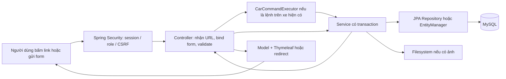
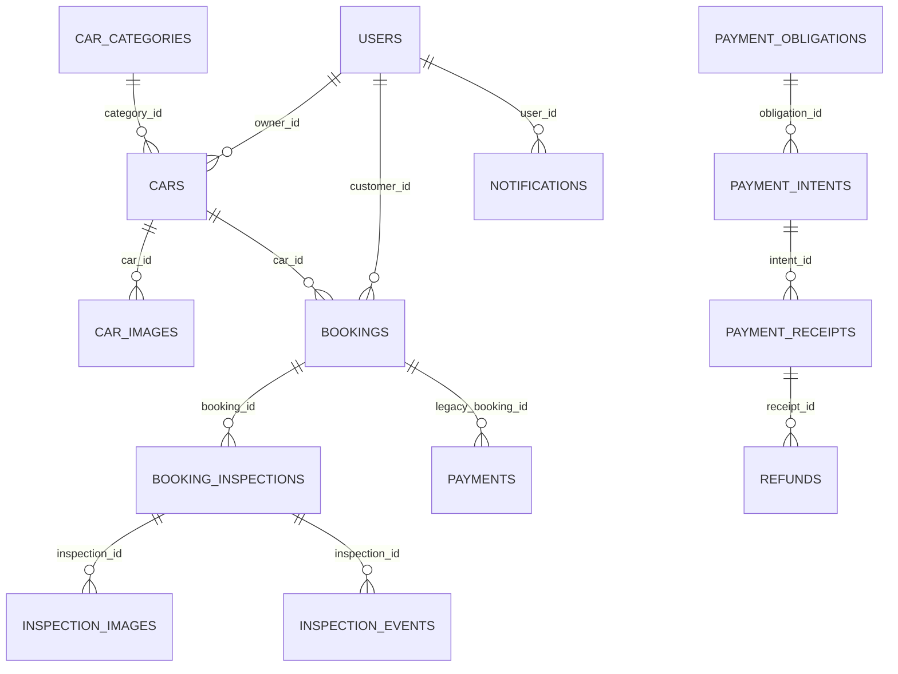

# Huy — toàn bộ màn hình, luồng xử lý và đường đi dữ liệu

Ngày đối chiếu: **2026-11-09**. Repo `C:\Users\Admin\Documents\hoc\Car`, nhánh `feat/phase5-profile-password`, HEAD `b829b05`, có nhiều thay đổi chưa commit. Phân tích này dùng **source trong working tree**, gồm file chưa được Git theo dõi; không chỉ dùng source tại HEAD.

Đây là phân tích tĩnh frontend/controller/service/repository/entity/schema. Chưa chạy lại ứng dụng, browser, SQL thực tế hoặc giao dịch ngân hàng. SQL bên dưới là diễn giải thao tác tương đương; không phải SQL log do Hibernate xuất ra. GitNexus chỉ có index của repo khác, chưa có CarRent, nên mọi đường gọi được kiểm tra trực tiếp trong source.

## 1. Phạm vi nào thực sự thuộc Huy?

Nguồn chính: [phân công ba thành viên](../plans/team-assignment.md), [Phase 6](../plans/phase-6-inspection.md), [P5.5–P5.6](../plans/phase-5-admin-polish.md).

| Phần việc | Bằng chứng | Cách hiểu trong báo cáo |
|---|---|---|
| Owner CRUD xe, ảnh listing, catalog công khai | Git author Huy, `a880f13` | Phần triển khai lịch sử của Huy; code hiện tại đã có cập nhật tích hợp |
| Tìm xe theo ngày, kiểm tra availability | `bc3f34f` | Phần triển khai lịch sử của Huy; lịch tháng hiện tại được giải thích theo working tree |
| Booking và notification ban đầu | `aab8035` | Huy có đóng góp lịch sử; notification hiện giao ducbinhnguyen07ars bảo trì |
| Payment entity/repository legacy P4.1 | `aab8035` | Giải thích đường legacy còn tồn tại; payment core mới do thanhmit phụ trách |
| Duyệt xe Admin ban đầu | `a880f13` | Huy có đóng góp lịch sử; Admin hiện giao ducbinhnguyen07ars bảo trì |
| P6.1–P6.13: model/policy, BEFORE/AFTER, 30/70, hợp đồng, nhận/trả, hủy, timeline | Phân công cho huy69332; `f8efe9e`, `3ee56f4`, `4a6af85`, `983e7c9`, `6de7526`, `705f320` | Mảng chính hiện tại của Huy; gọi queue/payment/subscription dùng chung |
| P5.5–P5.6: profile và đổi mật khẩu | Phân công + checkpoint P5.5/P5.6 | Code có trong working tree, gồm các file đang untracked; không coi tất cả đã nằm trong HEAD |

**Phân biệt author và phân công:** P6.1 được giao Huy trong tài liệu nhưng commit model/schema `94e51e6` ghi author `thanhmit`. Vì vậy không khẳng định mọi dòng Phase 6 do Huy tự viết. Git xác nhận tác giả commit, tài liệu xác nhận trách nhiệm; chúng không tự chứng minh pair programming hoặc human review.

Auth/login/register, queue engine, webhook/payout core thuộc thanhmit. Gói Owner, dashboard Owner/Home, quản trị user/finance/booking P5.4 thuộc ducbinhnguyen07ars. Báo cáo chỉ lần vào các phần đó khi cần giải thích đầu vào/đầu ra của chức năng Huy.

## 2. Frontend trong repo này hoạt động thế nào?

CarRent dùng **Spring MVC + Thymeleaf**, frontend nằm ở `src/main/resources/templates`, JavaScript ở `src/main/resources/static/js`.



- GET thường đọc DB → đặt dữ liệu vào `Model` → trả tên template → server render HTML.
- POST thường nhận form → chạy service → commit → redirect sang GET. Nếu validate lỗi, controller có thể render lại form ngay.
- `th:field="*{fullName}"` tạo trường HTML tên `fullName`; Spring bind nó vào DTO. `th:text` đưa dữ liệu backend ra HTML và escape nội dung.
- Principal là người dùng lấy từ session qua `@AuthenticationPrincipal`; `customerId`, `ownerId`, role, status, tổng tiền không lấy tùy ý từ hidden input.
- Form POST đi qua CSRF; với tích hợp Spring Security/Thymeleaf, CSRF được đưa vào form khi render. Backend vẫn kiểm tra quyền và trạng thái hiện tại trong DB.
- `JpaRepository.save()` trên entity mới dẫn tới INSERT. Entity đã được đọc và đang được JPA quản lý chỉ cần `set...()` trong transaction; khi flush/commit, Hibernate phát UPDATE. Cơ chế này gọi là **dirty checking**. Không có `save()` không có nghĩa là không ghi DB.
- `EntityManager.find/createQuery/createNativeQuery` cũng truy cập DB trực tiếp; không phải hàm nào cũng qua một repository riêng.
- Queue FIFO theo `carId` là hạ tầng dùng chung. Service mở transaction bên trong lệnh queue; không giữ transaction trong lúc đợi queue. Khóa DB vẫn cần để bảo vệ dữ liệu giữa các process/instance.

Nguồn: `config/SecurityConfig.java:21`, `concurrency/CarCommandExecutor.java:54`, `user/UserService.java:64`.

## 3. Danh sách đầy đủ màn hình trong phạm vi

Đếm theo URL/trạng thái tác vụ: **18 màn nghiệp vụ dùng 16 template**. Thêm/sửa xe dùng chung template; BEFORE/AFTER cũng dùng chung template. `/draft` là biến thể của màn biên bản, không đếm thành trang nghiệp vụ mới.

| Màn | URL GET | Controller.method | Template |
|---|---|---|---|
| Tìm/lọc xe | `/cars` | `CarController.list` | `cars/list.html` |
| Chi tiết xe, lịch bận | `/cars/{id}` | `CarController.detail` | `cars/detail.html` |
| Xe của Owner | `/owner/cars` | `OwnerCarController.list` | `owner/cars.html` |
| Đăng xe | `/owner/cars/new` | `OwnerCarController.newCar` | `owner/car-form.html` |
| Sửa xe, quản lý ảnh | `/owner/cars/{id}/edit` | `OwnerCarController.editCar` | `owner/car-form.html` |
| Danh sách duyệt xe Admin, đóng góp lịch sử | `/admin/cars` | `AdminCarController.list` | `admin/cars.html` |
| Chi tiết duyệt xe Admin, đóng góp lịch sử | `/admin/cars/{id}` | `AdminCarController.detail` | `admin/car-detail.html` |
| Đặt thuê | `/bookings/new?carId=...` | `BookingController.createForm` | `booking/create.html` |
| Đơn của Customer | `/bookings` | `BookingController.list` | `booking/list.html` |
| Chi tiết booking | `/bookings/{id}` | `BookingController.detail` | `booking/detail.html` |
| Đơn trên xe Owner | `/owner/bookings` | `OwnerBookingController.list` | `owner/bookings.html` |
| Quản lý một đơn của Owner | `/owner/bookings/{id}` | `OwnerBookingController.detail` | `owner/booking-detail.html` |
| Biên bản trước thuê | `/bookings/{bookingId}/inspections/BEFORE` hoặc thêm `/draft` | `InspectionController.view` | `inspection/detail.html` |
| Biên bản sau thuê và so sánh | `/bookings/{bookingId}/inspections/AFTER` hoặc thêm `/draft` | `InspectionController.view` | `inspection/detail.html` |
| Hồ sơ cá nhân | `/profile` | `ProfileController.view` | `profile/view.html` |
| Sửa hồ sơ | `/profile/edit` | `ProfileController.edit` | `profile/edit.html` |
| Đổi mật khẩu | `/profile/change-password` | `ProfileController.changePassword` | `profile/change-password.html` |
| Lịch sử thông báo, đóng góp lịch sử | `/notifications` | `NotificationController.list` | `notification/list.html` |

Các template `booking/fragments.html`, `fragments/header.html`, pagination/messages là phần ghép chung, không phải trang riêng. QR/kết quả/hoàn tiền là màn payment dùng chung mà luồng thuê chuyển sang; chúng không được tính vào 18 màn sở hữu ở trên.

## 4. Xe: từ đăng xe đến tìm thấy trên catalog

### 4.1. Mở danh sách xe của Owner

Đi từ menu Owner → `/owner/cars` → `OwnerCarController.list()`.

Controller chuẩn hóa `page/size`, rồi gọi:

1. `CarService.findCarsByOwner(ownerId, pageable)` → `CarRepository.findByOwnerId()` → SELECT `cars WHERE owner_id=?`, lấy trang theo ID giảm dần.
2. `CarImageRepository.findFirstImagesByCarIds()` → SQL lấy ảnh có ID nhỏ nhất trên mỗi xe → map `carId → imageUrl` làm thumbnail.
3. `BookingRepository.findCarIdsWithHistory()` → SELECT các xe đã có booking, để UI biết xe nào có lịch sử.
4. `CarService.countPublicCars()` / `countPendingCars()` → COUNT xe công khai/chờ duyệt. Số công khai dùng cùng predicate với catalog.
5. Nếu có service gói, `SubscriptionService.overview(owner)` bổ sung gói/hạn/quota; đó là dữ liệu tích hợp từ module gói.

Kết quả đi vào model `cars/page/thumbnails/carsWithHistory/publicCount/pendingCount/subscription` → `owner/cars.html`. GET này không tạo/sửa/xóa xe.

### 4.2. Đăng xe mới

**Mở form:** nút Đăng thêm xe → GET `/owner/cars/new` → `newCar()` → `carForm()` → `CarCategoryRepository.findAllByOrderByIdAsc()` lấy danh mục → `owner/car-form.html`.

**Dữ liệu gửi:** `brand`, `model`, `categoryId`, `manufactureYear`, `licensePlate`, `color`, `seatCount`, `transmission`, `fuelType`, `description`, `pricePerDay`, `province`, `district`, `addressDetail` và file `images`. Form dùng `multipart/form-data`.

```text
owner/car-form.html
  → POST /owner/cars/new
  → OwnerCarController.create(@Valid CarForm, images, owner)
  → CarService.createCar(form, images, owner)
  → requireOwner() / SubscriptionPolicy / validateAndResolveCategory()
  → CarRepository.save(new Car)
  → StorageService.store(file) + CarImageRepository.save(new CarImage)
  → NotificationService.notify(Admin...)
  → commit → redirect:/owner/cars
```

**DB thực hiện:**

- SELECT `users`: lấy đúng principal, kiểm tra ACTIVE OWNER; khi mutation lấy khóa user.
- Nếu bật subscription: khóa Owner/entitlement, kiểm tra còn hạn và suất đăng; COUNT xe ACTIVE có approval PENDING/APPROVED. Xe đang chờ duyệt cũng chiếm quota.
- SELECT `car_categories` theo `categoryId`, validate form/file.
- INSERT `cars` với `owner_id` lấy từ principal, dữ liệu đã trim; `approval_status=PENDING`, `listing_status=ACTIVE`.
- Với mỗi ảnh: lưu bytes vào thư mục `uploads/`; INSERT `car_images(car_id,image_url)`. DB lưu đường dẫn `/uploads/<uuid>.<ext>`, không lưu bytes ảnh.
- SELECT Admin qua `UserRepository.findByRole(ADMIN)`; INSERT `notifications` loại `CAR_PENDING_APPROVAL`.

Validation lỗi → render lại form, không redirect thành công. Nếu transaction rollback sau upload, callback dọn file mới đã lưu. **Tạo xe không đi qua queue theo ID xe** vì chưa có carId; khóa Owner và quota bảo vệ bước admission.

Nguồn: `OwnerCarController.java:51`, `CarService.java:235`, `CarService.java:498`, `StorageService.java:22`.

### 4.3. Sửa thông tin xe và thêm ảnh

Nút sửa từ `owner/cars.html` → GET `/owner/cars/{id}/edit` → `editCar()` → `CarService.getOwnedCar()` → `UserRepository.findById()` và `CarRepository.findById()` → đối chiếu `car.owner.id` → `CarForm.from(car)` + danh mục + ảnh → form cũ được điền sẵn.

Gửi POST cùng URL → `OwnerCarController.update()` → kiểm tra ownership trước cả trường hợp render lỗi → `CarCommandExecutor.execute(carId, ...)` → `CarService.updateCar()`.

Service khóa Owner/xe bằng `ownedCarForUpdate()` → `lockedCarWithOwner()` → `CarRepository.findByIdForUpdate()`, đọc lại entity hiện tại → `applyForm()` → `cars.save(car)` → **UPDATE cars**; ảnh thêm mới theo đường lưu file + **INSERT car_images** ở trên.

Giá mới chỉ đổi `cars.price_per_day`; không đổi `bookings.price_per_day_snapshot/total_amount` đã có. `applyForm()` hiện không tự reset approval về PENDING và không tự sửa owner/status từ dữ liệu form. Thành công → `/owner/cars`.

### 4.4. Xóa một ảnh, ẩn xe, đăng lại và xóa xe

| Nút/POST | Controller → service | Repository/DB và file |
|---|---|---|
| `/owner/cars/{id}/images/{imageId}/delete` | `deleteImage → CarService.deleteImage` qua queue | Khóa xe; `images.findByIdAndCarId(imageId,carId)` chống xóa ảnh xe khác; `images.delete` → DELETE `car_images`; xóa file **sau commit**; redirect form edit |
| `/owner/cars/{id}/deactivate` | `deactivate → deactivateCar` qua queue | Khóa xe, set `listingStatus=INACTIVE` → UPDATE `cars`; giữ booking/ảnh/lịch sử |
| `/owner/cars/{id}/activate` | `activate → activateCar → activateListing` qua queue | Kiểm tra điều kiện gói/quota nếu bật; set ACTIVE → UPDATE `cars`; xe REJECTED khi có cơ chế resubmission được đưa về PENDING, xóa rejection reason và notify Admin |
| `/owner/cars/{id}/delete` | `delete → deleteCar` qua queue | `BookingRepository.findHistoryForUpdate`; có **bất kỳ booking lịch sử** thì chặn. Nếu chưa có: `images.findByCarIdForUpdate`, DELETE ảnh metadata, DELETE `cars`; xóa file sau commit |

Khi subscription tắt, `activateListing()` yêu cầu APPROVED trước khi đăng lại. Ẩn/đăng lại xe không xóa đơn thuê đã có. Các thao tác mutation kiểm tra lại ACTIVE/role/ownership trong service sau khi đợi queue.

### 4.5. Admin duyệt/từ chối xe — phần lịch sử của Huy

Admin mở `/admin/cars` → `AdminCarController.list()` → `CarService.searchCarsForAdmin(q,approval,listing,pageable,admin)` → kiểm tra Admin hiện tại → `CarRepository.findAll(Specification,pageable)` + ảnh đầu + số pending → `admin/cars.html`.

Bấm xe → GET `/admin/cars/{id}` → `detail()` → `CarService.getCarForAdmin()` → SELECT `users/cars/car_images` → `admin/car-detail.html`.

| Action trên trang chi tiết | Đường gọi | Ghi DB |
|---|---|---|
| POST `/{id}/approve` | `approve → queue → CarService.approveCar → pendingCarForAdmin` | Khóa Admin/Owner nếu cần/Car; chỉ xe PENDING. UPDATE approval=APPROVED, rejection_reason=NULL; INSERT thông báo `CAR_APPROVED` cho Owner |
| POST `/{id}/reject`, `reason` | `reject → queue → rejectCar` | Validate lý do 1–500 ký tự; UPDATE approval=REJECTED, rejection_reason; INSERT `CAR_REJECTED` |
| POST `/{id}/deactivate` | `deactivate → queue → deactivateCarForAdmin` | UPDATE listing=INACTIVE |
| POST `/{id}/activate` | `activate → queue → activateCarForAdmin → activateListing` | Cùng guard đăng lại/quota/gói; UPDATE listing, có thể resubmit |

Các URL trên có tiền tố `/admin/cars`. Thành công quay lại `/admin/cars/{id}`. Reject lỗi nghiệp vụ có thể render lại chi tiết và giữ reason. APPROVED và ACTIVE là **hai cột độc lập**; được duyệt chưa đủ công khai nếu xe ẩn hoặc gói hết hạn khi gate gói bật.

### 4.6. Tìm/lọc xe công khai

Từ Home/menu Tìm xe → `cars/list.html`. Form GET gửi `q`, `categoryId`, `province`, `minPrice`, `maxPrice`, `seatCount`, `transmission`, `fuelType`, `startDate`, `endDate`, `sort`, cùng phân trang.

```text
GET /cars?...filters...
  → CarController.list(@Valid CarSearchCriteria, page, size)
  → CarService.searchPublicCars(criteria,pageable)
  → SubscriptionPolicy.publicCars()
  → CarSpecifications.* + availableBetween(start,end)
  → CarRepository.findAll(spec,pageable)
  → MySQL SELECT/COUNT cars + subquery bookings/owner_subscriptions nếu cần
  → lấy categories + thumbnails → Model → cars/list.html
```

Predicate cơ bản: `approval_status='APPROVED' AND listing_status='ACTIVE'`. Nếu bật subscription, thêm EXISTS entitlement của đúng Owner còn hạn. Các filter nối bằng AND; q so brand/model bằng LIKE đã escape wildcard. Sort chỉ newest/priceAsc/priceDesc; size bị chặn tối đa 50.

Điều kiện loại xe bận tương đương:

```sql
NOT EXISTS (
  SELECT 1 FROM bookings b
  WHERE b.car_id = c.id
    AND b.status IN ('PENDING','CONFIRMED')
    AND b.start_date < :endDate
    AND b.end_date > :startDate
)
```

Khoảng thuê là **[startDate, endDate)**. Đơn trả ngày 12 và đơn nhận ngày 12 không trùng theo lịch. Pending cũng chặn lịch; xem danh sách không giữ chỗ mới và không tự expire booking.

Controller thêm `cars/page/categories/thumbnails/criteria/today` → render cards. Link chi tiết giữ ngày đã chọn. Ngày sai có thể trả HTTP400 với trang tìm xe rỗng và lỗi; lỗi filter ngoài ngày trả màn 400.

### 4.7. Chi tiết xe và lịch tháng

GET `/cars/{id}?startDate=...&endDate=...` → `CarController.detail()` → `CarService.getPublicCar(id,principal)` → `CarRepository.findById()` + `isPublicListing()` → `CarImageRepository.findByCarIdOrderByIdAsc()`.

- Xe public: mọi người xem được; controller thêm `busyDateRanges=CarService.busyDateRanges()` → `BookingRepository.findBusyDateRanges(carId,today)`.
- Query chỉ trả start/end của booking PENDING/CONFIRMED còn phần tương lai (`end_date>today`); không trả tên khách, số tiền hay ghi chú.
- Xe không public: chỉ Admin ACTIVE hoặc đúng Owner ACTIVE được preview; người khác nhận not found. Preview không có nút đặt thuê công khai.
- Template nhúng ngày bận vào `data-busy-range`. `car-availability.js` đọc dữ liệu HTML, dựng lịch, kiểm tra overlap, cập nhật link `/bookings/new?carId=...&startDate=...&endDate=...`.
- JavaScript lịch **không gọi API availability mới** và không ghi DB. Lịch là snapshot lúc GET; backend bắt buộc kiểm tra lại khi POST booking.

Nguồn: `CarController.java:35`, `CarService.java:159`, `BookingRepository.java:16`, `static/js/car-availability.js:13`.

## 5. Booking: tạo đơn, danh sách và xem tiến độ

### 5.1. Mở form đặt thuê

Từ chi tiết xe bấm Đặt thuê → GET `/bookings/new?carId=...&startDate=...&endDate=...` → `BookingController.createForm()` → `populateForm()`.

`BookingService.getCustomerForBooking()` → `UserRepository.findById()` kiểm tra ACTIVE CUSTOMER. `CarService.getPublicCar(carId,null)` buộc xe thực sự public, không dùng quyền preview của Owner/Admin để đặt. Query ảnh lấy thumbnail. Model gồm `customer/car/thumbnail/today/form` → `booking/create.html`.

Form chỉ gửi `carId`, `startDate`, `endDate`, `customerNote`. Tên/điện thoại hiển thị từ tài khoản hiện tại; địa điểm nhận được backend ghép từ thông tin xe. `booking-price.js` tính số ngày/tiền ước tính bằng BigInt để hiển thị, không quyết định giá lưu DB.

### 5.2. Gửi đơn đặt thuê — một ví dụ đi xuyên các lớp

```text
booking/create.html: POST /bookings
  carId=42, startDate=2026-11-15, endDate=2026-11-18, customerNote=...
  → BookingController.create(BookingCreateForm, principal)
  → CarService.getPublicCar(42,null)
  → CarCommandExecutor.execute(42,...)
  → BookingService.createBooking(form,principal) [transaction]
  → UserRepository.findById(customer trong session)
  → SubscriptionPolicy.lockCarOwner / requireActive nếu bật
  → CarRepository.findByIdForUpdate(42)
  → BookingRepository.findConflictsForUpdate(42,start,end)
  → BookingRepository.save(new Booking)
  → NotificationService.notify(owner,...BOOKING_CREATED)
  → COMMIT → redirect:/bookings/{bookingId}
```

Backend validate ngày nhận từ hôm nay, ngày trả sau ngày nhận; dữ liệu form/ghi chú; xe APPROVED/ACTIVE; subscription còn hạn nếu gate bật. Luồng mới yêu cầu cả advance và balance handler được bật, Owner ACTIVE và customer hiện tại còn quyền.

**Thao tác DB:** SELECT/lock `users`, `cars`, booking trùng; INSERT `bookings`; INSERT `notifications`. `CarRepository.findByIdForUpdate()` là SELECT dưới khóa ghi, không phải UPDATE xe.

Giả sử DB có giá 800.000/ngày và thuê 3 ngày: backend tính `Math.multiplyExact(800000,3)=2400000`, lưu `price_per_day_snapshot=800000`, `total_amount=2400000`, địa chỉ snapshot, customer_id/car_id/ngày/note, `status=PENDING`. Nếu workflow bật lưu `workflow_version=VIETQR_V1`, `inspection_required=true`; nếu tắt tạo LEGACY.

Không tin tổng tiền từ client. Giá xe đổi sau này không sửa snapshot booking. Lịch xem trên UI có thể cũ; queue + khóa Car + query overlap ở POST mới quyết định có tạo đơn hay không. Bất kỳ lỗi bắt buộc nào trong transaction làm rollback, không tạo booking mà thiếu notification theo đường code này.

Nguồn: `BookingController.java:82`, `BookingService.java:252`, `BookingRepository.java:22`.

### 5.3. Customer xem danh sách đơn

GET `/bookings` → `BookingController.list()` → `BookingService.findBookingsForCustomer()` → `requireCustomer()` → `BookingRepository.findByCustomerId(principal.id,pageable)` → SELECT `bookings WHERE customer_id=?` + trang/count + thumbnails → `booking/list.html`.

Chỉ thấy đơn của người đang đăng nhập; client không truyền customerId để đổi scope. List chủ yếu hiển thị thông tin/chuyển sang chi tiết; mutation đặt ở trang detail.

### 5.4. Owner xem danh sách đơn trên xe mình

GET `/owner/bookings` → `OwnerBookingController.list()` → `BookingService.findBookingsForOwner()` → `requireOwner()` → `BookingRepository.findByCarOwnerId()` → SELECT booking JOIN car, lọc `cars.owner_id=principal.id` → thumbnails/model → `owner/bookings.html`.

Phân biệt: customer xem `customer_id`; Owner xem chủ của `car_id`, không dựa vào người tạo booking là Owner.

### 5.5. Màn chi tiết Customer và Owner lấy những gì?

GET `/bookings/{id}` → `BookingController.detail()`; GET `/owner/bookings/{id}` → `OwnerBookingController.detail()`.

Hai controller cùng gọi `BookingService.getBookingForView()` → SELECT `users` kiểm tra ACTIVE/current role → `BookingRepository.findById()`. Người xem phải là đúng Customer của đơn, đúng Owner của xe hoặc Admin. Biết ID không đủ quyền.

Sau đó ghép:

| Model/dữ liệu | Hàm/repository | DB/ý nghĩa |
|---|---|---|
| `booking/car/days/thumbnail` | Booking + `CarImageRepository.findByCarIdOrderByIdAsc` | `bookings/cars/car_images`, ngày/giá snapshot và thông tin xe hiện tại |
| `timeline` | `BookingTimeline.view()` | booking milestones, inspection, obligations, receipts, refunds; xem mục 10 |
| `cancellationQuote` | `BookingService.cancellationQuote → RentalPolicy.cancellation` | Đọc snapshot/mốc tiền, tính dự kiến theo Clock; không tạo refund |
| `hasPaid` legacy | `PaymentRepository.existsByBookingIdAndStatus(PAID)` | Đọc bảng `payments` cũ; không dùng thay cho 30/70 của luồng mới |
| BEFORE/AFTER đã gửi | `BookingInspectionRepository.findByBookingIdAndPhase` | Không công khai bản DRAFT cho bên còn lại |
| 70% và hạn nợ | `PaymentObligationRepository.findByBusinessKey('BOOKING:id:BALANCE')` | obligation của đúng đơn |
| Link QR gần nhất của Customer | `PaymentIntentRepository.findFirstByObligationBusinessKeyOrderByCreatedAtDescIdDesc` | intent ADVANCE/BALANCE gần nhất; GET không tự sinh QR |
| Đã báo chưa nhận xe | `InspectionService.getView(AFTER).events()` | Tìm event RETURN_NOT_RECEIVED |
| `handoverDateAllowed` trên Owner | Clock → ngày Asia/Ho_Chi_Minh | Chỉ gợi ý UI; service kiểm tra lại khi POST |

Customer nhận `booking/detail.html`; Owner nhận `owner/booking-detail.html` có thêm confirm/reject/cancel/handover/return. GET chi tiết chỉ đọc dữ liệu; không tự công nhận đã nhận tiền/giao xe.

## 6. Luồng mới VIETQR_V1: BEFORE → 30% → ký hợp đồng/giao xe

### 6.1. Owner chấp nhận hoặc từ chối yêu cầu

**Chấp nhận:** `owner/booking-detail.html` → POST `/owner/bookings/{id}/confirm` → `OwnerBookingController.confirm()` → queue(carId) → `BookingService.confirmBooking()` → `pendingBookingForOwner()` khóa Car/Booking và kiểm tra ACTIVE OWNER/ownership.

- VIETQR_V1: set `owner_accepted_at=now`; **status vẫn PENDING**; INSERT notification `BOOKING_OWNER_ACCEPTED` cho Customer; redirect tới `/bookings/{id}/inspections/BEFORE` để lập biên bản.
- LEGACY: set `status=CONFIRMED`, notify Customer; quay về chi tiết Owner.
- Chấp nhận lại trong điều kiện cho phép không tạo thêm mốc nghiệp vụ.

**Từ chối:** POST `/owner/bookings/{id}/reject`, gửi `reason` → `reject()` → queue → `BookingService.rejectBooking()` → khóa/kiểm tra pending → validate reason 1–500 ký tự → UPDATE `bookings.status=REJECTED`, `owner_note=reason`; INSERT notification Customer. VIETQR_V1 đã đồng ý BEFORE/mở trả trước thì không dùng reject này nữa.

### 6.2. Mở và lưu nháp BEFORE

Owner bấm Lập/xem biên bản → GET `/bookings/{bookingId}/inspections/BEFORE` → `InspectionController.view()` → `InspectionService.getView()`.

Service SELECT user hiện tại, booking được hỗ trợ (`VIETQR_V1`, inspection required), `BookingInspectionRepository.findByBookingIdAndPhase()`, ảnh và events. **GET chưa có report chỉ dựng view rỗng, không INSERT nháp.** Nháp BEFORE chỉ đúng Owner được xem; kể cả Customer/Admin cũng không xem nháp của Owner.

Form gửi 5 trường: `conditionNote`, `visibleDamage`, `odometerKm`, `energyPercent`, `accessoriesNote`.

```text
inspection/detail.html
  → POST /bookings/{id}/inspections/BEFORE/draft
  → InspectionController.save(@Valid InspectionForm)
  → queue(carId)
  → InspectionService.saveDraft(id,BEFORE,form,owner)
  → CarRepository.findByIdForUpdate
  → BookingRepository.findByIdForUpdate
  → BookingInspectionRepository.findForUpdate(id,BEFORE)
  → reports.save(report)
  → INSERT nháp mới hoặc UPDATE nháp đang có
  → redirect cùng màn /draft
```

Nháp được phép thiếu trường nhưng vẫn kiểm tra độ dài/biên số; đã gửi thì không sửa nội dung gốc. Metadata gồm booking_id, phase=BEFORE, author_id=Owner, status=DRAFT. Không cho form sửa status/author/booking qua mass assignment; binder chỉ cho 5 trường trên.

### 6.3. Upload/xóa/xem ảnh biên bản

**Upload:** POST `/bookings/{id}/inspections/{phase}/images`, multipart `images` → `InspectionController.upload()` → queue → `InspectionService.addImages()` → khóa booking/report/ảnh → `mutableReport()` buộc đúng tác giả, đúng nháp, đúng cửa sổ sửa → `InspectionStorageService.store()` → `InspectionImageRepository.save()`.

- Trước tiên phải lưu nháp để có report ID.
- Mỗi lần 1–4 file, tổng tối đa 10 ảnh/report.
- Mỗi ảnh tối đa 5 MiB, JPEG/PNG; đọc/giải mã nội dung thực bằng ImageIO, giới hạn 20 triệu pixel.
- Bytes vào thư mục mặc định `private-uploads/inspections`; DB INSERT `inspection_images(inspection_id,storage_key,media_type,size_bytes)`.
- Rollback DB → dọn file mới. Đây là kho private, khác ảnh listing `/uploads/**`.

**Xóa ảnh nháp:** POST `.../{phase}/images/{imageId}/delete` → `InspectionController.delete()` → queue → `InspectionService.deleteDraftImage()` → `images.findForUpdate(reportId)` và lọc đúng imageId của report → DELETE `inspection_images`; chỉ xóa file sau commit. Không xóa bằng chứng của report đã gửi.

**Xem ảnh:** `` hoặc link mở ảnh → GET `.../{phase}/images/{imageId}` → `InspectionController.image()` → `InspectionService.readImage()` → `getView()` kiểm tra quyền → `images.findByInspectionIdAndId()` → `storage.read(storageKey)` → trả bytes với đúng media type, `Cache-Control:no-store`, `nosniff`.

Ảnh không đọc trực tiếp từ public URL. Controller kiểm tra đồng thời booking/phase/report/image và người xem mỗi lần truy cập.

### 6.4. Owner gửi BEFORE

Nút Gửi biên bản → POST `.../BEFORE/submit` → `InspectionController.submit()` → queue → `InspectionService.submitBefore()`.

Điều kiện: đúng Owner ACTIVE, booking PENDING, Owner đã chấp nhận, Customer chưa chấp nhận BEFORE, chưa giao xe; report nháp của Owner có đủ **5 trường và 4–10 ảnh**.

DB: UPDATE `booking_inspections.status=SUBMITTED`, `submitted_at=now`; INSERT `inspection_events(action=SUBMITTED,actor_id=Owner)`; INSERT notification `INSPECTION_SUBMITTED` cho Customer. Commit cùng nhau; redirect tới màn BEFORE.

Từ đây Customer và Owner của đơn, Admin ACTIVE được đọc bản đã gửi. Báo cáo gốc/ảnh giữ nguyên; chỉnh sửa sau gửi bằng event bổ sung, không overwrite report.

### 6.5. Customer bất đồng, Owner bổ sung

| Action | Controller → service | DB |
|---|---|---|
| Customer POST `.../BEFORE/dispute`, `note` | `InspectionController.dispute → InspectionService.disputeBefore → appendBeforeEvent` qua queue | Validate 1–2000 ký tự; INSERT `inspection_events.DISPUTED`; UPDATE report.status=DISPUTED; notify Owner |
| Owner POST `.../BEFORE/addendum`, `note` | `addendum → appendBeforeAddendum → appendBeforeEvent` qua queue | INSERT `inspection_events.ADDENDUM`; giữ nguyên bằng chứng gốc, notify Customer |

Chỉ áp dụng BEFORE đã gửi/chưa được đồng ý, booking còn beforeOpen. POST addendum/dispute cho phase AFTER bị từ chối; bất đồng AFTER được ghi qua bước nhận xe ở mục 7.3.

### 6.6. Customer đồng ý BEFORE và mở QR 30%

Nút đồng ý ở `inspection/detail.html` → POST `/bookings/{id}/accept-before` → `BookingController.acceptBefore()` → lấy carId từ booking có quyền → queue → `BookingService.acceptBefore()`.

Service khóa Car/Booking, đọc lại Customer ACTIVE và ownership; buộc VIETQR_V1, PENDING, ownerAcceptedAt có giá trị, chưa giao xe.

1. `RentalPolicy.advance(total)` lấy floor(30% tổng); `balance(total)=total-advance`, giữ đúng tổng khi làm tròn số nguyên VND.
2. `PaymentObligationRepository.findByBusinessKeyForUpdate('BOOKING:id:ADVANCE')`; chưa có → `saveAndFlush()` INSERT `payment_obligations`: purpose ADVANCE, subject BOOKING/id, payer Customer, collector đúng Owner, amount_due=30%, status OPEN.
3. `PaymentIntentTransactions.openForLockedBooking(route,principal)` → payment core kiểm tra payer/parties/pilot/kênh SePay của Owner và cấu hình khả dụng; `PaymentIntentRepository.saveAndFlush()` INSERT intent mới hoặc tái dùng ACTIVE hợp lệ; hạn thường 900 giây.
4. `InspectionService.acceptBeforeLocked()` → kiểm tra lại report và ảnh → UPDATE report.status=ACCEPTED; INSERT event BEFORE_ACCEPTED.
5. UPDATE booking `before_accepted_at`, `advance_amount`, `balance_amount`, `hold_expires_at`; obligation `due_at=intent.expiresAt`.
6. Commit tất cả rồi redirect `/payment/intents/{id}`.

**Atomic:** không có trạng thái đã ACCEPTED nhưng tạo QR thất bại mà vẫn commit nửa chừng. Bấm lặp tái dùng lần hợp lệ; không gia hạn hold đã chốt. Booking lúc này vẫn PENDING và chưa có `advance_paid_at`.

Nguồn: `BookingService.java:206`, `InspectionService.java:43`, `PaymentIntentTransactions.java:52`.

### 6.7. Nhận tiền 30%: callback từ payment core vào rental

Trang QR GET → `PaymentController.checkout()` → `PaymentObligationService.status()` → `PaymentIntentTransactions.status()` → SELECT dữ liệu hiện có → `payment/checkout.html` hoặc `payment/result.html`. JavaScript polling GET `.../status` chỉ đọc; không có nút frontend tự xác nhận đã trả tiền.

Đường **bất đồng bộ từ ngân hàng**:

```text
SePay → POST /webhooks/sepay/{channelId}
  → SePayWebhookController.receive
  → SePayWebhookService.receive → xác minh → ghi webhook_inbox
  → worker payment gọi ReceiptProcessor.process(inboxId)
  → InboxWorkService.claim
  → PaymentRoutes.execute qua queue(carId)
  → ReceiptApplicationService.apply [transaction]
  → RentalPaymentHandler.lockSubject [khóa Car/Booking]
  → khóa obligation/intent/inbox; kiểm tra và lưu receipt
  → RentalPaymentHandler.apply(receiptId)
  → BookingService.applyAdvance(receiptId)
  → commit receipt + tiền đã phân bổ + booking + notification + inbox
```

Payment core dùng `PaymentReceiptRepository.findByChannelIdAndProviderTransactionId()` để chống xử lý lại cùng giao dịch; `saveAndFlush()` ghi `payment_receipts`. Receipt đúng số tiền/đúng kênh/đúng chủ thể/đúng hạn mới được phân bổ vào ADVANCE và làm obligation SETTLED, intent RECEIVED.

`BookingService.applyAdvance()` kiểm tra các entity đang dưới khóa, receipt APPLIED/amount allocated đủ, obligation/intent đúng đơn và tiền; rồi UPDATE `bookings.status=CONFIRMED`, `advance_paid_at=receipt.creditedAt`. INSERT notification cho Customer và Owner. **Đây mới là bước xác nhận đặt xe của luồng mới.**

Sai số tiền → receipt/inbox REVIEW_REQUIRED, chưa xác nhận rental. Nhận trùng hoặc sau khi hold đã kết thúc → `RefundService.request()` theo DUPLICATE_PAYMENT/LATE_ADVANCE/SYSTEM_CONFIRMATION_DELAY phù hợp; không giành lại lịch của đơn khác.

### 6.8. Hết 15 phút hoặc hủy yêu cầu trả trước

Worker payment tìm intent đến hạn → `ReceiptProcessor.expire()` → queue → `ReceiptApplicationService.expire()` → khóa subject/obligation/intent → UPDATE intent EXPIRED → `RentalPaymentHandler.expire()` → `BookingService.expireHold()`.

`expireHold()` chỉ chốt khi booking vẫn PENDING/chưa nhận advance/chưa giao xe, đã đến hold deadline và obligation chưa settled. UPDATE booking EXPIRED, obligation EXPIRED, notify hai bên. Query availability không còn coi EXPIRED là chiếm lịch.

Từ QR, POST `/payment/intents/{id}/cancel` → `PaymentController.cancel()` → `PaymentObligationService.cancelAttempt()` → queue → `PaymentIntentTransactions.cancel()` → `RentalPaymentHandler.cancel()` → `BookingService.cancelAdvanceLocked()` → `endUnpaidAdvance()`.

DB: intent ACTIVE → CANCELLED, obligation → CANCELLED, booking → CANCELLED + cancelled_at/fee=0/reason; chưa nhận tiền thì chưa tạo refund. Tiền tới sau được xử lý qua receipt/refund riêng.

### 6.9. Owner xác nhận hợp đồng và giao xe

`owner/booking-detail.html` có checkbox `contractSigned=true` → POST `/owner/bookings/{id}/handover` → `OwnerBookingController.handover()` → queue → `BookingService.confirmHandover()`.

Service kiểm tra Owner hiện tại/ownership; VIETQR_V1; CONFIRMED; BEFORE đã ACCEPTED; advance đủ/SETTLED đúng Customer→Owner; ngày Việt Nam nằm trong `[startDate,endDate)`; checkbox true.

`BookingRepository.findOutstandingCustodyForUpdate(carId,bookingId)` chặn nếu xe còn được giao cho đơn khác chưa nhận lại, kể cả lịch đặt nhìn có vẻ không trùng.

`InspectionService.confirmPickupLocked()` → khóa BEFORE ACCEPTED và INSERT event PICKUP_CONFIRMED. Sau đó UPDATE booking `contract_confirmed_by=Owner`, `contract_confirmed_at=now`, `vehicle_received_at=now`, notify Customer. **Status vẫn CONFIRMED**; UI hiện “Đang thuê” dựa vào mốc giao/nhận lại, không có enum IN_PROGRESS riêng.

Hợp đồng ở đây được ký ngoài ứng dụng; checkbox lưu xác nhận của Owner, không phải luồng ký số/file PDF. Từ mốc giao xe, cả hai bên bị chặn hủy.

## 7. AFTER → nhận xe thực tế → nghĩa vụ 70% → hoàn tất

### 7.1. Customer lập/gửi AFTER và so sánh

Customer từ booking detail → `/bookings/{id}/inspections/AFTER` → cùng `InspectionController.view()` / `InspectionService.getView()` / template `inspection/detail.html`.

AFTER nháp chỉ đúng Customer được xem/sửa, cần booking đã giao xe (`vehicle_received_at!=null`) và chưa nhận lại (`vehicle_returned_at==null`). Lưu nháp/upload/xóa ảnh dùng đúng endpoints/hàm của mục 6.2–6.3 với phase AFTER và author Customer.

`InspectionController.render()` còn đọc `BookingInspectionRepository.findByBookingIdAndPhase(BEFORE)`; bản BEFORE đã gửi được lấy qua `InspectionService.getView()` rồi đặt `beforeInspection`. Template đặt 5 trường và ảnh BEFORE cạnh AFTER để đối chiếu. Đây là SELECT + render; không tự tính phạt theo km/pin/hư hỏng.

Nút Gửi AFTER → POST `.../AFTER/submit` → `InspectionController.submit()` chọn `InspectionService.submitAfter()` → queue/khóa → validate 5 trường/4–10 ảnh → UPDATE report SUBMITTED/submitted_at, INSERT SUBMITTED event của Customer, INSERT notification `INSPECTION_AFTER_SUBMITTED` cho Owner.

**Gửi AFTER chưa có nghĩa là đã trả xe thực tế**: chưa ghi vehicle_returned_at, chưa tạo BALANCE, chưa hoàn tất booking.

### 7.2. Sau một giờ Owner chưa nhận xe

Khi scheduler rental được bật, `RentalDeadlineConfiguration.Tick.scan()` chạy mỗi 30 giây → `RentalDeadlineJob.scan()` → `BookingRepository.findAfterReturnReminderCandidates()` lấy đơn AFTER đã gửi ≥1 giờ, chưa return và chưa đánh dấu đã nhắc.

Job đưa công việc qua executor/queue theo carId → `BookingService.remindAfterReturn()` → `InspectionService.remindAfterReturnLocked()` kiểm tra hiện trạng một lần nữa → UPDATE `bookings.after_reminder_sent_at`; INSERT notification cho Owner và Admin.

Không tự nhận xe, không tự tạo 70% và không tự giải phóng custody. Mốc đã nhắc nằm DB nên restart không tự làm mất dấu đã gửi. Query discovery/queue trong RAM chỉ phục vụ lập lịch.

### 7.3. Owner xác nhận nhận lại xe — ba lựa chọn

Trang Owner detail có form `decision`, `note` → POST `/owner/bookings/{id}/return` → `OwnerBookingController.confirmReturn(@Valid ReturnReceiptForm)` → queue → `BookingService.confirmReturn()`.

Service khóa Car/Booking, đọc lại Owner ACTIVE; buộc luồng mới CONFIRMED, đã giao xe và thời điểm hiện tại không trước handover. Phải có AFTER hợp lệ đã gửi đúng Customer. `InspectionService.confirmReturnLocked()` khóa report và kiểm tra evidence.

| decision | Biên bản/event | Booking | Tài chính |
|---|---|---|---|
| `NOT_RECEIVED` | INSERT RETURN_NOT_RECEIVED; giữ report SUBMITTED | Chưa set vehicle_returned_at; tiếp tục đang thuê | Không tạo nghĩa vụ 70% |
| `RECEIVED_ACCEPTED` | UPDATE AFTER ACCEPTED; INSERT RETURN_CONFIRMED | Set vehicle_returned_at=now | Tạo BALANCE đúng 70%, hạn now+3600 giây |
| `RECEIVED_DISPUTED` | Bắt buộc note; UPDATE AFTER DISPUTED; INSERT DISPUTED event | Vẫn set vehicle_returned_at=now | Vẫn tạo BALANCE đúng 70%, hạn now+3600 giây |

Tạo BALANCE: `PaymentObligationRepository.findByBusinessKeyForUpdate('BOOKING:id:BALANCE')`; chưa có → `saveAndFlush()` INSERT obligation subject BOOKING/id, payer Customer, collector đúng Owner, amount_due=`booking.balance_amount`, status OPEN, due_at=giờ nhận+1h. Có rồi phải khớp snapshot/mốc; không đẩy hạn thêm.

BALANCE được tạo/khóa trước khóa inspection; report sai làm rollback cả obligation vừa tạo. Event + physical return + debt + notification commit cùng nhau. Replay cùng quyết định đã nhận không nhân đôi obligation/đẩy giờ nhận. Đã nhận rồi không đổi thành chưa nhận hoặc quyết định khác.

Bất đồng giữ lịch sử bằng chứng; không tự cộng phụ phí, không giữ xe trong trạng thái chưa trả chỉ vì có tranh luận. Enum RESOLVED có trong model nhưng không có endpoint resolve tùy ý ở controller inspection đang xét.

### 7.4. Customer mở QR 70%

Sau khi Owner nhận thực tế, Customer detail có `balanceObligation` và nút thanh toán:

```text
booking/detail.html
  → POST /payment/obligations/{id}/attempts
  → PaymentController.open
  → PaymentObligationService.openAttempt
  → PaymentRoutes.obligation → execute(queue theo carId)
  → PaymentIntentTransactions.open
  → RentalBalancePaymentHandler.lockSubject
  → openLocked → kiểm tra payer/kênh/pilot/nợ
  → PaymentIntentRepository.saveAndFlush hoặc tái dùng ACTIVE
  → redirect:/payment/intents/{intentId}
```

Query/khóa `bookings/cars/payment_obligations`, chọn kênh `payment_channels` SePay của Owner. INSERT `payment_intents` với số nợ còn lại, mã CR..., hạn QR 15 phút. **Hạn QR 15 phút khác hạn nghĩa vụ 1 giờ**.

`RentalBalancePaymentHandler.expire()` và `cancel()` không xóa nợ. QR hết hạn/hủy thì có thể mở lần mới khi debt còn OPEN; `due_at` của BALANCE giữ nguyên. Nợ quá hạn vẫn có thể thanh toán; không hủy booking vì quá một giờ.

### 7.5. Ngân hàng báo tiền 70% và tự hoàn tất

Cùng webhook/inbox/receipt pipeline mục 6.7 → `RentalBalancePaymentHandler.apply(receiptId)` → `BookingService.applyBalance()`.

- **Chuyển thiếu so với nợ còn lại:** `ReceiptApplicationService.apply()` lưu receipt REVIEW_REQUIRED và inbox REVIEW_REQUIRED; chưa tăng amount_settled, chưa gọi domain apply để hoàn tất. Hai receipt thiếu không tự cộng dồn thành đủ.
- **Chuyển đủ:** receipt APPLIED; tăng obligation.amount_settled đủ amount_due → SETTLED; intent RECEIVED; `applyBalance()` kiểm tra physical return/parties/amount/locks → UPDATE booking COMPLETED; notify Customer và Owner.
- **Chuyển dư:** chỉ allocate phần nợ; receipt REFUND_REQUIRED; `applyBalance()` gọi `RefundService.request(EXCESS:receiptId,...)` cho phần dư; booking vẫn COMPLETED nếu phần nợ đủ.
- **Chuyển trùng sau settled:** allocated=0, tạo DUPLICATE_PAYMENT refund; không complete lại/notify completion lại.
- **Chuyển vào mã BALANCE cũ/hết hạn:** mã có thể nhận diện nghĩa vụ nợ bền vững; core có thể phân bổ nếu nợ còn OPEN và đủ điều kiện, không áp policy giữ chỗ ADVANCE vào nợ BALANCE.

Các thay đổi receipt/obligation/intent/booking/refund/notification/inbox nằm trong transaction apply; kiểm tra thất bại không commit nửa nghiệp vụ. UI đọc trạng thái đã commit bằng polling/GET kết quả rồi quay về booking.

### 7.6. Nợ 70% quá một giờ

`RentalDeadlineJob.scan()` còn gọi `BookingRepository.findBalanceOverdueCandidates()` → queue → `BalanceDeadlineService.remind()`.

Hàm này đọc/khóa hiện trạng Car/Booking/obligation, kiểm tra OPEN, amount_settled<amount_due và now≥due_at → UPDATE `bookings.balance_overdue_notified_at`; INSERT notification `BOOKING_BALANCE_OVERDUE` cho Customer, Owner, Admin, loại người trùng.

Không sửa tổng tiền/nợ gốc, không đổi booking sang CANCELLED/COMPLETED, không tạo một khoản phạt chỉ vì deadline. Nếu đã thanh toán đồng thời thì kiểm tra lại dưới khóa sẽ tránh cảnh báo từ snapshot cũ.

## 8. Hủy trước giao xe, phí hủy và nghĩa vụ hoàn

### 8.1. Frontend gửi gì?

Customer: `booking/detail.html` → POST `/bookings/{id}/cancel`, `reason` → `BookingController.cancel()` → queue → `BookingService.cancelBooking()`.

Owner: `owner/booking-detail.html` → POST `/owner/bookings/{id}/cancel`, `reason` → `OwnerBookingController.cancel()` → queue → `BookingService.cancelByOwner()`.

Hai đường kiểm tra đúng actor/ownership và gọi `cancelRental(booking,reason,ownerCancels)`. Luồng mới chỉ trước handover/return, lý do 1–500 ký tự. Quote hiển thị trên GET được **tính lại khi POST**, không tin phí/tiền hoàn do frontend gửi.

### 8.2. Chưa nhận 30%

`cancelRental → endUnpaidAdvance()` → khóa obligation ADVANCE và intents nếu đã có → UPDATE các intent ACTIVE thành CANCELLED, obligation CANCELLED; UPDATE booking CANCELLED/cancelled_at/cancellation_fee=0/cancellation_reason; INSERT notification.

Chưa có tiền ghi nhận thì chưa tạo refund. Nếu tiền thực đến sau, webhook tạo receipt và refund riêng, không làm booking sống lại. Query lịch bỏ booking CANCELLED nên lịch được giải phóng sau commit.

### 8.3. Đã nhận 30%

`cancelRental()` → khóa đúng obligation ADVANCE, intent RECEIVED, receipt đã allocate → kiểm tra số tiền/chủ thể/mốc → `RentalPolicy.cancellation()` → `RefundService.request()`.

| Trường hợp | Phí trên khoản trả trước | Hoàn |
|---|---:|---:|
| Owner hủy | 0 | 100% advance |
| Customer hủy trong **≤1 giờ** từ creditedAt trả trước | 0 | 100% advance |
| Customer hủy sau 1 giờ, cách ngày nhận **>3 ngày lịch Việt Nam** | floor(10% advance) | advance−fee |
| Customer hủy sau 1 giờ, cách ngày nhận **≤3 ngày** | floor(50% advance) | advance−fee |

Ví dụ tổng 2.400.000 → advance 720.000, balance 1.680.000. Customer hủy sau 1 giờ, còn hơn 3 ngày: phí 72.000, refund 648.000. Còn đúng 3 ngày: phí 360.000, refund 360.000. Ngày lịch được tính theo Asia/Ho_Chi_Minh; không đổi thành quy tắc 72 giờ liên tục.

`RefundService.request()` khóa receipt, kiểm tra business key và tổng refund không vượt phần cho phép; query kênh PAYOS/PAYOUT của **đúng Owner đã thu**; `RefundRepository.saveAndFlush()` INSERT `refunds` status WAITING_RECIPIENT và notification yêu cầu tài khoản nhận hoàn. Giữ receipt gốc và lịch sử amount allocated.

Sau đó UPDATE booking CANCELLED, cancelled_at, cancellation_fee, cancellation_reason; notify hai bên. Việc lưu refund và hủy commit cùng nhau; thiếu kênh hoàn hợp lệ có thể làm thao tác hủy đã trả trước bị từ chối/rollback, không bỏ qua guard tài chính.

**Hủy thành công nghĩa là đã hủy lịch và tạo nghĩa vụ hoàn, chưa phải tiền đã về.** Xác minh người nhận, worker payOS, trạng thái WAITING_FUNDS/UNKNOWN/SUCCEEDED thuộc payment core. Timeline liên kết tới `/payment/finances/refunds/{refundId}` để theo dõi riêng.

Nguồn: `BookingService.java:340`, `BookingService.java:399`, `RentalPolicy.java:28`, `RefundService.java:28`.

## 9. Nhánh LEGACY vẫn còn trong code

`workflow_version` là snapshot của mỗi booking. Không suy rằng bật workflow mới sẽ biến toàn bộ booking cũ thành mới.

| Tác vụ | LEGACY | VIETQR_V1 |
|---|---|---|
| Tạo đơn | PENDING, snapshot giá/ngày | PENDING, thêm inspection_required |
| Owner confirm | Chuyển CONFIRMED ngay | Chỉ owner_accepted_at; chờ BEFORE/30% |
| Nhận tiền | Bảng `payments` cũ được đọc để hiện hasPaid | obligation/intent/receipt riêng cho ADVANCE/BALANCE |
| Customer hủy | `PaymentRepository.refundByBookingId()` bulk UPDATE PAID→REFUNDED, mô phỏng | Tính phí, giữ receipt, tạo `refunds` thật ở mức nghiệp vụ |
| Hoàn tất | Owner POST `/owner/bookings/{id}/complete` sau endDate | Tự COMPLETED khi physical return và BALANCE settled |
| BEFORE/AFTER | Không thuộc luồng inspection mới | Bắt buộc theo các bước ở trên |

`completeBooking()` khóa Car/Booking, buộc đúng Owner, CONFIRMED, `endDate<LocalDate.now()`, UPDATE COMPLETED và notify. Hàm này chặn VIETQR_V1. Nó không buộc legacy phải có PAID trước complete.

`PaymentRepository.refundByBookingId()` là JPQL UPDATE bảng `payments`, không gọi ngân hàng. Entity/repository legacy P4.1 có đóng góp Huy; không gán các màn/payment service mới cho Huy chỉ vì cùng package payment. Không thấy endpoint checkout legacy riêng trong `PaymentController` hiện tại.

## 10. Timeline đọc dữ liệu thế nào?

Trong Customer/Owner detail và Admin booking detail: controller gọi `BookingTimeline.view(id,actor)`. Đây là service `@Transactional(readOnly=true)`, không có bảng timeline riêng.

1. `BookingService.getBookingForView()` kiểm tra quyền booking.
2. LEGACY → không dựng timeline mới.
3. `BookingInspectionRepository.findByBookingIdAndPhase()` lấy BEFORE/AFTER đã gửi; loại DRAFT.
4. `EntityManager.createQuery(PaymentObligation...)` lấy ADVANCE/BALANCE đúng subject id, business key, payer Customer, collector Owner và amount snapshot.
5. BALANCE settled → query receipt đã allocate đúng kênh SEPAY/COLLECT của Owner để lấy creditedAt gần nhất làm mốc trả 70%.
6. Query `Refund` theo đúng obligations/recipient/kênh thu và kênh hoàn PAYOS của Owner; trả từng refund id/amount/status.
7. Dựng DTO `View` gồm milestones/refunds/beforeSubmitted/afterSubmitted/afterStatus/balanceSettled.

Các mốc hiển thị: Owner chấp nhận, đồng ý BEFORE, nhận 30%, xác nhận hợp đồng, giao xe, AFTER đã gửi, nhận xe lại, nhận 70%. `booking/fragments.html` render giờ Việt Nam, trạng thái AFTER và link từng khoản hoàn.

Timeline không dùng mỗi `booking.status` để suy mọi bước đã xong. Đơn COMPLETED vẫn có thể còn AFTER DISPUTED hoặc refund chưa SUCCEEDED. Admin đọc timeline không được ký hợp đồng/nhận xe thay Owner.

Nguồn: `BookingTimeline.java:30`; consumer bổ sung `booking/AdminBookingController.java:44`. Các trang quản trị booking P5.4 hiện tại thuộc ducbinhnguyen07ars, không tính thêm vào 18 màn Huy.

## 11. Profile và đổi mật khẩu

### 11.1. Xem profile

Menu tài khoản → GET `/profile` → `ProfileController.view()` → `UserService.profile(actor)` → `current(actor,false)` → **`EntityManager.find(User.class,actor.id)`**, không gọi `UserRepository` ở đường này.

SELECT users, đối chiếu ACTIVE/current role → dựng DTO `Profile(fullName,email,phone,role,createdAt)` → model `profile` → `profile/view.html`. Không đưa password hash ra DTO. ID lấy từ session, không có URL `/profile/{userId}` để người dùng tự chọn tài khoản khác.

### 11.2. Sửa profile

GET `/profile/edit` → `ProfileController.edit()` → `users.profile()` → điền `ProfileForm(fullName,phone)` → `profile/edit.html`.

POST cùng URL gửi `fullName`, `phone` → `ProfileController.edit()` → validate → `UserService.updateProfile()` trong transaction → `current(actor,true)` detach reference rồi `EntityManager.find(...,PESSIMISTIC_WRITE)` để đọc user hiện tại dưới khóa.

Form trim tên/số điện thoại; tên bắt buộc ≤100 ký tự, phone tùy chọn ≤20 ký tự. `user.setFullName()` / `setPhone()` → **dirty checking UPDATE users.full_name, users.phone** khi commit. Không gọi repository.save; không thay role/status/email/password. Binder và DTO không nhận các trường quản trị.

Thành công redirect `/profile`. Tên trên navbar còn snapshot trong principal lúc login; controller thông báo đăng nhập lại để menu cập nhật. Lỗi field render lại edit, không commit dữ liệu lỗi.

### 11.3. Đổi mật khẩu

GET `/profile/change-password` → `ProfileController.changePassword()` → kiểm tra profile hiện tại → form rỗng → `profile/change-password.html`.

POST gửi `currentPassword`, `newPassword`, `confirmPassword` → `ProfileController.changePassword()` → validate DTO → `UserService.changePassword()`.

```text
UserService.changePassword
  → current(actor,true) → SELECT users dưới khóa ghi
  → validate newPassword tối thiểu 6 ký tự, tối đa 72 byte UTF-8
  → kiểm tra newPassword == confirmPassword
  → PasswordEncoder.matches(currentPassword, hash DB mới nhất)
  → PasswordEncoder.encode(newPassword) [BCrypt]
  → user.setPasswordHash(hash mới)
  → commit: UPDATE users.password_hash
  → redirect:/profile
```

Kiểm tra mật khẩu cũ bằng hash DB dưới khóa, không dùng hash cache trong session, nên request cũ không ghi đè từ password snapshot. Mật khẩu hiện tại quá 72 byte cũng bị từ chối. Không lưu plain text/confirmPassword vào DB.

Khi lỗi, controller tạo `safeForm` và lỗi mới không giữ bound/rejected password, rồi render lại trang. Đổi thành công giữ chính sách session hiện có; không chủ động logout hoặc revoke mọi session trong đường code này.

Nguồn: `ProfileController.java:28`, `UserService.java:27`, `UserService.java:33`, `UserService.java:41`, `UserService.java:64`.

## 12. Notification — đóng góp lịch sử và kết nối các màn

### 12.1. Sinh thông báo từ nghiệp vụ

CarService/BookingService/InspectionService/BalanceDeadlineService gọi `NotificationService.notify(userId,type,title,message,relatedType,relatedId)` ngay trong transaction nghiệp vụ.

`notify()` validate loại/nội dung/tham chiếu, `UserRepository.findById(recipient)` → `NotificationRepository.save()` → INSERT `notifications(user_id,type,title,message,related_entity_type,related_entity_id,is_read=false,created_at)`.

Ví dụ booking mới notify Owner; Owner chấp nhận/gửi BEFORE notify Customer; AFTER gửi notify Owner; trả tiền/hủy/hoàn tất notify các bên theo từng service. Notification ở đây là row DB trong ứng dụng, không gửi email/Slack/SMS.

### 12.2. Chuông và lịch sử

- Header: `NavbarControllerAdvice.unreadCount()` → `NotificationService.countUnread(userId)` → `UserRepository.findById()` kiểm tra ACTIVE → `NotificationRepository.countByUserIdAndReadFalse()` → COUNT `notifications` của đúng người → model `unreadCount`.
- Bấm chuông: GET `/notifications?page=...&size=...` → `NotificationController.list()` → `NotificationService.getNotifications()` → `findByUserIdOrderByCreatedAtDesc()` → SELECT/count theo user → map DTO → `notification/list.html`.
- Link CAR dẫn Admin tới `/admin/cars/{id}`, Owner tới `/owner/cars/{id}/edit`; link BOOKING tới `/bookings/{id}`; link REFUND tới `/payment/finances/refunds/{id}`. Trang đích kiểm tra quyền lại.
- Mở trang/thao tác link không tự mark read.

### 12.3. Đánh dấu đã đọc

| Form | Hàm | DB |
|---|---|---|
| POST `/notifications/{id}/read` | `NotificationController.read → NotificationService.markRead` | `findByIdAndUserId(id,principal.id)` → setRead(true) → UPDATE `notifications.is_read` của đúng row/người |
| POST `/notifications/read-all` | `readAll → markAllRead` | `findByUserIdAndReadFalse(userId)` → setRead từng entity → UPDATE các row chưa đọc của đúng người |

Thành công redirect `/notifications`, badge được COUNT lại. Không xóa thông báo/lịch sử booking. Nền notification từng được Huy implement, nhưng các loại mới/tích hợp hiện tại có nhiều người đóng góp và module được giao ducbinhnguyen07ars bảo trì.

## 13. Bản đồ repository/EntityManager → bảng DB

| Thành phần truy cập dữ liệu | Hàm quan trọng | Thao tác và bảng |
|---|---|---|
| `CarRepository` | `findById`, `findByOwnerId`, `findAll(spec,pageable)`, `exists(spec)`, count methods | SELECT/COUNT `cars`; spec có subquery `bookings`, `owner_subscriptions` |
| `CarRepository` | `findByIdForUpdate`, `save`, `delete` | SELECT khóa ghi; INSERT/UPDATE/DELETE `cars` |
| `CarCategoryRepository` | `findAllByOrderByIdAsc`, `findById` | SELECT `car_categories` |
| `CarImageRepository` | `findByCarIdOrderByIdAsc`, `findFirstImagesByCarIds`, `findByIdAndCarId`, `findByCarIdForUpdate`, `save/delete/deleteAll` | SELECT/INSERT/DELETE `car_images`; bytes nằm filesystem |
| `BookingRepository` | `findByCustomerId`, `findByCarOwnerId`, `findById` | SELECT `bookings`, join `cars`/`users` khi cần |
| `BookingRepository` | `findBusyDateRanges`, `findConflictsForUpdate`, `findOutstandingCustodyForUpdate`, `findHistoryForUpdate` | SELECT thường/khóa ghi `bookings` theo lịch/custody/lịch sử |
| `BookingRepository` | `findByIdForUpdate`, `save` + setter managed entity | SELECT khóa, INSERT/UPDATE `bookings` |
| `BookingRepository` | `findAfterReturnReminderCandidates`, `findBalanceOverdueCandidates` | SELECT candidates join `booking_inspections` hoặc `payment_obligations` |
| `BookingInspectionRepository` | `findByBookingIdAndPhase`, `findForUpdate`, `save` | SELECT/khóa/INSERT/UPDATE `booking_inspections` |
| `InspectionImageRepository` | `findByInspectionIdOrderByIdAsc`, `findForUpdate`, `findByInspectionIdAndId`, `save/delete` | SELECT/INSERT/DELETE `inspection_images` |
| `InspectionEventRepository` | `save`, `findByInspectionIdOrderByCreatedAtAscIdAsc`, `findLatestForUpdate` | INSERT/SELECT `inspection_events`; không có API update/delete lịch sử trong repository này |
| `PaymentObligationRepository` | `findByBusinessKey`, `findByBusinessKeyForUpdate`, `findByIdForUpdate`, `saveAndFlush` | SELECT/INSERT `payment_obligations`; setters trong service dẫn UPDATE |
| `PaymentIntentRepository` | query theo business key/status/code, `saveAndFlush` | SELECT/INSERT/UPDATE `payment_intents` qua payment core |
| `PaymentReceiptRepository` | `findByChannelIdAndProviderTransactionId`, `saveAndFlush` | SELECT dedupe, INSERT `payment_receipts` |
| `RefundRepository` | `findByReceiptIdForUpdate`, `saveAndFlush` | SELECT/INSERT `refunds`; payout worker cập nhật tiếp bên payment |
| `PaymentRepository` legacy | `existsByBookingIdAndStatus`, `findByBookingIdForUpdate`, `refundByBookingId` | SELECT/bulk UPDATE `payments`; không thay cho ledger mới |
| `UserRepository` và `EntityManager` | `findById`, `findByRole`, `find/refresh` có lock | SELECT users/kiểm tra actor; profile UPDATE qua managed entity |
| `NotificationRepository` | `save`, list/unread/count/scoped find + managed setters | INSERT/SELECT/UPDATE `notifications` |
| `BookingTimeline` dùng `EntityManager.createQuery` | `view` | SELECT trực tiếp obligations/receipts/refunds, không tạo bảng timeline |
| `SubscriptionPolicy` dùng `EntityManager` | lockOwner/requireActive/requireCanReserveSlot/publicCars | SELECT/lock `users`, `owner_subscriptions`, COUNT `cars`; mảng tích hợp từ module gói |

`SELECT ... FOR UPDATE`/JPA `PESSIMISTIC_WRITE` là khóa bản ghi phục vụ lệnh, chưa tự sửa cột. UPDATE xuất hiện khi code thay entity/bulk query và transaction flush/commit. Đọc association LAZY như car.owner/category có thể sinh SELECT bổ sung; số lượng SQL thực tế cần SQL trace mới kết luận.

## 14. Các bảng liên kết với nhau



Obligation mới tham chiếu booking theo **cặp `subject_type='BOOKING'`, `subject_id=booking.id` và business_key**; đây là liên kết nghiệp vụ đa loại subject, không vẽ như FK vật lý trực tiếp trong sơ đồ. Payer/collector/recipient/author/actor cũng trỏ user tương ứng.

Các điểm schema cần nhớ:

- `bookings`: giữ snapshot giá/ngày/địa chỉ; các timestamp phân tách chấp nhận/biên bản/tiền/hợp đồng/custody/hủy/deadline.
- `booking_inspections`: UNIQUE `(booking_id,phase)`, tối đa một BEFORE và một AFTER trên đơn; nháp/gửi là trạng thái cùng row.
- `inspection_images`: metadata và storage_key UNIQUE; bytes private nằm ổ đĩa.
- `inspection_events`: lịch sử bổ sung, ai làm gì/lúc nào/nội dung; không overwrite bản report gốc.
- Constraint custody chặn return trước receive; contract actor/time phải đi với handover; tiền phase phải dương nếu có; ảnh có size/media/key contract.
- Migration rental là `docs/migrations/2026-10-27-02-rental-workflow.sql`; lý do hủy bổ sung ở `2026-11-02-01-cancellation-reason.sql`.
- `spring.jpa.hibernate.ddl-auto=none`: entity không tự tạo bảng. Báo cáo nói về schema source/migrations, không xác nhận DB đang chạy đã apply đầy đủ.

## 15. Bảng chuyển trạng thái để trình bày luồng thuê

| Hành động | booking.status sau hành động | Dữ liệu phân biệt bước |
|---|---|---|
| Customer tạo yêu cầu | PENDING | car/customer/date/price snapshot |
| Owner chấp nhận | PENDING | owner_accepted_at |
| Owner gửi BEFORE | PENDING | report SUBMITTED/submitted_at |
| Customer đồng ý BEFORE, mở QR | PENDING | report ACCEPTED; before_accepted_at; advance/balance snapshot; hold_expires_at |
| Đủ tiền 30% được apply | CONFIRMED | advance_paid_at; ADVANCE SETTLED |
| Owner xác nhận hợp đồng/giao xe | CONFIRMED | contract_confirmed_by/at; vehicle_received_at |
| Customer gửi AFTER | CONFIRMED | AFTER SUBMITTED; chưa có return timestamp |
| Owner chưa nhận xe | CONFIRMED | RETURN_NOT_RECEIVED event; chưa có BALANCE |
| Owner đã nhận, đồng ý hoặc bất đồng | CONFIRMED | vehicle_returned_at; AFTER ACCEPTED/DISPUTED; BALANCE OPEN/due_at |
| Đủ 70% được apply | COMPLETED | BALANCE SETTLED; có thể vẫn AFTER DISPUTED/refund pending |
| Owner từ chối trước mở trả trước | REJECTED | owner_note |
| Customer/Owner hủy trước giao | CANCELLED | cancellation snapshot; refund riêng nếu đã thu |
| Giữ chỗ trả trước hết hạn chưa thu | EXPIRED | intent/obligation advance hết hạn |

Không có enum “Đã nhận lại xe” hoặc “Đang thuê” riêng: frontend suy từ timestamp. Không dùng COMPLETED để suy mọi khoản hoàn hoặc bất đồng đã kết thúc.

## 16. Chỉ mục source để tra trực tiếp

Các đường dẫn dưới đây tính từ `src/main/java/com/carrent/`, trừ template/static/migration ghi rõ. Line là tại working tree lúc phân tích.

| Điểm cần đọc | File và dòng bắt đầu |
|---|---|
| Public catalog / chi tiết | `car/CarController.java:35`, `car/CarController.java:57` |
| Owner xe form/create/edit/actions/list | `car/OwnerCarController.java:51`, `:56`, `:74`, `:100`, `:172` |
| Admin xe | `car/AdminCarController.java:37`, `:67`, `:76` |
| Xe search/create/update/delete/activate | `car/CarService.java:102`, `:235`, `:275`, `:307`, `:368` |
| Search overlap | `car/CarSpecifications.java:33`, `booking/BookingRepository.java:22` |
| Form và tạo booking | `booking/BookingController.java:69`, `:82`, `booking/BookingService.java:252` |
| Customer list/detail/cancel/accept | `booking/BookingController.java:116`, `:134`, `:169`, `:189` |
| Owner list/detail/actions | `booking/OwnerBookingController.java:67`, `:86`, `:116`, `:137`, `:153`, `:169`, `:185`, `:210` |
| Owner accept / handover / return | `booking/BookingService.java:503`, `:518`, `:563` |
| Accept BEFORE / apply 30 / expiry | `booking/BookingService.java:206`, `:53`, `:159` |
| Apply 70 / cancellation | `booking/BookingService.java:92`, `:340`, `:399` |
| Inspection endpoints | `inspection/InspectionController.java:33`, `:41`, `:58`, `:71`, `:83`, `:94`, `:111`, `:126` |
| Inspection quyền/nháp/ảnh | `inspection/InspectionService.java:246`, `:265`, `:286`, `:310`, `:327` |
| BEFORE/AFTER/return/addendum | `inspection/InspectionService.java:65`, `:88`, `:112`, `:221` |
| Tiền callback handlers | `booking/RentalPaymentHandler.java:46`, `booking/RentalBalancePaymentHandler.java:48` |
| Receipt allocation | `payment/ReceiptApplicationService.java:27` |
| QR attempt | `payment/PaymentController.java:28`, `payment/PaymentIntentTransactions.java:64` |
| Refund request | `payment/RefundService.java:28` |
| Phí hủy / rounding | `booking/RentalPolicy.java:17`, `:28` |
| Timeline | `booking/BookingTimeline.java:30` |
| Deadline jobs | `booking/RentalDeadlineJob.java:40`, `booking/BalanceDeadlineService.java:40` |
| Profile endpoints | `user/ProfileController.java:33`, `:39`, `:49`, `:67`, `:74` |
| Profile DB access/change password | `user/UserService.java:27`, `:33`, `:41`, `:64` |
| Notification endpoints/core | `notification/NotificationController.java:23`, `notification/NotificationService.java:32` |
| HTML form đặt thuê | `src/main/resources/templates/booking/create.html:14` |
| Form return/handover | `src/main/resources/templates/owner/booking-detail.html:40`, `:94` |
| Form biên bản/ảnh/accept | `src/main/resources/templates/inspection/detail.html:44`, `:76`, `:114` |

## 17. Mức kiểm chứng của báo cáo

Đã đọc và đối chiếu route, form field/action, service, repository/query, entity mapping và migration liên quan; kiểm tra lịch sử Git/phân công; phân biệt working tree với commit. Tất cả nhóm màn ở mục 3 có luồng GET và mọi POST controller chính tương ứng được giải thích ở mục 4–12.

Test sẵn có để đối chiếu kịch bản gồm `CarDateSearchIntegrationTest`, `BeforeInspectionTest`, `BeforeAcceptanceTest`, `InspectionPrivacyTest`, `RentalAdvanceTest`, `RentalHandoverTest`, `RentalAfterReturnTest`, `RentalAfterReminderJobTest`, `RentalBalanceTest`, `RentalBalanceDeadlineTest`, `RentalPaidCancellationTest`, `RentalTimelineTest`, `ProfileSecurityTest`, `ProfilePasswordTest`, `FinalRentalJourneyTest`. Chỉ đối chiếu tên/source liên quan; **không chạy test trong lần phân tích này**, không coi checkpoint test cũ là lần test source hiện tại.

File `application.properties` hiện ghi workflow/advance/balance `true`; constructor/annotation có default `false` khi không cấu hình. Profile/biến môi trường/điều kiện pilot/provider có thể thay đổi hành vi runtime. Chưa kiểm tra cấu hình riêng hoặc tiến trình đang chạy, nên không kết luận luồng tiền thật đang bật/hoạt động chỉ từ ba giá trị đó.

Chỉ tạo tài liệu này, không sửa implementation/cấu hình/DB, không chạy migration/server/provider, không commit/push. Nguồn thực thi và schema runtime cần được kiểm chứng riêng nếu dùng báo cáo để demo live.
