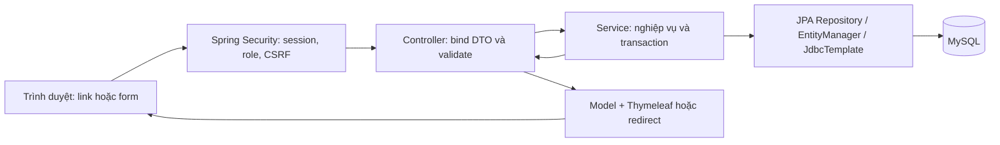
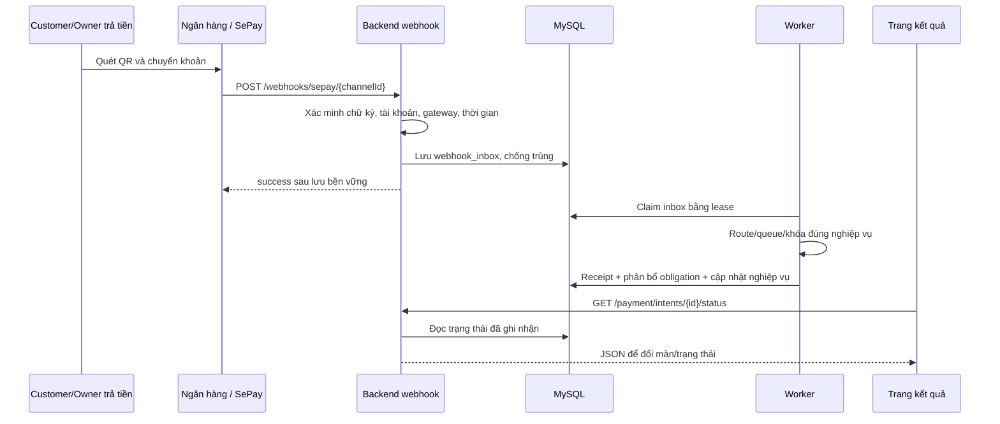

# Thanhmit — chức năng, màn hình và đường đi dữ liệu

Ngày đối chiếu code: **2026-11-09**. Đây là phân tích source hiện tại, không phải một lần chạy lại tất cả màn hình/giao dịch thật.

## 1. Phân công và ranh giới

Theo `docs/plans/team-assignment.md` §2, §3.1, §5, thanhmit phụ trách:

- Nền Spring Boot, DB/bootstrap, xác thực, session, BCrypt, CSRF và phân quyền.
- Queue/concurrency P7.1–P7.4: FIFO theo carId, giới hạn tải, ranh giới transaction và tích hợp caller.
- Payment core P4.2–P4.11: nghĩa vụ thanh toán, lần QR, webhook/inbox SePay, receipt, polling, refund recipient, payout, retry/reconcile và cảnh báo.
- P4.2-A: hợp đồng/provider/cấu hình và kiểm chứng live; không suy live readiness từ code hoặc fixture.
- Điều phối migration/bootstrap và review phần tài chính/bảo mật giao nhau.

Đây là quyền phụ trách/bảo trì, không khẳng định mọi dòng code hay UI hiện tại do riêng thanhmit viết. Booking/BEFORE/AFTER/profile thuộc huy69332; gói Owner, Admin/dashboard và notification thuộc ducbinhnguyen07ars. Những màn đó gọi nền queue/payment của thanhmit.

## 2. Cách frontend/backend giao tiếp

CarRent dùng **Spring MVC + Thymeleaf**. Controller thường trả tên template, backend render HTML rồi trình duyệt hiển thị; không có một React frontend gọi JSON CRUD cho mọi màn.



Ngoại lệ JSON quan trọng: GET polling trạng thái thanh toán/hoàn tiền. Webhook là SePay gọi backend trực tiếp, không xuất phát từ frontend.

POST form dùng CSRF và principal lấy từ session. ID/số tiền/chủ thể tài chính không được tin chỉ vì frontend gửi lên. Controller/service kiểm tra quyền với dữ liệu DB hiện tại.

## 3. Danh sách màn hình

| Màn | Route | Template | Người dùng |
|---|---|---|---|
| Đăng nhập | GET `/login` | `auth/login.html` | Chưa đăng nhập |
| Đăng ký | GET `/register` | `auth/register.html` | Người đăng ký CUSTOMER/OWNER |
| QR chuyển khoản | GET `/payment/intents/{id}` khi ACTIVE | `payment/checkout.html` | Người trả tiền đúng obligation |
| Kết quả thanh toán | GET `/payment/intents/{id}/result`; checkout không ACTIVE cũng trả view này | `payment/result.html` | Người trả tiền được phép xem |
| Tài chính | GET `/payment/finances?view=...&page=...` | `payment/finances.html` | CUSTOMER/OWNER/ADMIN theo scope |
| Tài khoản nhận hoàn | GET `/payment/refunds/{id}` | `payment/refund.html` | Đúng người nhận hoàn |
| Tóm tắt khoản hoàn | GET `/payment/finances/refunds/{id}` | `payment/refund-summary.html` | Người nhận, bên hoàn hoặc Admin theo scope |

Ngoài **7 màn nghiệp vụ**, có `payment/finance-unavailable.html` khi thiếu nền schema tài chính và các màn lỗi dùng chung, gồm `/access-denied` → `error/403.html`.

Queue, webhook và worker không có trang riêng. Logout là action, không phải một màn. Các tab tài chính là các view của cùng một template, không phải bốn giao diện độc lập.

## 4. Màn đăng nhập

**Hiển thị:** trường định danh `username`, mật khẩu `password`, thông báo sai đăng nhập/đăng ký thành công/đã đăng xuất, nút đăng nhập và link đăng ký. Backend tra định danh bằng `users.email`; dữ liệu demo có thể dùng chuỗi như customer1.

**Mở trang:** `GET /login` → `AuthController.login()` → trả `auth/login` → HTML.

**Gửi dữ liệu:** form `POST /login` gửi `username`, `password`, CSRF. POST này do **Spring Security form-login filter** nhận, không có `AuthController.POST /login`.

```text
auth/login.html
  → POST /login
  → Spring Security authentication provider
  → CustomUserDetailsService.loadUserByUsername(identifier)
  → UserRepository.findByEmail(identifier)
  → SELECT users
  → kiểm tra ACTIVE và BCrypt password match
  → CustomUserPrincipal + SecurityContext trong session
  → RoleBasedAuthSuccessHandler.onAuthenticationSuccess()
  → ADMIN /admin/dashboard; OWNER /owner/dashboard; CUSTOMER /cars
```

Sai thông tin hoặc tài khoản bị khóa → `/login?error`. Không trả password/hash về frontend và không lưu mật khẩu thô. Role đích lấy từ user DB, không lấy từ role frontend tự khai.

**Logout:** form POST `/logout` → Spring Security logout handler → invalidate session → `/login?logout`; không cần ghi user DB để đăng xuất.

## 5. Màn đăng ký

**Hiển thị/nhập:** fullName, email, phone, password, confirmPassword và radio CUSTOMER/OWNER. Không cho tự đăng ký ADMIN.

```text
GET /register → AuthController.register(Model)
  → model form = RegisterForm → auth/register.html

POST /register
  → AuthController.register(@Valid RegisterForm, BindingResult, Model)
  → AuthService.register(form)
  → kiểm tra role, password <= 72 byte UTF-8, password xác nhận
  → UserRepository.existsByEmail(email)
  → BCrypt encode(password)
  → UserRepository.saveAndFlush(User ACTIVE)
  → INSERT users
  → redirect /login?registered
```

Bean Validation kiểm tra trường trống/độ dài. Unique constraint còn bảo vệ trường hợp hai request đăng ký trùng email đồng thời. Lỗi trả lại cùng template và lỗi theo trường; controller xóa cả password và rejected password values khỏi model trước khi render.

## 6. Màn QR chuyển khoản

**Hiển thị:** số tiền của lần thanh toán, mã nội dung CR..., hạn QR theo giờ Việt Nam, ảnh QR, hướng dẫn, trạng thái chờ và action hủy phù hợp. Đối với thuê xe có phần 30%/70%; với balance có số nợ còn lại, hạn trả nợ và trạng thái hoàn tất riêng.

**Nguồn dữ liệu:** `payment_obligations` là khoản phải thu, `payment_intents` là một lần tạo QR, `payment_channels` là kênh nhận tiền đã cấu hình. Users/bookings/subscription_orders giúp kiểm tra chủ thể và trạng thái nghiệp vụ.

**Đường mở QR dùng chung:**

```text
Màn chi tiết có obligation → POST /payment/obligations/{id}/attempts
  → PaymentController.open(id, actor)
  → PaymentObligationService.openAttempt(id, actor)
  → PaymentRoutes.obligation(id), handler(subject)
  → PaymentRoutes.execute(route, action)
       → nếu gắn xe: CarCommandExecutor.execute(carId,...)
  → PaymentIntentTransactions.open(route, actor)
  → handler.lockSubject + khóa obligation/intent
  → kiểm tra payer, payment pilot, số còn nợ, kênh SePay duy nhất và cấu hình
  → tái sử dụng QR ACTIVE hợp lệ hoặc INSERT payment_intents
  → redirect /payment/intents/{intentId}
```

**Lối vào riêng theo nghiệp vụ:**

- Customer đồng ý BEFORE: POST `/bookings/{id}/accept-before` → `BookingController.acceptBefore` → queue → `BookingService.acceptBefore` → nghĩa vụ ADVANCE + `PaymentIntentTransactions.openForLockedBooking` trong cùng transaction. Tiền cần trả lấy từ tổng đơn và RentalPolicy, không lấy số tiền frontend tự gửi.
- Owner mua gói: `SubscriptionService.createOrder` tạo order/obligation rồi dùng payment core để mở attempt. Nghiệp vụ gói thuộc ducbinhnguyen07ars.
- Thanh toán balance: dùng obligation BALANCE đã lập sau nhận lại xe và route mở attempt dùng chung ở trên.

**Render:** GET `/payment/intents/{id}` → `PaymentController.checkout` → `PaymentObligationService.status` → `PaymentIntentTransactions.status/view` → DTO `PaymentIntentView` và danh sách refund → model `payment`/`intentRefunds` → checkout nếu ACTIVE, result nếu khác.

QR hiện được dựng bằng URL `https://img.vietqr.io/image/{bankBin}-{account}-compact2.png?amount=...&addInfo=...`. Đây là ảnh mô tả chuyển khoản, không phải gọi API chuyển tiền và không xác nhận đã nhận tiền. SePay phục vụ nhánh nhận giao dịch qua webhook.

**Frontend polling:** `payment-polling.js` đọc `data-status-url`, gọi GET `/payment/intents/{id}/status` khoảng 2 giây khi tab đang hiển thị. Backend trả JSON `PaymentIntentView`: id, code, amount, expiresAt, status, qrUrl, rental. Khi trạng thái đổi, ẩn QR rồi chuyển đến result. Hết hạn thì frontend ẩn QR; backend vẫn là nơi quyết định trạng thái/lịch sử tiền.

**Hủy:** POST `/payment/intents/{id}/cancel` → `PaymentController.cancel` → `PaymentObligationService.cancelAttempt` → route/queue → `PaymentIntentTransactions.cancel` → cập nhật attempt và gọi handler theo nghiệp vụ → redirect result. Với balance, hủy QR không xóa khoản nợ. Hủy QR cũng không đảo một giao dịch ngân hàng đã xảy ra.

## 7. Màn kết quả thanh toán

**Hiển thị:** số tiền lần QR, nội dung, thông báo trạng thái; các khoản hoàn liên quan. Với balance phân biệt số nợ còn lại và kết quả một QR, có thể mở attempt mới nếu còn nợ và đủ điều kiện.

GET `/payment/intents/{id}/result` → `PaymentController.result` → `payments.status` + `FinancialViews.refundsForIntent` → đọc intents/obligation/receipt/refund và dữ liệu nghiệp vụ liên quan → `payment/result.html`.

Trạng thái DB của intent gồm ACTIVE/RECEIVED/EXPIRED/CANCELLED/REVIEW_REQUIRED. `PaymentIntentTransactions.view` còn tổng hợp trạng thái hiển thị như REFUND_PENDING/REFUNDED/UNAVAILABLE/SETTLED; không phải mọi chuỗi UI đều là enum lưu trực tiếp trong `payment_intents.status`.

`payment-polling.js` theo dõi GET status và reload khi trạng thái tổng hợp thay đổi. Một QR EXPIRED không tự chứng minh tiền không tới; tiền tới muộn/trùng vẫn có thể đi qua webhook/hoàn tiền.

## 8. Dữ liệu nhận tiền đi từ ngân hàng về UI



Chuỗi class thực tế:

1. `SePayWebhookController.receive` → `SePayWebhookService.receive(channelId, headers, rawBody)`.
2. Đọc channel, `SePayWebhookVerifier.verify`, parse `SePayIncomingPayment`; đối chiếu tài khoản nhận/gateway/thời gian và khóa các channel cùng tài khoản nhận.
3. Chống trùng bằng providerTransactionId và unique key; định tuyến đúng channel khi Owner/Admin dùng chung tài khoản; INSERT `webhook_inbox` trạng thái RECEIVED. Trả success không có nghĩa đã apply booking.
4. Khi bật maintenance, `PaymentMaintenanceJob.scan` → `ReceiptProcessor.process` → `InboxWorkService.claim` ghi lease PROCESSING và tìm intent theo mã CR.
5. `PaymentRoutes`/queue → `ReceiptApplicationService.apply`: khóa đối tượng nghiệp vụ/obligation/intent/inbox, tạo `payment_receipts`, kiểm tra chủ thể, tiền và thời gian.
6. Tiền hợp lệ được phân bổ vào `amount_settled`, obligation đủ tiền chuyển SETTLED, intent chuyển RECEIVED; callback handler cập nhật nghiệp vụ trong transaction.
7. `RentalPaymentHandler.apply` → `BookingService.applyAdvance`: đủ trả trước thì CONFIRMED, chưa đồng nghĩa đã giao xe. `RentalBalancePaymentHandler.apply` → `BookingService.applyBalance`: đủ điều kiện nhận/trả và đủ balance thì COMPLETED. `SubscriptionPaymentHandler.apply` → `SubscriptionService.apply`: cập nhật order/quyền gói.
8. Giao dịch không khớp/thiếu dữ liệu → REVIEW_REQUIRED. Tiền trùng/muộn/dư có thể sinh yêu cầu hoàn qua nghiệp vụ; giữ receipt gốc và dấu vết xử lý.

Frontend không gửi cờ “đã nhận tiền” để tự đổi booking. Các cập nhật nền chỉ chạy khi cấu hình worker/domain/provider tương ứng cho phép.

## 9. Màn tài chính

GET `/payment/finances?view=paid|collected|refunds|managed&page=N` → `FinancialController.list` → `FinancialViews.available`, `obligations`, `refunds`, `reviewReceipts` → DTO phân trang → `payment/finances.html`.

| Tab | Dữ liệu và scope |
|---|---|
| paid — Khoản tôi thanh toán | Obligation có payer=current user; Customer: ADVANCE/BALANCE, Owner: SUBSCRIPTION |
| collected — Khoản tôi thu | Collector=current user; Owner: tiền thuê, Admin: phí gói; Customer không được dùng tab này |
| refunds — Khoản tôi nhận hoàn | Refund recipient=current user và khớp payer/purpose hợp lệ |
| managed — Quản trị tài chính | Chỉ Admin; tra cứu dữ liệu toàn hệ thống |

Mỗi trang tối đa 20 dòng theo nhóm query. Màn có nghĩa vụ/số phải trả/số đã ghi nhận/latest intent, các khoản hoàn, giao dịch cần kiểm tra và link mở chi tiết. Các group có quy tắc query/paging riêng; không phải một bảng nối tất cả rồi cộng số tiền tùy ý.

Nguồn đọc: `payment_obligations`, `payment_intents`, `refunds`, `payment_receipts`, `payment_channels`, `users`. `FinancialViews.active` đối chiếu user/role/ACTIVE hiện tại, không tin `userId` frontend; account trong danh sách chỉ hiện đuôi.

Tab/link là GET server-rendered. Không có fetch POST cập nhật số tiền trên màn này. Bản Admin chuyên biệt `/admin/finance` thuộc module Admin của ducbinhnguyen07ars, dù dùng cùng nền tài chính.

## 10. Màn nhập tài khoản nhận hoàn

GET `/payment/refunds/{id}` → `RefundController.detail` → `RefundRecipientService.view/form` → `RefundRecipientTransactions.view` kiểm tra đúng recipient/role/ACTIVE → đọc `refunds` và thông tin liên quan; có thể lấy `refund_recipient_accounts` để điền sẵn → `payment/refund.html`.

**Bước 1:** hiển thị số tiền/lý do/trạng thái và nhập `bankBin` 6 chữ số, `accountNumber`, checkbox `saveForLater`. Form POST `/payment/refunds/{id}/recipient/preview`.

```text
RefundController.preview(@Valid RefundRecipientForm)
  → RefundRecipientService.preview
  → RefundRecipientTransactions.prepare: quyền, editable, payout channel
  → RefundDestinationVerifier.verify(channelId, bankBin, accountNumber)
  → destination: bankBin/accountNumber/accountName đã xác minh
  → model destination + recipientForm → render bước 2 cùng template
```

**Bước 2:** xem ngân hàng/số tài khoản/tên xác minh, tích xác nhận. POST `/payment/refunds/{id}/recipient` gửi form + confirmed=true + CSRF.

`RefundController.submit` → `RefundRecipientService.submit` → xác minh lại và so tên, không tin hidden confirmedAccountName → `RefundRecipientTransactions.confirm` khóa receipt/refund, kiểm tra channel không đổi, snapshot đích nhận → cập nhật `refunds`, đặt READY/readyAt/dueAt và tùy chọn lưu `refund_recipient_accounts` → redirect lại trang.

Sau lưu là chờ worker, chưa phải đã chuyển tiền. Khi đã có payout attempt/lease hoặc trạng thái không cho phép, không sửa đích nhận. Polling GET `/payment/refunds/{id}/status` theo trạng thái/overdue; đổi thì reload. Full thông tin đích nhận chỉ trả cho recipient có quyền; màn tổng hợp dùng account đã che.

Hai trường hợp: hoàn tiền thuê Owner → Customer; hoàn phí gói Admin → Owner. Người trả nguồn tiền phải là đúng collector của khoản thu gốc.

## 11. Màn tóm tắt khoản hoàn

GET `/payment/finances/refunds/{id}` → `FinancialController.refund` → `FinancialViews.available/refund` → kiểm tra recipient/collector/Admin → đọc refund và quan hệ receipt/intent/obligation/channel → `payment/refund-summary.html`.

Hiển thị mã khoản hoàn, số tiền, lý do, trạng thái, tài khoản đã che, hạn/quá hạn. Người nhận có thể đi sang màn bổ sung tài khoản nếu được phép. Đây là màn theo dõi, không có nút chỉnh số tiền hoặc đánh dấu hoàn thành thủ công.

Polling cũng dùng `/payment/refunds/{id}/status`, trả `{id,status,dueAt,overdue}` qua `FinancialViews.status`. SUCCEEDED mới là kết quả provider xác nhận; quá hạn là thuộc tính theo deadline, không tự có nghĩa tiền thất bại hoặc thành công.

## 12. Nhánh xử lý hoàn tiền nền

```text
Nghiệp vụ hủy/trùng/muộn/dư (BookingService hoặc SubscriptionService)
  → RefundService.request(businessKey, receiptId, amount, reason)
  → khóa/đối chiếu receipt, số được hoàn, payer/collector, nguồn PAYOS
  → INSERT refunds WAITING_RECIPIENT + notifications
  → người nhận xác minh/xác nhận tài khoản → READY
  → PaymentMaintenanceJob.scan(DISPATCH)
  → PayoutWorker.dispatch
  → PayoutTransactions.prepareDispatch / beginSend
  → INSERT payout_attempts + lease + snapshot/idempotency
  → HttpPayOsPayoutClient.create → POST /v1/payouts
  → PayoutTransactions.finish → lưu kết quả
```

Ví Bảo Kim là nguồn chi liên kết tài khoản payOS; code tích hợp API payOS, không có một frontend/controller Bảo Kim riêng.

- Thiếu số dư: WAITING_FUNDS, thông báo đúng bên phải bổ sung số dư.
- Đang xử lý hoặc mất phản hồi: lưu attempt UNKNOWN/PROCESSING, không coi là đã chuyển thành công.
- `scan(RECONCILE)` → `PayoutWorker.reconcile` → `prepareReconcile` → GET `/v1/payouts/{id}` hoặc tra danh sách theo reference → `finish`; tra cứu trước để tránh chi trùng.
- Provider xác nhận thành công: Refund SUCCEEDED, lưu dấu vết attempt và thông báo. Trường hợp không đủ tin cậy chuyển REVIEW_REQUIRED theo policy.
- `scan(OVERDUE)` → `PaymentMaintenanceWork.notifyOverdue`, không giả lập kết quả chuyển tiền.

Backend gọi provider ngoài transaction giữ khóa dài: prepare/claim và finish tách transaction, giữ lease/snapshot để xử lý crash/retry. Browser chỉ nhìn kết quả đã ghi vào DB.

## 13. Queue — chức năng không có màn riêng

Ví dụ Customer gửi đơn:

```text
booking/create.html → POST /bookings
  → BookingController.create(@Valid BookingCreateForm,...)
  → CarCommandExecutor.execute(carId, action)
  → lane FIFO theo carId trong JVM
  → worker gọi BookingService.createBooking(@Transactional)
  → khóa owner/car theo policy + BookingRepository.findConflictsForUpdate
  → đọc users/cars/bookings; ghi bookings + notifications nếu hợp lệ
  → commit → CompletableFuture trả kết quả controller
  → redirect /bookings/{id}, hoặc trả lại form có lỗi
```

Các caller khác: Owner sửa/ẩn/hiện/xóa xe/ảnh; Admin duyệt/từ chối/ẩn/hiện; Owner confirm/reject/cancel/handover/return/complete; inspection actions; callback payment gắn booking. Caller nghiệp vụ thuộc thành viên khác, phần executor/giới hạn/transaction boundary thuộc thanhmit.

Queue không ghi một bảng “queue”; lane/request đang chờ nằm trong memory. Các xe khác nhau có thể chạy song song. FIFO theo một xe trong một instance không thay DB locks khi có nhiều instance. Request phải vào queue trước khi mở transaction.

Giới hạn chờ/per-car/toàn hệ thống, từ chối khi đầy/tắt; request chưa bắt đầu có thể timeout, request đã chạy phải trả đúng kết quả commit/rollback. `CommonExceptionHandler.queueUnavailable` trả HTTP503 và trang lỗi dùng chung. Các khoản tài chính cần phục hồi sau restart có inbox/lease/attempt trong DB, không dựa riêng vào queue RAM.

## 14. Bảng dữ liệu thuộc nền thanhmit

| Bảng | Ý nghĩa |
|---|---|
| users | Định danh, role/status, password hash cho authentication |
| payments | Mapping thanh toán LEGACY được giữ để tương thích |
| payment_channels | Nguồn thu/chi, chủ kênh và credential reference |
| payment_obligations | Số tiền nghiệp vụ phải thu, số đã phân bổ, payer/collector |
| payment_intents | Từng lần QR, mã chuyển khoản, tiền, hạn và trạng thái |
| webhook_inbox | Sự kiện provider nhận bền vững, chống trùng, lease/retry |
| payment_receipts | Giao dịch tiền thực tế được ghi nhận/phân bổ/cần kiểm tra |
| refunds | Nghĩa vụ hoàn, lý do, người nhận, snapshot đích và deadline |
| payout_attempts | Từng lần gọi/đối soát chi hộ, reference, kết quả provider |
| refund_recipient_accounts | Tài khoản người nhận chọn lưu cho lần sau |

`bookings`, `subscription_orders`, `owner_subscriptions`, `notifications` là phần nối với module thành viên khác, không vì payment đọc/ghi qua handler mà đổi chủ sở hữu toàn bộ module đó.

## 15. Giới hạn hiện tại cần nói đúng

- Bean production `PaymentProviderConfiguration.refundDestinationVerifier` hiện trả lỗi chưa thể xác minh, nên preview/confirm recipient chưa phải live-ready dù UI và fixture có đường chạy.
- Snapshot runtime sau fix BEFORE: workflow/advance/balance bật nhưng provider/jobs vẫn giữ tắt. Có code webhook/worker không có nghĩa chúng đang tự chạy trên app8080.
- Không thấy UI nhập Client ID/API Key/Checksum Key/SePay trong controller/template hiện tại; Payment Settings còn là kế hoạch riêng. Các trường cấu hình đó không phải nội dung của màn tài khoản nhận hoàn.
- P4.2-A/provider/live chưa được coi hoàn thành chỉ từ phân tích này. Mô tả trên đối chiếu source, không phát sinh chuyển tiền hoặc thao tác DB.

## 16. File bắt đầu đọc để thuyết trình/debug

1. `docs/plans/team-assignment.md:60` và `:101`: phạm vi phụ trách.
2. `config/SecurityConfig.java`, `auth/AuthController.java`, `auth/AuthService.java`, `security/CustomUserDetailsService.java`.
3. `payment/PaymentController.java`, `PaymentObligationService.java`, `PaymentRoutes.java`, `PaymentIntentTransactions.java`.
4. `static/js/payment-polling.js` cùng templates payment.
5. `payment/SePayWebhookController.java`, `SePayWebhookService.java`, `ReceiptProcessor.java`, `ReceiptApplicationService.java`.
6. `payment/RefundController.java`, `RefundRecipientService.java`, `RefundRecipientTransactions.java`, `PayoutWorker.java`, `PayoutTransactions.java`.
7. `payment/FinancialController.java`, `FinancialViews.java`, `concurrency/CarCommandExecutor.java`.

Các đường Java ở mục này tương đối với `src/main/java/com/carrent/`; JavaScript tương đối với `src/main/resources/`.
