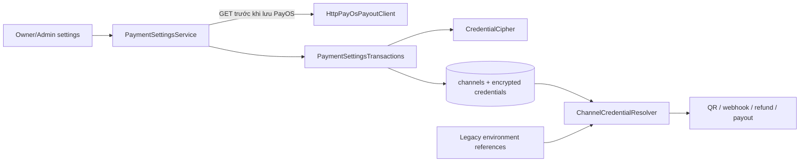

> **CANCELLED - 2026-11-09:** Chủ dự án hủy Payment Settings S1/S2/S3 và chọn source trước S1. Nội dung bên dưới chỉ là lịch sử thiết kế/kiểm chứng, không phải kế hoạch đang thực thi. Không tiếp tục implement, migrate hoặc kích hoạt từ tài liệu này.

# SDD bổ sung: UI kết nối PayOS và SePay

> **Nghiệm thu S1 — 09/11/2026:** S1 COMPLETE trong worktree: 1.230/1.230 Java tests (80 suites), 81 test mới, Node 18/18, clean verify/JAR và audit đạt. S2/S3 NOT_STARTED. Xem [bàn giao S1](../plans/payment-settings-S1-handoff.md); chỉ ghi nhận local completion, chưa tích hợp root hoặc bật provider thật.

> **Bổ sung 09/11/2026:** chuẩn bị S1 theo [kế hoạch thực thi hiện hành](../plans/payment-settings-S1-execution-2026-11-09.md). Resolver dùng nested `ChannelCredentialResolver.Unavailable` cho lỗi credential dự kiến và REQUIRED/readOnly với `noRollbackFor=Unavailable.class`; caller bắt riêng để trả UNAVAILABLE/false khi phù hợp mà không gây rollback-only. DB/repository lỗi vẫn propagate, không fallback. Schema phải migrate trước khi chạy binary mới; legacy fallback chỉ dành cho schema đủ bảng nhưng chưa có credential row. Chưa triển khai.

Ngày: **2026-11-08**. Trạng thái: **thiết kế/kế hoạch, chưa triển khai**. Người dùng đã duyệt hướng thêm UI, lưu credential mã hóa và yêu cầu mục tiêu thực hiện trong nửa ngày. Tài liệu này chốt bản đầu có thể kiểm chứng trong **240 phút**, không đưa thời gian chờ provider hoặc giao dịch thật vào mốc đó.

## 1. Phạm vi và tiêu chí hoàn thành

| ID | Yêu cầu bản đầu |
| --- | --- |
| PS-01 | Owner và Admin có trang Kết nối thanh toán; chỉ quản lý cấu hình của chính mình, kiểm tra role/ACTIVE hiện tại ở mỗi POST |
| PS-02 | Owner/Admin nhập Client ID, API Key, Checksum Key của kênh chi PayOS đã được tạo và liên kết Bảo Kim bên ngoài; kiểm tra GET có chữ ký trước khi lưu |
| PS-03 | Owner cấu hình ngân hàng/BIN, số tài khoản, gateway SePay và webhook secret; hệ thống cung cấp URL webhook HTTPS để cấu hình thủ công trên SePay |
| PS-04 | Credential mã hóa trong DB, tồn tại qua restart; trang không đọc lại khóa gốc và không đưa chúng vào HTML, log, URL hoặc audit |
| PS-05 | QR/inbox/refund worker đọc credential mới từ DB mà không cần restart; kênh chưa nhập DB tiếp tục dùng cấu hình môi trường hiện có |
| PS-06 | Lưu PayOS không bật payout. SePay có hành động xác nhận bật nhận tiền riêng, vẫn tuân thủ pilot và các gate nghiệp vụ hiện hành |
| PS-07 | Kênh/tài khoản đã có lịch sử tài chính không bị đổi nguồn hoặc đổi secret qua UI bản đầu; cấu hình pilot dùng chung nguồn Owner/Admin vẫn được hỗ trợ bằng hai mapping riêng |
| PS-08 | Migration một bảng mới, DB-first; có test migration, bảo toàn dữ liệu, bảo mật, restart và HTTP/browser cho hai vai trò |

Không có trong bản 240 phút: OAuth, đăng ký tài khoản provider, liên kết ví Bảo Kim trực tiếp, tự tạo webhook qua API SePay, API polling đối soát SePay mới, UI SePay cho Admin, nhiều kênh mỗi provider/user, disconnect/rotation khi có lịch sử tài chính, quản trị khóa mã hóa nhiều phiên bản, recipient lookup production, chuyển tiền thật. Admin SePay hiện có tiếp tục chạy bằng cấu hình cũ. Các giới hạn này không cắt việc nối DB vào QR/webhook/payout hiện tại.

## 2. UI và routes

- `GET /owner/payment-settings`: hai khối PayOS chi hoàn và SePay nhận tiền.
- `GET /admin/payment-settings`: khối PayOS chi hoàn; không có form quản lý user khác.
- `POST /owner/payment-settings/payos`, `POST /admin/payment-settings/payos`: **Kiểm tra và lưu**. Gọi GET list/balance bằng ba khóa vừa nhập ngoài DB transaction, kiểm tra chữ ký bằng client hiện có; chỉ persist nếu đạt. Không gọi create payout hoặc estimate-credit.
- `POST /owner/payment-settings/sepay`: **Lưu cấu hình**; lưu trạng thái CONFIGURED, không gọi API provider. Kênh mới mặc định disabled, kênh cũ giữ nguyên enabled.
- `POST /owner/payment-settings/sepay/enable`: **Xác nhận bật nhận tiền**; yêu cầu checkbox đã cấu hình đúng webhook, cấu hình hợp lệ và Owner thuộc pilot hiện tại. Owner ngoài pilot vẫn lưu được cấu hình nhưng không tự mở checkout. Đây là hành động được kiểm thử bằng fixture, không được tự gọi trên DB ứng dụng trong đợt implement.
- Một template `payment/settings.html`, dùng `fragments/workspace.html`; thêm menu Owner/Admin và active state, không sửa các trang thanh toán khác.
- Mọi POST dùng CSRF, PRG khi thành công, `Cache-Control: no-store`. Binding chỉ nhận trường được phép; không nhận userId/channelId/provider URL/enabled/role từ hidden input.
- Secret input dùng `type=password`, `autocomplete=new-password`; mỗi lần sửa phải nhập đủ bộ. Sau lỗi xóa mọi field secret khỏi form/BindingResult; không render rejectedValue của secret, không lưu draft vào session/localStorage.
- Trạng thái PayOS: chưa cấu hình / GET đã xác thực / lỗi kết nối; có thời điểm kiểm tra và cảnh báo quyền chi/lookup riêng. Không gọi GET đã xác thực là payout-ready.
- Trạng thái SePay: đã lưu cấu hình / đang bật nhận tiền / đã nhận webhook hợp lệ (dựa vào inbox của chính kênh). Không tuyên bố đã xác minh nguồn provider hoặc có tiền thật chỉ từ việc lưu secret.
- URL webhook lấy từ `carrent.payment.public-base-url`, là HTTPS origin do server quản lý; nối `/webhooks/sepay/{channelId}`. Không lấy Host/request URL hoặc cho user nhập callback URL tùy ý. Host local/tunnel có thể thay đổi, UI luôn hiển thị origin cấu hình hiện tại.

## 3. Dữ liệu và mã hóa

Giữ `payment_channels`: chủ kênh, role, provider/purpose, reference, ngân hàng/STK, enabled và FK lịch sử. Tạo bảng **`payment_channel_credentials`**:

```sql
CREATE TABLE payment_channel_credentials (
    channel_id BIGINT NOT NULL,
    ciphertext VARBINARY(8192) NOT NULL,
    nonce BINARY(12) NOT NULL,
    encryption_version SMALLINT NOT NULL DEFAULT 1,
    status VARCHAR(20) NOT NULL,
    checked_at DATETIME(6) NULL,
    version BIGINT NOT NULL DEFAULT 0,
    created_at DATETIME(6) NOT NULL,
    updated_at DATETIME(6) NOT NULL,
    PRIMARY KEY (channel_id),
    CONSTRAINT fk_channel_credentials_channel FOREIGN KEY (channel_id)
        REFERENCES payment_channels(id) ON DELETE RESTRICT,
    CONSTRAINT chk_channel_credentials_version CHECK (encryption_version = 1 AND version >= 0),
    CONSTRAINT chk_channel_credentials_status CHECK (status IN ('CONFIGURED','READ_VERIFIED')),
    CONSTRAINT chk_channel_credentials_cipher CHECK (OCTET_LENGTH(ciphertext) >= 16)
) ENGINE=InnoDB DEFAULT CHARSET=utf8mb4 COLLATE=utf8mb4_unicode_ci;
```

- Migration mới: `docs/migrations/2026-11-08-01-payment-channel-credentials.sql`; tiền điều kiện payment_channels tồn tại/đúng PK, MySQL 8.0.16+, strict mode, marker `@carrent_channel_credentials_backup_confirmed=1`; từ chối target đã có/partial. Bootstrap `scriptDB.sql` thêm DDL trước START TRANSACTION, không seed secret. Không sửa migration đã apply.
- JSON plaintext PayOS có đúng `clientId`, `apiKey`, `checksumKey`; SePay có đúng `webhookSecret`, `gateway`. Không lưu API token SePay chưa có caller chỉ để làm đẹp form; token query sẽ thuộc đợt tích hợp đối soát nếu được yêu cầu.
- AES-256-GCM của JDK, nonce ngẫu nhiên 12 byte cho mỗi lần ghi, tag 128 bit. AAD UTF-8: `v1|{provider}|{channelId}|{userId}|{credentialReference}`. Giới hạn mỗi secret 512 ký tự, gateway 50; reject control characters; tài khoản dạng chuỗi 1–19 chữ số, BIN 6 chữ số. Không cắt mất số 0 đầu.
- Property `carrent.payment.credentials.master-key=${CARRENT_PAYMENT_CREDENTIAL_MASTER_KEY:}`; Base64 của đúng 32 byte, giữ ngoài DB/Git. Không hash credential một chiều vì cần dùng khóa để ký/gọi provider.
- Không có master key: trang hiển thị chưa được operator cấu hình, mọi ghi/giải mã DB credential bị từ chối; legacy channel không có DB record vẫn hoạt động. Không sinh master key mới mỗi boot, không tự tạo key production, không fallback khi DB record tồn tại nhưng giải mã lỗi.
- `@Version Long version` chống ghi đè đồng thời; null khi entity mới để Spring Data persist, DB lưu bắt đầu 0. Entity dùng `@MapsId` đến PaymentChannel, map nonce BINARY(12) và ciphertext VARBINARY(8192) tường minh; chỉ format mã hóa version 1. Entity không làm response DTO; record/exception/toString không chứa plaintext/ciphertext.

## 4. Luồng và interfaces dùng lại



Các interfaces chốt cho implement, đều trong `com.carrent.payment` nếu không ghi khác:

- `CredentialCipher.Sealed(byte[] nonce, byte[] ciphertext)`; `available(): boolean`, `seal(byte[] plaintext, String aad)` và `open(Sealed value, String aad)`; không xử lý HTTP/DB. Thiếu/sai key không làm legacy startup lỗi; available=false, thao tác crypto bị từ chối.
- `ChannelCredentialResolver.payos(String reference): ProviderPaymentProperties.PayOsChannel`; `sepay(String reference): ProviderPaymentProperties.SePayChannel`. Repository lookup bằng **provider + reference** vì constraint chỉ UNIQUE theo cặp; method `findByProviderAndReference(PaymentProvider provider, String reference)`. DB record được ưu tiên; chỉ không có record mới đọc map legacy. DB corrupt/missing key từ chối, không fallback. Boolean enabled trả về lấy từ PaymentChannel, không lấy READ_VERIFIED làm enabled. Disabled record vẫn có thể được đọc để xác minh shared webhook của QR cũ; caller giữ guard của nghiệp vụ, resolver không tự áp ACTIVE lên mọi lần đọc secret.
- `PaymentSettingsService.view(CustomUserPrincipal actor): View`; `savePayos(PayOsSettingsForm form, CustomUserPrincipal actor): void`; `saveSepay(SePaySettingsForm form, CustomUserPrincipal actor): void`; `enableSepay(boolean webhookConfigured, CustomUserPrincipal actor): void`.
- `View(boolean masterKeyReady, boolean owner, ChannelSummary payos, ChannelSummary sepay)` và `ChannelSummary(Long id, boolean storedInDatabase, boolean enabled, String status, String bankBin, String maskedAccount, Instant checkedAt, Instant lastWebhookAt, String webhookUrl)`. Không field secret.
- `PaymentSettingsTransactions.prepare(PaymentProvider provider, CustomUserPrincipal actor): Target`; `save(Target target, PayOsSettingsForm form, CustomUserPrincipal actor): void`; overload `save(Target target, SePaySettingsForm form, CustomUserPrincipal actor): void`; `view(actor): View`; `enableSepay(boolean webhookConfigured, actor): void`.
- `Target(Long channelId, String reference, Long credentialVersion, Long ownerId, Role role)`: context server tạo trước network; null channelId/version cho cấu hình mới. Khi commit, lock User rồi channel theo thứ tự ổn định, refresh role/status/owner/reference/version và kiểm tra lại trước lưu. Target không chứa secret. `View`/`ChannelSummary` là nested records của PaymentSettingsService; Target là nested record của PaymentSettingsTransactions.

Giữ network ngoài transaction/queue; không giữ khóa DB khi gọi PayOS. Input provider/user không quyết định URL endpoint hoặc credential của user khác. `checkConnection` hiện có kiểm tra signature và dùng GET kể cả khi payout chưa bật, dùng lại nguyên contract.

## 5. Caller phải cập nhật và tương thích

| File | Thay đổi cần có |
| --- | --- |
| `PaymentProviderConfiguration` | Tạo SePay verifier bằng resolver động; giữ PayOS client/resolver hiện có |
| `SePayWebhookVerifier` | Dùng `Function<String,SePayChannel>` thay map cứng; giữ constructor `(ProviderPaymentProperties, Clock)` cho test/caller cũ; constructor mới `(Function<String,SePayChannel>, Clock)` |
| `PaymentIntentTransactions` | Cả tạo/reuse và shared ACTIVE QR view đọc resolver; ACTIVE bị lỗi credential thành UNAVAILABLE, lịch sử PAID/EXPIRED không cần resolve hoặc lỗi 500 vì key |
| `PayoutChannelResolver`, `PayoutTransactions`, `RefundRecipientTransactions` | Đọc `resolver.payos(reference)` thay map môi trường; giữ mọi guard nguồn/role/snapshot/status |
| `SePayWebhookService` | Không đổi routing/dedup/HMAC contract; các hàm verify/sharesWebhookSecret/acceptsGateway cùng dùng resolver động qua verifier |
| `LocalPayOsSetup`, `LocalSePaySetup` | Giữ công cụ operator cấu hình cũ; không dùng chúng làm controller UI hoặc tự chạy provisioning |

Chuẩn bị S1 chi tiết, bao gồm boot-path migration fixtures và properties-only context: [phân tích trước implement](../plans/payment-settings-S1-preimplementation-2026-11-08.md). Không coi lỗi credential là absent-row để fallback; xử lý unavailable ở đúng caller và giữ đọc lịch sử tiền đã ghi nhận.

Kênh mới: tạo reference `ui:{userId}:{provider}` từ server; không trùng scope user khác. Chỉ một channel của mỗi provider/purpose cho user trong bản đầu; nếu có nhiều candidate thì từ chối để operator xử lý, không chọn tùy ý. Không thêm channel mới bên cạnh channel lịch sử rồi làm `RefundService` mất tính duy nhất.

Kênh có sẵn: reuse đúng ID/owner/provider/purpose. Khi chưa có history có thể sửa cấu hình dưới khóa. Khi có intent/inbox/receipt/refund/payout attempt liên quan, chỉ cho **adopt cùng cấu hình**: ngân hàng/STK giữ nguyên; bộ khóa/secret/gateway nhập phải khớp credential đang dùng sau resolve legacy/DB. Không đổi nguồn/secret hoặc sửa snapshots. Lặp lại cùng cấu hình là idempotent, không tạo channel/record trùng. API token không có trong bản đầu nên không phát sinh sửa token.

Các khóa truy vấn history phải bao gồm `payment_intents.channel_id`, `webhook_inbox.channel_id`, `payment_receipts.channel_id`, `refunds.payout_channel_id`, `payout_attempts.payout_channel_id`; không chỉ kiểm tra refund đang pending. Khóa User/channel chỉ bảo vệ save; giữ thứ tự khóa hiện có và kiểm tra lại ở commit để không cạnh tranh tạo intent. Nếu không chứng minh được mutation an toàn khi có writer đồng thời, từ chối chỉnh sửa kênh hiện hữu và chỉ cho adopt giống hệt.

Owner/Admin được phép nhập cùng bộ khóa cho pilot; mỗi người chỉ xem metadata và ghi record của mình. Không có UI cho Owner sao chép/đọc credential Admin. Đổi cấu hình một vai trò không tự sửa vai trò kia.

## 6. Kiểm chứng và nghiệm thu

- Migration bootstrap parity, marker/partial/refusal, legacy hash không đổi, không seed credential; JPA UTC DATETIME(6).
- Cipher roundtrip, cùng plaintext nonce khác, AAD sai/user khác/channel khác, tag sai, key thiếu/sai; DB dump không chứa plaintext.
- HTTP role/ACTIVE/CSRF/IDOR/mass assignment; Owner chỉ lưu của mình, Admin không vào Owner SePay; stale role trong lúc GET bị từ chối trước persist; POST lỗi không echo secret.
- PayOS fixture signed GET success/failure; không có POST payouts; failed probe không sửa cấu hình cũ. Lưu/restart DB credential vẫn dùng được; bad DB cipher không fallback legacy.
- SePay UI lưu → bật có xác nhận/pilot → QR đúng ngân hàng/STK/mã → webhook HMAC thật của fixture vào inbox → receipt; sai secret/account/gateway và duplicate không cấp thêm. Khóa mới đọc không restart, legacy Admin vẫn hoạt động.
- History adoption hợp lệ; đổi secret/tài khoản/nguồn có history bị chặn; User lock/version race không tạo cấu hình trùng. Payout disabled không bị form hoặc probe bật lên.
- Browser Owner/Admin/Customer và 1440/390/320: menu, nhãn, lỗi, secret không nằm trong DOM/response, webhook URL, status không gọi GET là chi được; screenshot chỉ dùng credential giả.
- Full clean verify + JAR trên source cuối, Node polling test; fingerprint DB ứng dụng/private files/HEAD/index và cleanup schema/port thử nghiệm. Không dùng test fixture thay live provider acceptance.

## 7. Tổ chức thực hiện trong 240 phút

Một worktree, thực hiện tuần tự; tái sử dụng Spring MVC/Thymeleaf/RestClient/JDK crypto, không thêm dependency. Chủ module theo phân công hiện tại là `thanhmit`; review tích hợp `huy69332`, UI/Owner/Admin `ducbinhnguyen07ars`. Không tự đổi credential Git hoặc suy ra ai đã viết code từ assignment.

Người dùng đã đồng ý mục tiêu 4 giờ; chia thành **3 phiên, mỗi phiên 80 phút**: S1 gồm PS-A/B, S2 gồm PS-C/D, S3 gồm PS-E/F. [Tài liệu giao phiên](../plans/payment-settings-sessions-2026-11-08.md) quy định điều kiện đầu vào/đầu ra, test/handoff và prompt đầy đủ; không tách branch hoặc thiết kế lại giữa các chat.

| Mốc | Thời lượng | Kết quả kiểm chứng |
| --- | ---: | --- |
| PS-A | 40 phút | Migration + encrypted store + cipher tests |
| PS-B | 40 phút | Resolver động đủ caller, legacy và restart tests |
| PS-C | 40 phút | PayOS save/check HTTP + hai role UI |
| PS-D | 40 phút | SePay form/manual webhook/enable + QR/inbox fixture |
| PS-E | 65 phút | Full regression, browser, review và sửa lỗi |
| PS-F | 15 phút | Manifest/handoff và hướng dẫn operator |

240 phút là mục tiêu thực hiện có rủi ro, không phải thời gian đã đo. Không bỏ encryption, phân quyền hoặc regression để khớp giờ; nếu lỗi nền hoặc test chưa đạt thì bàn giao đúng trạng thái, không gọi 100%. Không triển khai chức năng ngay trong phiên viết kế hoạch.

Tham chiếu: [SDD chính](../SDD.md), [implementation plan](../plans/payment-settings-implementation-2026-11-08.md), [worktree handoff](../plans/payment-settings-worktree-2026-11-08.md), [P4.2-A/P8.8 analysis](../plans/p42a-p88-completion-analysis-2026-11-08.md). Hoàn thành PS-01–08 không tự đóng P4.2-A/P8.8/P5.9.
