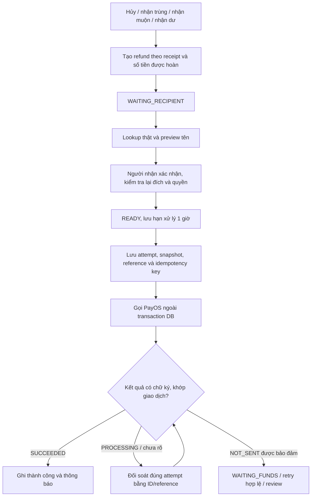

# Hoàn tiền — phần còn lại để hoàn tất luồng

Ngày kiểm tra **2026-11-09**, checkout gốc `feat/phase5-profile-password`, HEAD `b829b059a2f1af3c9ba79629759b608036470620`; bảo toàn dirty baseline. Đây là phân tích, kiểm chứng local và đọc metadata/aggregate DB, không triển khai tính năng hoặc kích hoạt payout.

## 1. Kết luận

**Chưa đạt 100% hoàn tiền thật.** Khung nghiệp vụ, giao diện, worker và phần bảo vệ tiền đã có. Còn năm nhóm điều kiện: **lookup tên người nhận thật; kênh chi đúng chủ thể/capability; xử lý kết quả chưa rõ; review/kích hoạt bản cuối; giao dịch và đối soát thật**. Blocker source trực tiếp là `RefundDestinationVerifier` production vẫn luôn từ chối. Không có căn cứ viết lại module hoặc làm thêm một đợt redesign UI để giải quyết blocker này.

“100%” ở đây là phạm vi pilot đã chốt cho **Owner hoàn Customer tiền thuê** và **Admin hoàn Owner phí gói**, bao phủ các nhánh nghiệp vụ cần dùng và có cách xử lý lỗi rõ ràng. Không đồng nghĩa mọi trạng thái ngân hàng đều tự retry hoặc toàn bộ dự án/P5.9/P8.8 đã hoàn tất. Mở tự phục vụ cho nhiều Owner qua Payment Settings là scope khác, chưa tự gộp vào lần phân tích này.

## 2. Bằng chứng mới hôm nay

| Kiểm tra | Kết quả / giới hạn |
| --- | --- |
| Source | Đọc RefundService, recipient/controller/transactions, payout worker/transactions/resolver/HTTP adapter, scheduler, rental cancellation, subscription refund, UI/financial callers và test |
| Regression mới | **248/248**, 0 failure/error/skip, **14 class**, log `.scratch/refund-analysis-20261109/tests.log` |
| DB ứng dụng, chỉ SELECT | Đủ bốn bảng `refunds`, `payout_attempts`, `refund_recipient_accounts`, `payment_channels`; chưa có hàng refund. Không query thông tin tài khoản hoặc credential |
| Mapping DB hiện tại | Một PAYOS/PAYOUT Owner và một Admin, **cả hai disabled**; hai SEPAY/COLLECT tương ứng enabled. Đây là metadata kênh, không phải chứng minh quyền/nguồn tiền ở provider |
| Runtime 8080, chỉ đọc process | Đúng CarRent, PID32872 tại thời điểm kiểm tra; command line ép maintenance=false và hai cấu hình payOS owner-payout/admin-payout=false. Không restart/stop hoặc bật cờ |
| Provider | Không gọi API có xác thực, lookup thực tế hoặc tạo/chuyển tiền; entitlement, POST permission và funding chưa được xác minh lại |
| Browser | Không chạy lại trong lượt này. Evidence UI/mock trước đó nằm trong `ui-03-handoff.md`, `ui-05A-handoff.md`, `ui-05C-handoff.md` |

14 class mới: `RefundServiceTest,RefundRecipientTest,RefundAccountMigrationTest,PayoutWorkerTest,PaymentMaintenancePayoutTest,PayOsPayoutClientTest,PaymentRecoveryTest,RentalPaidCancellationTest,RentalAdvanceTest,RentalBalanceTest,SubscriptionPaymentTest,FinancialViewsTest,PaymentAccessAuditTest,PaymentMaintenanceScheduleTest`.

Suite dùng schema UUID riêng của PaymentTestDatabase, provider giả/MockRestServiceServer và build riêng; không bootstrap/migrate schema ứng dụng. Warning notification/queue trong log là fault injection có test pass. Probe SELECT thấy 9 schema mang prefix fixture đang còn visible; không có inventory trước test để quy nguồn, không tự xóa các schema đó hoặc nhận là cleanup của lượt này. Các afterAll/AutoCloseable trong suite đã qua không lỗi; không suy ra toàn bộ fixture cũ của workspace đã dọn.

Artifacts: `.scratch/refund-analysis-20261109/{baseline.json,tests.log,db-readonly.json,runtime-readonly.json,validation.json}`. Probe dùng JDBC readOnly, chỉ thông tin bảng và đếm trạng thái/kênh. Baseline lưu hash private config để bảo toàn, không xuất giá trị secret.

## 3. Luồng hiện có

Nhánh NOT_SENT trong sơ đồ là năng lực worker; adapter PayOS hiện chưa tạo outcome này. Điểm D đang bị production verifier chặn. Kênh disabled còn có thể chặn trước D trong `RefundRecipientTransactions.prepare`.

Những phần đã có:

- Tạo khoản hoàn idempotent, khóa receipt, kiểm tra tổng tiền hoàn không vượt receipt và đúng payer/collector/channel: `RefundService.java:28`.
- Các lý do rental: Customer/Owner hủy trước giao, late advance, trễ xác nhận hệ thống, trùng và dư balance; subscription: cancelled/late/incompatible/duplicate. Hoàn từ đúng nguồn Owner hoặc Admin: `RefundReason.java:4`, `BookingService.java:399`, `SubscriptionService.java:155`.
- Preview không ghi tiền; submit xác minh lại tên, BIN/STK, quyền và snapshot; chưa dispatch mới cho đổi đích. Hạn một giờ bắt đầu lúc READY lần đầu, không reset khi sửa tài khoản: `RefundRecipientService.java:40`, `RefundRecipientTransactions.java:54`.
- Persist attempt trước network, stable reference/key, lease và snapshot; provider call ngoài transaction; timeout/mất response chỉ query, không tự tạo lệnh mới: `PayoutTransactions.java:38`, `PayoutTransactions.java:58`, `PayoutWorker.java:18`.
- Chỉ transaction SUCCEEDED có chữ ký và đủ đối chiếu mới hoàn thành; pending/processing riêng; cảnh báo quá hạn và masking/phân quyền có sẵn: `HttpPayOsPayoutClient.java:170`, `PaymentMaintenanceWork.java:54`, `FinancialViews.java`.

## 4. Năm nhóm cần đóng

### RF-G1 — Lookup tên người nhận production: blocker ưu tiên cao nhất

`PaymentProviderConfiguration.java:23–27` luôn ném lỗi. Test `RefundRecipientTest.java:277` còn xác nhận chính xác rằng default production không được đánh dấu READY hoặc tạo attempt khi chưa xác minh được. Vì vậy nhập đúng ngân hàng/STK và điền khóa PayOS chưa đủ chạy xuyên suốt.

Cần chốt một API **không chuyển tiền**, entitlement áp dụng cho tài khoản, environment/auth/scope, ngân hàng/định dạng hỗ trợ, tên chuẩn trả về, timeout/rate limit và phí; sau đó thêm một implementation `RefundDestinationVerifier` với HTTP contract test và cấu hình private. Giữ STK dạng chuỗi để bảo toàn số 0 đầu; lỗi/thiếu tên không được pass; có lookup thực được provider cho phép.

Báo cáo nguồn chính thức ngày08/11 xác định VietQR `/v2/lookup` có schema nhưng đang migration CAS; quyền hiện tại chưa được chứng minh. `estimate-credit`, tên ví nguồn ở balance hoặc tên sau create payout không thay lookup trước xác nhận. Không lấy khóa payout mặc định dùng cho sản phẩm lookup khác. Nguồn: `payos-recipient-lookup-check-2026-11-08.md:7–21`, `p42a-provider-contract-analysis-2026-11-08.md:9–12`.

### RF-G2 — Nguồn tiền, quyền chi và điều kiện nhà cung cấp

Cần xác nhận riêng từng chủ thể: quyền POST payout, activation/IP, auto-approval hay duyệt/OTP theo hạn mức, min/max/phí, principal trong ví và credit dịch vụ. Signed GET balance/list có thể chứng minh credential đọc được, chưa chứng minh chi được.

DB hôm nay có mapping Owner/Admin nhưng payout đều disabled. Snapshot cấu hình08/11 còn mô tả hai reference dùng chung bộ khóa: **cần duyệt phạm vi pilot nguồn chung hoặc cung cấp nguồn độc lập**; không suy hai mapping là hai ví, không repoint channel đã có lịch sử. Việc dùng chung khóa chưa được kiểm tra lại hôm nay. Nguồn: `payos-account-configuration-2026-11-08.md:12–18`, `p42a-p88-completion-analysis-2026-11-08.md:62`.

Phải chốt xử lý được hoàn gói **5.000đ** và các khoản dư/lẻ do nghiệp vụ sinh ra; ví dụ phí trong docs không phải minimum chính thức. Chỉ bật kênh sau khi các điều kiện áp dụng có evidence.

### RF-G3 — Không để khoản chưa rõ treo mà không có người xử lý

`HttpPayOsPayoutClient.java:185–188` map SUCCEEDED, PROCESSING hoặc UNKNOWN; **không trả NOT_SENT**. WAITING_FUNDS/retry của `PayoutTransactions.java:109` vì thế chưa chứng minh bắt được lỗi thiếu tiền thực tế. Timeout, HTTP error, FAILED/CANCELLED/REVERSED hoặc lookup rỗng không chứng minh chưa chuyển.

Có hai phương án hợp lệ: chỉ map NOT_SENT khi provider cam kết chắc chắn chưa gửi; hoặc giữ UNKNOWN/query-only và nghiệm thu quy trình hỗ trợ/đối soát. Checklist gốc cho phép phương án thứ hai (`phase-4-payment.md:134`). Không cần tự phát minh mã lỗi hoặc tích hợp API payout khác.

Cần chốt người nhận cảnh báo, thời hạn can thiệp, evidence provider/ngân hàng phải thu, cách xử lý khi nguồn bị vô hiệu hóa, thiếu principal/credit, khoản bị từ chối hoặc không còn query được. UNKNOWN hiện retry query với backoff tối đa300s; không có ngưỡng tự kết thúc ở nhánh đó (`PayoutTransactions.java:128–135`). REVIEW_REQUIRED bị loại khỏi auto-reconcile (`PaymentMaintenanceWork.java:45`); Admin finance hiện chỉ GET. Runbook phải chứng minh vận hành xử lý được những ca này; chỉ thêm công cụ tối thiểu nếu thao tác hiện có không đủ. Không thêm nút gửi lại hoặc tự đặt SUCCEEDED.

### RF-G4 — Review, recovery và kích hoạt đúng bản

Nghiệm thu adapter lookup mới trên schema/provider giả; chạy hồi quy refund/cancellation/subscription/worker, browser preview→confirm→status và fault/restart trên source cuối. Kiểm tra binary/source/config/schema đúng bản được review, cờ payout/maintenance bật theo phạm vi đã duyệt.

**Backup/restore local đã có evidence08/11:20/20 bảng và9/9 ca constraint.** Không ghi thành chưa bao giờ backup, không chạy lại migration one-shot. Còn review baseline/17 CHECK đã ghi nhận và khả năng restore/deployment đúng môi trường mục tiêu; local restore cùng máy không tự chứng minh production recovery. Nguồn: `p42a-p88-completion-analysis-2026-11-08.md:45–62`.

### RF-G5 — Hoàn thật, đối soát thật và ký nghiệm thu

Khi được chấp thuận khoản tiền/kênh/đích cụ thể: lookup thật → xác nhận đích → đúng nguồn tạo một attempt → provider transaction SUCCEEDED đúng reference/amount/BIN/STK → tiền vào tài khoản nhận được đối chiếu. Có evidence sau restart/reconcile không chi trùng. Bao phủ cả Owner→Customer và Admin→Owner, gồm duplicate/late cần dùng; không suy từ một luồng sang nguồn còn lại.

SePay inbound cũng cần đối chiếu đúng giao dịch thật, không dùng replay webhook làm bằng chứng tiền nhận. Nếu đóng luôn P8.8, cần ca hai giao dịch ngân hàng khác nhau cho cùng order, cấp gói một lần và hoàn trùng; late không cấp gói và hoàn đủ. Nguồn: `phase-8-pilot-runbook.md:65–66`, `p42a-p88-completion-analysis-2026-11-08.md:94`.

## 5. Thứ tự thực hiện đề xuất

| Đợt | Phạm vi gọn | Điều kiện ra |
| --- | --- | --- |
| RF-01 | Chốt contract/entitlement lookup và điều kiện payout; quyết định nguồn chung/riêng; implement verifier và HTTP fixtures | Preview/confirm qua verifier thật được cấp quyền, lỗi chặn đúng, không chuyển tiền trong lookup; hồi quy pass |
| RF-02 | Chốt UNKNOWN/query-only hoặc NOT_SENT có guarantee; diễn tập recovery, hoàn tất quy trình vận hành và công cụ tối thiểu nếu cần | Lost response/restart không chi trùng; ca thiếu tiền/unknown/review có người và cách xử lý; browser + regression trên bản cuối, review source/config/schema |
| RF-03 | Pilot được duyệt, bật đúng scope và người dùng thực hiện giao dịch nghiệm thu; đối soát hai nguồn | Có tiền vào đích, IDs/amount/source khớp, không chi trùng, reviewer chấp thuận evidence; đóng đúng gate tương ứng |

Đây là **ba đợt công việc đề xuất**, không phải ước lượng thời gian hoặc cam kết có thể tự làm hết bằng code. RF-01 phụ thuộc quyền và contract provider; RF-03 phụ thuộc phê duyệt/người dùng và giao dịch thực tế. Có thể chuẩn bị test/adapter theo contract công bố, nhưng chưa được gọi là production hoàn tất khi entitlement chưa có.

Ưu tiên tiếp theo: **RF-01, bắt đầu từ lookup entitlement/contract**. Payment Settings PS-01–08 chỉ cần gộp nếu mục tiêu bao gồm self-service quản lý credential nhiều Owner; form cấu hình không giải quyết thay verifier hoặc bằng chứng hoàn thật.

## 6. Phạm vi và bàn giao

Chỉ thêm báo cáo này và [nghiên cứu gate nguồn](refund-gates-research-2026-11-09.md); không sửa source/test/config/schema, không Git mutation, không restart app, bật worker/provider, gửi hỗ trợ ra ngoài hoặc chuyển tiền. Mã/payload/secret không được đưa vào báo cáo. Audit thay đổi và kết quả test nằm ở `validation.json` trong scratch.

Trong khi phân tích có thêm tài liệu ngoài nhiệm vụ `docs/analysis/thanhmit-functional-data-flows-2026-11-09.md`. Giữ nguyên file đó, ghi hash/provenance giới hạn ở `concurrent-documents.json`; không tính vào thay đổi do đợt này tạo. Lượt audit đầu dừng vì file mới này; lượt cuối kiểm tra riêng hai báo cáo của đợt và bảo toàn tài liệu đồng thời, không sửa baseline ban đầu.

Chưa kiểm tra entitlement/quyền POST/lookup và chuyển tiền thật, chưa chạy browser mới. Không ghi 248 test local thành nghiệm thu live hoặc suy phần trăm hoàn thành khi các gate bên ngoài còn mở.
